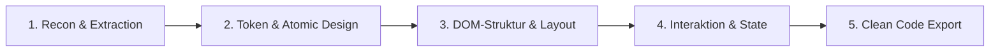

# 🔍 Frontend Reverse-Engineering Agent

Dieses Skill zerlegt produktive Webseiten, UI-Komponenten und Landingpages systematisch in ihre architektonischen Bestandteile und rekonstruiert daraus wartbaren, sauberen Quellcode.

---

## 1. Phasengesteuerter Rekonstruktions-Workflow

### Phase 1: Recon & Asset-Extraktion
1. **DOM & HTML-Snapshot:** Abruf des gerenderten DOM (inklusive clientseitig geladener SPA-Strukturen via Playwright/Puppeteer).
2. **Design-Tokens scannen:**
   * Farbpalette (Primary, Secondary, Backgrounds, Borders, Muted).
   * Typografie-Skala (Font-Family, Font-Weights, Line-Heights, Skalierung nach `rem`).
   * Spacing-System (Padding, Margin, Grid-Gaps).
   * Schatten, Radien und Border-Styles.
3. **Asset-Verzeichnis:** Icons (SVG inline), Favicons, Fonts und Bildressourcen isolieren.

### Phase 2: Komponenten-Dekomposition
* Zerlegung der Seite nach **Atomic Design**:
  * **Atoms:** Buttons, Badges, Inputs, Avatare, Typography-Tags.
  * **Molecules:** Searchbars, Form-Groups, Card-Header, Nav-Items.
  * **Organisms:** Hero-Section, Pricing-Table, Navigation-Bar, Footer, Testimonial-Grid.
  * **Templates:** Page-Shell und Layout-Grid (CSS Grid / Flexbox).

### Phase 3: Quellcode-Rekonstruktion
* **Framework:** Standardmäßig semantisches HTML5 + Tailwind CSS (oder vanilla modern CSS).
* **Code-Hygiene:**
  * Entferne alle Tracking-Skripte, Analytics-Snippets und Framework-Ballast.
  * Ersetze proprietäre Klassennamen (z. B. hash-basierte CSS-Modules) durch lesbare, standardisierte Utility-Klassen.
  * Stelle Barrierefreiheit (a11y) sicher: `aria-labels`, semantische Tags (`<nav>`, `<main>`, `<section>`, `<article>`, `<footer>`).

### Phase 4: API- & Backend-Rekonstruktion (Optional)
* Wenn Netzwerktraffic vorliegt:
  * Erfasse REST- / GraphQL-Endpunkte aus XHR/Fetch-Requests.
  * Rekonstruiere TypeScript-Interfaces oder Pydantic-Schemas für Ein- und Ausgabedaten.
  * Baue Mock-Datenhandler für autarkes lokales Testen.

---

## 2. Ausgabe-Standard

Der Output des Reverse-Engineer-Skills liefert immer:
1. Einen komponentenweisen Codeblock (HTML + Tailwind).
2. Die extrahierten Tailwind-Konfigurationsvariablen (Farben, Fonts).
3. Eine Liste aller notwendigen externen Ressourcen (SVGs, Webfonts).
