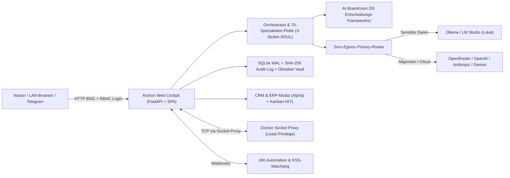

<div align="center">


# ARCHON AGENTIC OS (2026)

**Autonomes, lokal betreibbares Multi-Agenten-Betriebssystem für Gründer, Teams & Fachdomänen**

[](LICENSE)
[](agent_profiles.json)
[](requirements.txt)
[](docker-compose.yml)

[🇬🇧 English](README.md) · **🇩🇪 Deutsch** · [🇪🇸 Español](docs/readme/README.es.md) · [🇫🇷 Français](docs/readme/README.fr.md) · [🇵🇹 Português](docs/readme/README.pt.md) · [🇷🇺 Русский](docs/readme/README.ru.md) · [🇯🇵 日本語](docs/readme/README.ja.md) · [🇰🇷 한국어](docs/readme/README.ko.md) · [🇨🇳 中文](docs/readme/README.zh.md)

[🤖 Agenten-Installationsprotokoll](INSTALL_AGENT.md) | [📘 Handbücher & PDFs](#dokumentation--handbücher-pdf) | [🗺️ Roadmap](docs/system/ROADMAP_2026.md)

</div>

---

> **Zuerst die Basis:** Archon OS ist ein Aufsatz auf **[Hermes Agent](https://github.com/NousResearch/hermes-agent)** von **[Nous Research](https://nousresearch.com)** — der autonomen Multi-Agenten-Runtime. Hermes ist die Engine; Archon OS macht daraus ein vollständiges, selbst gehostetes Betriebs-Ökosystem für Unternehmen.

Archon OS ersetzt isolierte Einzel-Chatbots durch ein persistentes, selbst gehostetes **Agentic Operating System**. Das System koordiniert **70 Fachspezialisten in 8 Fachdomänen**, führt strukturierte **AI-Boardroom-Debatten über 55 Entscheidungs-Frameworks**, routet sensible Daten über einen **Zero-Egress-Privacy-Router** direkt an lokale LLMs, protokolliert Transaktionen in einem **GoBD-/ISO-27001-Audit-Log (SHA-256)** und verbindet **Obsidian Second Brain**, **n8n**, **Telegram** sowie ein integriertes **CRM- & ERP-Modul *(Alpha)***.

---

## Dokumentation & Handbücher (PDF)

| Dokument | Deutsch (DE) | Englisch (EN) | Inhalt & Umfang |
|---|---|---|---|
| **Benutzer- & Firmenhandbuch** | [**ARCHON_OS_SYSTEM_HANDBUCH_2026.pdf**](docs/system/ARCHON_OS_SYSTEM_HANDBUCH_2026.pdf) *(97 S., 1,9 MB)* | [ARCHON_OS_SYSTEM_MANUAL_2026_EN.pdf](docs/system/ARCHON_OS_SYSTEM_MANUAL_2026_EN.pdf) *(97 S., 1,9 MB)* | Installation, Kapitel 1–19, 5 Use Cases, IT-Sicherheit/Verschlüsselung/DSGVO & A–Z-Glossar |
| **Vollständige Featureliste (`v0.5.1`)** | [**ARCHON_OS_FEATURELISTE_2026.pdf**](docs/system/ARCHON_OS_FEATURELISTE_2026.pdf) *(34 S., 0,7 MB)* | [ARCHON_OS_FEATURE_LIST_2026_EN.pdf](docs/system/ARCHON_OS_FEATURE_LIST_2026_EN.pdf) *(31 S., 0,7 MB)* | Kompletter System- & Modul-Katalog, FinOps, Pillars 1–7, ERP *(alpha)*, Hardening & Index |
| **AI-Boardroom: 55 Frameworks** | [**ARCHON_OS_BOARDROOM_FRAMEWORKS_2026.pdf**](docs/system/ARCHON_OS_BOARDROOM_FRAMEWORKS_2026.pdf) *(32 S., 0,7 MB)* | [ARCHON_OS_BOARDROOM_FRAMEWORKS_2026_EN.pdf](docs/system/ARCHON_OS_BOARDROOM_FRAMEWORKS_2026_EN.pdf) *(31 S., 0,7 MB)* | Alle 55 strukturierten Decision-Engine-Methodiken in 9 Kategorien & A–Z-Verzeichnis |

*Weitere Technik- & Sicherheitsdokumente:* [Systemarchitektur & Audit](docs/system/SYSTEM_ARCHITEKTUR_UND_AUDIT_2026.md) · [Roadmap](docs/system/ROADMAP_2026.md) · [CLI-Übersetzungsskript (`scripts/translate_manual.py`)](scripts/translate_manual.py)

---

## Einzel-Chatbot vs. Super-Agent vs. Archon OS

| Merkmal | Klassischer Chat | Einzelner „Super-Agent“ | **Archon Agentic OS** |
|---|---|---|---|
| **Spezialisten-Kader** | 1 Generalist | 1 Agent mit Tool-Liste | **70 Fachspezialisten** (`agent_profiles.json`) mit **3-Stufen-`SOUL.md`** (`Compact` / `Pro` / `Full`) |
| **Entscheidungen** | Einmalige Antwort | Iterativer Loop | **AI-Boardroom**: getrennte Perspektiven, Kritiker-Kreuzverhör & Synthese über **55 Frameworks** |
| **Langzeitgedächtnis** | Flacher Verlauf | Vektor-Snippets | **Obsidian Vault Sync**, Agenten-Personalakten, SQLite WAL & LRU-K Paging |
| **Datenschutz** | Cloud-Zwang | Keys in Env | **Zero-Egress-Routing** (Ollama / LM Studio für Finanzen/HR/CRM) + **Dual-LLM Prompt-Injection Guard** |
| **Haftung & Kontrolle** | Ungeprüfter Output | Unkontrollierte Tools | **HITL-Freigabe-Gates**, **SHA-256 Hash-Kette** & verpflichtende **Berufsrechts-Warndialoge** |
| **Unternehmensbetrieb** | Keine Integration | Externe SaaS-Ketten | Natives **Kanban (mit 4-Augen-Gate)**, **Postfach-Triage**, **CRM** & **ERP *(Alpha)*** |

---

## Einblicke ins System

| Mission Control & Operations | 70-Spezialisten-Kader & 3-Stufen-SOUL |
|---|---|
|  |  |
| **AI-Boardroom (Multi-Agenten-Debatte)** | **Org-Chart & Teams** |
|  |  |

---

## Fundament & Pflicht-Module (Die 4 Archon-Säulen der Basis)

Archon OS funktioniert als Verbund aus vier zentralen Komponenten. Sowohl **Weg A** als auch **Weg B** richten diese im empfohlenen Standard-Profil automatisch komplett ein:

| Baustein | Aufgabe in Archon OS | Wie er installiert wird |
|---|---|---|
| **1. Docker** *(Desktop / Engine v2)* | Betreibt Archon OS, Hermes Agent, AnythingLLM, Chroma & Socket-Proxy isoliert im Container | **Automatisch angeboten** via `winget` (Windows), `brew` (macOS) oder `get.docker.com` (Linux) |
| **2. Hermes Agent** *(`nousresearch/hermes-agent`)* | Autonome Agenten-Runtime, Session-Gateway (Port `8644`) und Telegram-Brücke | **Automatisch geladen & gestartet** per Docker Compose gemeinsam mit Archon OS |
| **3. AnythingLLM + Chroma** *(Vektor-RAG)* | Versorgt **Zentralbibliothek → RAG** (`http://localhost:3001`) mit semantischer Dokumentensuche | **Automatisch geladen & gestartet** im Standard-Stack |
| **4. Obsidian** *(Desktop-App + Vault)* | Persistentes Markdown-Second-Brain (`/opt/data/obsidian`) für Berichte, Personalakten & Graph | Vault-Ordner werden in `./obsidian_vault` automatisch initialisiert; **Obsidian Desktop** wird automatisch angeboten (`winget` / `brew` / Flatpak) |

---

## Installation (2 Wege)

### Weg A: Durch deinen KI-Agenten installieren lassen (1 Prompt)

Öffne das Repository in **Antigravity**, **Claude Code**, **OpenAI Codex**, **Cursor** oder **Windsurf** und gib exakt diesen Prompt ein:

```text
Lies bitte INSTALL_AGENT.md und richte Archon OS auf meinem System ein. Führe zuerst den System-Check aus und stelle mir alle 6 Pflichtfragen, bevor du installierst.
```

Der Agent prüft Docker, RAM und laufende lokale Modelle, fragt Zielordner, Obsidian-Vault, Sprache, gewünschte Stack-Größe, API-Keys / lokale KI sowie Netzwerk-Binding sauber ab und verifiziert anschließend den Start.

---

### Weg B: Interaktiver 1-Click-Installer (für Einsteiger)

Beide Installer prüfen und installieren bei Bedarf **Docker** sowie **Obsidian Desktop**, legen die Vault-Struktur an, laden den **Nous Research Hermes Agent**, bauen Archon OS und synchronisieren alle 70 `SOUL.md`-Profile automatisch.

#### Windows (Doppelklick)
1. Repository klonen oder als ZIP herunterladen und entpacken.
2. Doppelklick auf **`setup.bat`** (oder Rechtsklick auf `setup.ps1` → *Mit PowerShell ausführen*).
3. Der Assistent führt durch alle Schritte (Enter übernimmt den Standardwert):
   - Fehlende Basis-Tools (**Docker Desktop** / **Obsidian Desktop**) automatisch via `winget` mitinstallieren
   - Pfad zu deinem Obsidian-Vault (Standard: `./obsidian_vault`)
   - Systemsprache (`de` / `en`) & Stack-Umfang (`Standard` [Empfohlen]: Archon + Hermes Agent + AnythingLLM/Chroma RAG + Socket-Proxy; `Full Automation`: + n8n + Ollama-Embed; `Minimal Core`)
   - KI-Provider-Keys (OpenRouter empfohlen, gilt für Archon & Hermes gemeinsam – oder leer lassen für Ollama / LM Studio)
   - Netzwerkzugriff (`127.0.0.1` nur lokal vs. `0.0.0.0` im WLAN/LAN)
4. Das Dashboard öffnet automatisch unter `http://localhost:8501`. Anschließend in Obsidian Desktop über *„Ordner als Vault öffnen“* auf `./obsidian_vault` zeigen.

*(Im Alltag genügt ein Doppelklick auf `start.bat` zum Starten und `stop.bat` zum geordneten Herunterfahren.)*

#### Linux & macOS
```bash
git clone https://github.com/michaelbeatman/Archon-Os.git
cd Archon-Os
chmod +x install.sh
./install.sh
```
*(Mit `./install.sh --yes` läuft der Installer ohne Rückfragen mit Standardwerten durch.)*

---

## Systemarchitektur & Die 4 Säulen



1. **Steuerung & Operation:** Mission Control, Master Chat, Triage-Postfach (Webhooks, E-Mail, Messenger, Freigaben), **70-Spezialisten-Kader** (inkl. Bot Screen PbD & 3-Stufen-SOUL), Showroom Sandbox.
2. **Kognition & Wissen:** Internet-Watchdog (RSS/Web-Radar), Research Lab (Quellen-Triangulation & Dossiers), Zentralbibliothek (Obsidian Vault + AnythingLLM RAG), AI-Boardroom.
3. **Wirtschaft & ERP *(Alpha)*:** CRM (Adressen, Kontakte, Pipeline), ERP-Suite (Angebote, Verträge, Rechnungen, OPOS/Mahnwesen, Belege), OmniRoute Token-FinOps mit Kostenkontrolle je Modell.
4. **Infrastruktur & Governance:** Org-Chart & Teams, Guardian (Parallelität, Sitzungen, Rate-Limits), System Control Center (API-Keys, Modell-Routing, Kernel-Watchdog, In-App-Update), manipulationssicherer Revisions-Audit-Log.

---

## Flotten-Kader: 70 Spezialisten in 8 Kern-Domänen

| Nr. | Fachdomäne | Anzahl | Kernfokus & Schutzmechanismen |
|---|---|---|---|
| **1** | **Strategie, Führung & Lebensplanung** | 12 | System-Orchestrierung, CEO-Copilot, Grundsatzentscheidungen, OKRs, domänenübergreifende Synthese & Endabnahme |
| **2** | **Handel, Beschaffung & E-Commerce** | 7 | Lieferkette, Bestandsprognose, Einkauf, Verhandlung, Shopify |
| **3** | **Recht, Steuern, Finanzen & Versicherung** | 11 | Verträge, DSGVO, Patente, Holding-Steuer, Kreditfinanzierung *(Warndialog nach RDG / StBerG / WpHG)* |
| **4** | **Immobilien & Objektentwicklung** | 7 | DCF-Kalkulation, BauGB-Genehmigung, KfW/ESG, Bauleitung *(Warndialog nach BauGB / HOAI)* |
| **5** | **Kreation, Medien & Content** | 8 | Copywriting, Video-Skripte, Keynote, Ghostwriting, UI/UX-Design |
| **6** | **Vertrieb, CRM, Marketing & Growth** | 11 | B2B-Outreach, Pricing, SEO/GEO, Paid Ads, Kundenbindung |
| **7** | **Tech, Software, Data & QA** | 8 | Fullstack-Entwicklung, DevOps/CloudSec, Datenbank-Tuning, Test-Automation |
| **8** | **Medizin, Chemie, Wissenschaft & Engineering** | 6 | Klinische Analyse, EU-MDR/MedTech, Chemie/REACH, Pharma/Biotech, Literatur-Synthese *(Warndialog nach EU-MDR / HWG / REACH)* |

---

## Sicherheit, Recht & Weiterführende Dokumentation

- **Sichere Netzwerk-Vorgabe:** Standardmäßig bindet Archon OS nur auf `127.0.0.1:8501`. Für LAN-Zugriff (`ARCHON_BIND_IP=0.0.0.0`) zuerst Multi-User-Auth in den Einstellungen aktivieren.
- **Keine Rechts-, Steuer- oder Medizinberatung:** Ausgaben aus den Domänen 3, 4 und 8 lösen beim Profilaufruf automatisch ein Warn-Modal aus und ersetzen keinen zugelassenen Fachberater ([LICENSE](LICENSE)).
- **Synthetische Avatare:** Alle 301 Porträts in `static/avatars/` sind künstlich mit Gemini (*Nano Banana 2*) generiert und zeigen keine realen Personen ([THIRD_PARTY_LICENSES.md](THIRD_PARTY_LICENSES.md)).

### Weiterführende Dokumente & Handbücher (PDF)
- **Benutzer- & Firmenhandbuch (DE, PDF):** [docs/system/ARCHON_OS_SYSTEM_HANDBUCH_2026.pdf](docs/system/ARCHON_OS_SYSTEM_HANDBUCH_2026.pdf)
- **Vollständige Featureliste & System-Katalog (v0.5.1, DE, PDF):** [docs/system/ARCHON_OS_FEATURELISTE_2026.pdf](docs/system/ARCHON_OS_FEATURELISTE_2026.pdf)
- **Decision Engine & 55 Boardroom-Frameworks (DE, PDF):** [docs/system/ARCHON_OS_BOARDROOM_FRAMEWORKS_2026.pdf](docs/system/ARCHON_OS_BOARDROOM_FRAMEWORKS_2026.pdf)
- **Entwicklungs-Roadmap (44 Meilensteine):** [docs/system/ROADMAP_2026.md](docs/system/ROADMAP_2026.md)
- **Systemarchitektur & Audit 2026:** [docs/system/SYSTEM_ARCHITEKTUR_UND_AUDIT_2026.md](docs/system/SYSTEM_ARCHITEKTUR_UND_AUDIT_2026.md)
- **Übersetzungs-Leitfaden für die englische Handbuch-Ausgabe:** [docs/system/MANUAL_TRANSLATION_GUIDE.md](docs/system/MANUAL_TRANSLATION_GUIDE.md)
