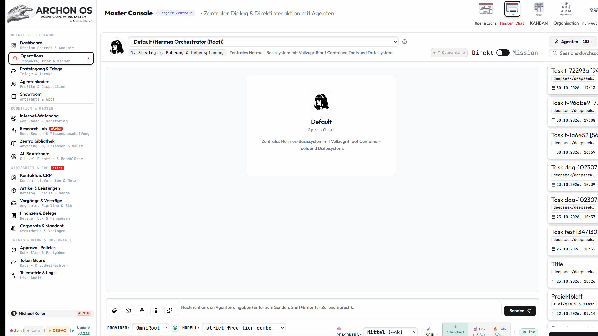
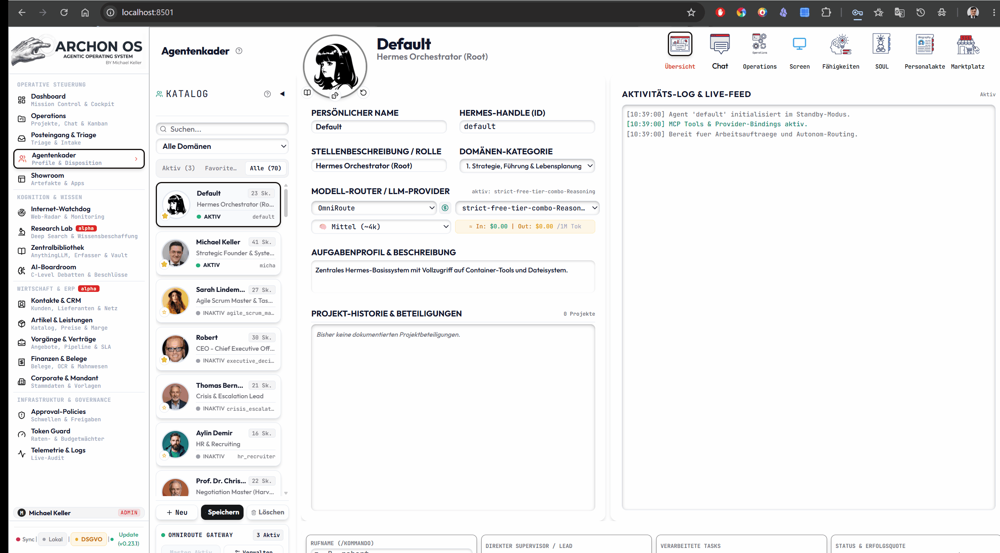
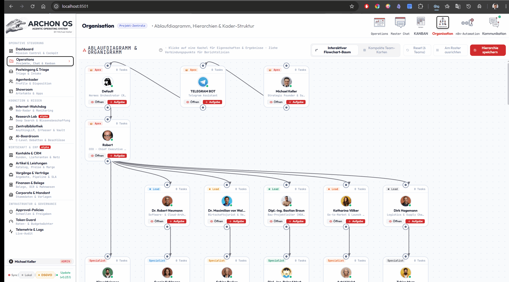
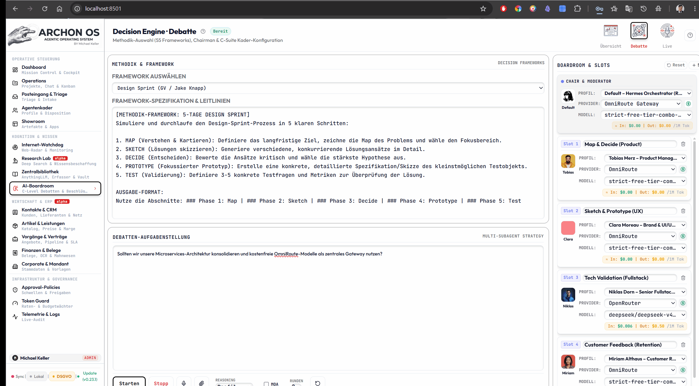
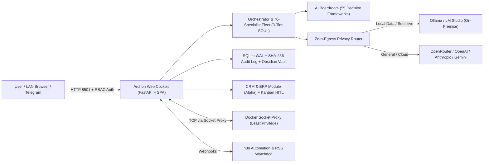

<div align="center">


# ARCHON OS - AGENTIC OPERATING SYSTEM

**Self-Hosted Multi-Agent Operating System for Founders, Teams & Domain Specialists**

[](LICENSE)
[](agent_profiles.json)
[](requirements.txt)
[](docker-compose.yml)

**🇬🇧 English** · [🇩🇪 Deutsch](README.de.md) · [🇪🇸 Español](docs/readme/README.es.md) · [🇫🇷 Français](docs/readme/README.fr.md) · [🇵🇹 Português](docs/readme/README.pt.md) · [🇷🇺 Русский](docs/readme/README.ru.md) · [🇯🇵 日本語](docs/readme/README.ja.md) · [🇰🇷 한국어](docs/readme/README.ko.md) · [🇨🇳 中文](docs/readme/README.zh.md) · [🇮🇹 Italiano](docs/readme/README.it.md) · [🇳🇱 Nederlands](docs/readme/README.nl.md)

[🤖 AI Agent Install Protocol](INSTALL_AGENT.md) | [📘 Manuals & PDFs](#documentation--manuals-pdf) | [🗺️ Roadmap](docs/system/ROADMAP_2026.md)

</div>

---

> **Foundation first:** Archon OS is an extension built on **[Hermes Agent](https://github.com/NousResearch/hermes-agent)** by **[Nous Research](https://nousresearch.com)** — the autonomous multi-agent runtime. Hermes is the engine; Archon OS turns it into a complete self-hosted business operating system.

Archon OS replaces isolated single-prompt chatbots with a persistent, self-hosted **Agentic Operating System**. It orchestrates **70 domain specialists across 8 specialized domains**, runs structured **55-framework AI Boardroom debates**, pairs **Zero-Egress local AI routing** with a tamper-evident **GoBD/ISO-27001 SHA-256 audit log**, and connects directly to your **Obsidian Second Brain**, **n8n automations**, **Telegram**, and an integrated **CRM & ERP suite *(Alpha)***.

> **Localization Status:** Core UI supports 9 languages via i18n (`en`, `de`, `es`, `fr`, `pt`, `ru`, `ja`, `ko`, `zh`). The **User Manual**, **Complete Feature List (`v0.5.1`)**, and **55 Boardroom Frameworks Reference** are available immediately below as compact, indexed **English & German PDFs**.

---

## Why Archon OS? — The Pitch

**Archon OS is not a chatbot. It's an operating system for an AI workforce.**

On your own server, Archon OS orchestrates **70 highly specialized AI profiles** — from tax law to sales leadership to software architecture — with a **3-tier SOUL competence system** (compact → pro → full): each agent only spends tokens when its domain is actually needed.

The core is the **AI Boardroom**: **55 decision frameworks** — from OKR to Six Thinking Hats to Pre-Mortem — force your agents into structured debates with verifiable reasoning instead of confident gut answers.

Around it, a complete OS: an **org hierarchy with autonomy mechanisms** (what an agent may decide alone vs. what needs approval), **Kanban operations** for every task, and **OmniRoute** as the central cost-control switchboard across all models and providers — local or cloud, transparent in euros.

Your **Second Brain**: a central **Library with an ingestion module and direct vectorization** — documents and scans are OCR-read automatically, converted to searchable Markdown and **vectorized straight into RAG**. Wired to your **Obsidian vault**.

And the best part: Archon OS is a **self-improving system built on Hermes Agent** — the platform can configure and evolve its own agents. Plus: **n8n integration** for thousands of automations, **Zero-Egress routing** for full data sovereignty, a **CRM & ERP (alpha)** with human approval gates, **Telegram** alerts — documented in **11 languages**, MIT licensed, installed with a single prompt to your AI agent.

### Product Tour

| Prompt Studio (opened in chat) | 70-Specialist Agent Fleet (3-tier SOUL) |
|---|---|
|  |  |
| **Org Hierarchy & Teams** | **AI Boardroom Debate (55 frameworks)** |
|  |  |

[](https://star-history.com/#michaelbeatman/Archon-Os&Date)

---

## Documentation & Manuals (PDF)

| Document | English (EN) | Deutsch (DE) | Scope |
|---|---|---|---|
| **User & Company Manual** | [**ARCHON_OS_SYSTEM_MANUAL_2026_EN.pdf**](docs/system/ARCHON_OS_SYSTEM_MANUAL_2026_EN.pdf) *(97 pp., 1.9 MB)* | [ARCHON_OS_SYSTEM_HANDBUCH_2026.pdf](docs/system/ARCHON_OS_SYSTEM_HANDBUCH_2026.pdf) *(97 pp., 1.9 MB)* | Installation, Chapters 1–19, 5 Use Cases, Encryption/GDPR Overview & A–Z Glossary |
| **Complete Feature List (`v0.5.1`)** | [**ARCHON_OS_FEATURE_LIST_2026_EN.pdf**](docs/system/ARCHON_OS_FEATURE_LIST_2026_EN.pdf) *(31 pp., 0.7 MB)* | [ARCHON_OS_FEATURELISTE_2026.pdf](docs/system/ARCHON_OS_FEATURELISTE_2026.pdf) *(34 pp., 0.7 MB)* | Full 19-chapter module catalog, FinOps, Pillars 1–7, ERP *(alpha)*, Hardening & Index |
| **AI Boardroom: 55 Frameworks** | [**ARCHON_OS_BOARDROOM_FRAMEWORKS_2026_EN.pdf**](docs/system/ARCHON_OS_BOARDROOM_FRAMEWORKS_2026_EN.pdf) *(31 pp., 0.7 MB)* | [ARCHON_OS_BOARDROOM_FRAMEWORKS_2026.pdf](docs/system/ARCHON_OS_BOARDROOM_FRAMEWORKS_2026.pdf) *(32 pp., 0.7 MB)* | All 55 structured Decision Engine methodologies across 9 categories & A–Z index |

*More technical & security guides:* [System Architecture & Audit](docs/system/SYSTEM_ARCHITEKTUR_UND_AUDIT_2026.md) · [Roadmap](docs/system/ROADMAP_2026.md) · [Manual Translation CLI (`scripts/translate_manual.py`)](scripts/translate_manual.py)

---

## Single Chat vs. Super-Agent vs. Archon OS

| Capability | Classic AI Chat | Single "Super-Agent" | **Archon Agentic OS** |
|---|---|---|---|
| **Agent Roster** | 1 generic assistant | 1 generalist with tool plugins | **70 distinct specialists** (`agent_profiles.json`) with **3-tier `SOUL.md`** (`Compact` / `Pro` / `Full`) |
| **Strategic Decisions** | One-shot answer | Iterative tool loop | **AI Boardroom**: isolated multi-perspective debate, critic cross-examination & synthesis across **55 frameworks** |
| **Long-Term Memory** | Flat chat history | Vector store snippets | **Obsidian Vault sync**, per-agent HR scorecards (`Personalakten/`), WAL SQLite DBs & LRU-K paging |
| **Privacy & Egress** | All data to cloud APIs | API keys in runtime env | **Zero-Egress Router** (Ollama / LM Studio for finance/HR/CRM) + **Dual-LLM Prompt-Injection Guard** |
| **Governance & Liability** | Blind output | Unchecked tool calls | **Human-in-the-Loop (HITL)Approval Gates**, **SHA-256 hash-chained Audit Log** & mandatory **Regulatory Warning Modals** |
| **Business Ops** | None | External SaaS integrations | Native **Kanban (with 4-eyes review gate)**, **Email Triage**, **CRM** & **ERP *(Alpha)*** |

---

## System Preview

| Mission Control & Operations | 70-Specialist Fleet & 3-Tier SOUL |
|---|---|
|  |  |
| **AI Boardroom (Multi-Agent Debate)** | **Org-Chart & Teams** |
|  |  |

---

## Core Foundations (Required Ecosystem)

Archon OS is built on four essential components working together. Both **Option A** and **Option B** below handle setup for you (Standard Default Profile):

| Component | Role in Archon OS | How It Gets Installed |
|---|---|---|
| **1. Docker** *(Desktop / Engine v2)* | Runs Archon OS, Hermes Agent, AnythingLLM, Chroma, and Socket Proxy in isolated containers | **Auto-offered** via `winget` (Windows), `brew` (macOS), or `get.docker.com` (Linux) |
| **2. Hermes Agent** *(`nousresearch/hermes-agent`)* | Core multi-agent runtime, session gateway (port `8644`), and Telegram interface | **Pulled & started automatically** by Docker Compose alongside Archon OS |
| **3. AnythingLLM + Chroma** *(Vector RAG)* | Powers **Central Library → RAG** (`http://localhost:3001`) with semantic indexing | **Pulled & started automatically** in the default `Standard` stack |
| **4. Obsidian** *(Desktop App + Mounted Vault)* | Persistent Markdown Second Brain (`/opt/data/obsidian`) storing reports, HR files, and graphs | Vault folders auto-initialized in `./obsidian_vault`; **Obsidian Desktop** install auto-offered (`winget` / `brew` / Flatpak) |

---

## Install Archon OS (2 Ways)

### Option A: Install with Your AI Agent (1 Prompt — Recommended for Developers)

Open this repository in **Antigravity**, **Claude Code**, **OpenAI Codex**, **Cursor**, or **Windsurf** and paste this prompt:

```text
Read INSTALL_AGENT.md and set up Archon OS on my machine. Run the pre-flight check first and ask me the 6 discovery questions before installing.
```

Your AI agent will check Docker, RAM, and local LLMs, ask you where to install, which language/stack tier you want, your provider API keys or Ollama/LM Studio setup, network exposure, and verify `/health` automatically.

---

### Option B: Interactive 1-Click Installer (Zero-CLI Friendly)

Both installers automatically check/offer **Docker** and **Obsidian Desktop**, initialize your Vault folders, pull **Nous Research Hermes Agent**, build Archon OS, and sync all 70 `SOUL.md` profiles.

#### Windows (Double-Click Setup)
1. Clone or download & extract this repository.
2. Double-click **`setup.bat`** (or right-click `setup.ps1` → *Run with PowerShell*).
3. Answer the guided prompts (or press `Enter` for defaults):
   - Auto-install missing **Docker Desktop** or **Obsidian Desktop** (via `winget`, if desired)
   - Obsidian Vault folder (`./obsidian_vault` default)
   - Language (`en` / `de`) & Stack Size (`Standard` [Default]: Archon + Hermes Agent + AnythingLLM/Chroma RAG + Socket Proxy; `Full Automation`: + n8n + Ollama-Embed; `Minimal Core`)
   - API Key (OpenRouter recommended, shared with Archon & Hermes — or leave blank for Ollama / LM Studio)
   - Network visibility (`127.0.0.1` localhost default vs. `0.0.0.0` LAN)
4. Your browser opens automatically at `http://localhost:8501`. Then open `./obsidian_vault` in Obsidian Desktop (*"Open folder as vault"*).

*(For daily use afterwards: double-click `start.bat` to launch or `stop.bat` to shut down gracefully.)*

#### Linux & macOS
```bash
git clone https://github.com/michaelbeatman/Archon-Os.git
cd Archon-Os
chmod +x install.sh
./install.sh
```
*(Use `./install.sh --yes` for non-interactive setup using `.env.example` defaults.)*

---

## System Architecture



### The 4 Navigation Pillars
1. **Steuerung & Operation:** Operations Command Center, Master Chat, Triage Inbox (Webhooks, Email, Messenger, Approvals), **70-Specialist Agent Fleet** (incl. Bot Screen PbD & 3-tier SOUL), Showroom Sandbox.
2. **Kognition & Wissen:** Internet-Watchdog (RSS/Web Radar), Research Lab (multi-source triangulation & dossiers), Central Library (Obsidian Vault + AnythingLLM RAG), AI Boardroom (6-phase debate across 55 frameworks).
3. **Wirtschaft & ERP *(Alpha)*:** CRM (addresses, contacts, pipeline), ERP suite (offers, contracts, invoices, receivables/dunning, receipts), OmniRoute token FinOps with per-model cost control.
4. **Infrastruktur & Governance:** Org-Chart & Teams, Guardian (Concurrency, Sessions, Rate Limits), System Control Center (API Keys, Routing, Kernel Watchdog, Updates), Tamper-Evident Audit Log Stream.

---

## The 70-Specialist Fleet (8 Domains)

| # | Domain | Count | Focus & Guardrails |
|---|---|---|---|
| **1** | **Strategy, Leadership & Life** | 12 | System orchestration, CEO copilot, M&A/decisions, personal strategy, OKRs, cross-domain synthesis & final QA |
| **2** | **Commerce, Procurement & E-Commerce** | 7 | Supply chain, inventory forecasting, sourcing, vendor negotiation, Shopify |
| **3** | **Law, Tax, Finance & Insurance** | 11 | Contracts, GDPR, IP, corporate/tax holdings, debt financing, insurance claims *(Mandatory Legal/Tax Warning Dialog)* |
| **4** | **Real Estate & Construction** | 7 | DCF valuation, zoning/BauGB permits, ESG/KfW, construction management *(Mandatory BauGB/HOAI Warning Dialog)* |
| **5** | **Creation, Media & Content** | 8 | Copywriting, video scripts, keynotes, ghostwriting, UI/UX brand design |
| **6** | **Sales, CRM, Marketing & Growth** | 11 | B2B outreach, pricing, SEO/GEO, paid ads, retention, partner management |
| **7** | **Tech, Software, Data & QA** | 8 | Fullstack architecture, DevOps/CloudSec, DB tuning, test automation |
| **8** | **Medicine, Chemistry, Science & Engineering** | 6 | Clinical advisor, EU-MDR/MedTech regulatory, chemistry/REACH, pharma/biotech, literature synthesis, industrial engineering *(Mandatory EU-MDR/REACH Warning Dialog)* |

---

## Security, Privacy & Regulatory Notice

- **Safe Network Default:** Binds to `127.0.0.1:8501` by default. Enable multi-user login (`auth.enabled = true`) before exposing `ARCHON_BIND_IP=0.0.0.0` on a LAN.
- **Zero-Trust Socket Proxy:** Container management routes through `docker-socket-proxy` on an isolated internal network (`archon-admin_net`).
- **Prompt Injection Defense:** Dual-LLM quarantine sanitization (`backend/dual_llm_sanitizer.py`) isolates untrusted external emails/web content before tool execution.
- **No Professional Advice:** Output from legal, tax, financial, construction, or medical/chemical specialist profiles is **for internal decision support only** and does not constitute licensed legal, tax, investment, engineering, or medical advice ([DISCLAIMER.md](DISCLAIMER.md), [LICENSE](LICENSE) & [THIRD_PARTY_LICENSES.md](THIRD_PARTY_LICENSES.md)).
- **Synthetic Avatars:** All 301 local portrait assets in `static/avatars/` are synthetic AI-generated portraits (Gemini Nano Banana 2) representing fictional personas; see [THIRD_PARTY_LICENSES.md](THIRD_PARTY_LICENSES.md).

---

## Project Structure & Documentation

```text
AgenticOS-2026/
├── archon/                 # Modular FastAPI routers & core runtime (70 profiles, org)
├── backend/                # Auth gate, audit log, privacy router, PbD, MCTS, updater
├── static/                 # Border-first SPA UI, views & interactive liability modals
├── scripts/                # SOUL sync (sync_soul_modes.py), backups, MCP drivers
├── docs/system/            # System Architecture, 44-Milestone Roadmap & Word Manual
├── INSTALL_AGENT.md        # Structured onboarding guide for AI Coding Agents
├── setup.bat / setup.ps1   # Interactive 1-Click Installer for Windows
├── install.sh              # Interactive Installer for Linux & macOS
├── docker-compose.yml      # Portable container stack definition
├── LICENSE                 # MIT License (SPDX: MIT)
├── DISCLAIMER.md           # Regulatory & Professional Liability Notice
└── THIRD_PARTY_LICENSES.md # Open-source attributions & synthetic avatar notice
```

- **User & Company Manual (EN, PDF):** [docs/system/ARCHON_OS_SYSTEM_MANUAL_2026_EN.pdf](docs/system/ARCHON_OS_SYSTEM_MANUAL_2026_EN.pdf) *(German: [DE PDF](docs/system/ARCHON_OS_SYSTEM_HANDBUCH_2026.pdf))*
- **Complete Feature List & System Catalog (v0.5.1, EN, PDF):** [docs/system/ARCHON_OS_FEATURE_LIST_2026_EN.pdf](docs/system/ARCHON_OS_FEATURE_LIST_2026_EN.pdf)
- **Decision Engine & 55 Boardroom Frameworks (EN, PDF):** [docs/system/ARCHON_OS_BOARDROOM_FRAMEWORKS_2026_EN.pdf](docs/system/ARCHON_OS_BOARDROOM_FRAMEWORKS_2026_EN.pdf)
- **Detailed Roadmap (44 Milestones):** [docs/system/ROADMAP_2026.md](docs/system/ROADMAP_2026.md)
- **System Architecture & Audit:** [docs/system/SYSTEM_ARCHITEKTUR_UND_AUDIT_2026.md](docs/system/SYSTEM_ARCHITEKTUR_UND_AUDIT_2026.md)
- **Manual Translation Guide (DE → EN):** [docs/system/MANUAL_TRANSLATION_GUIDE.md](docs/system/MANUAL_TRANSLATION_GUIDE.md)
