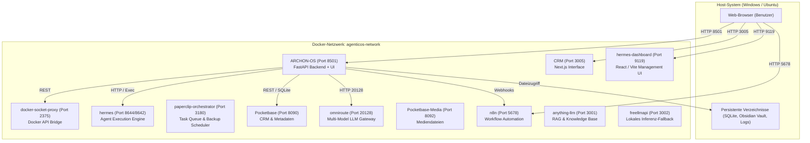
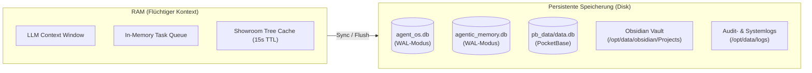
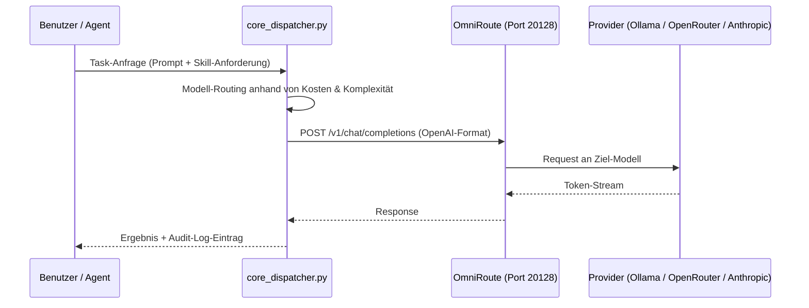

# Archon OS – Systemarchitektur & Betriebshandbuch

Dieses Handbuch dokumentiert die technische Infrastruktur, Schnittstellen und Arbeitsabläufe von Archon OS. Es dient als Referenz für Systemarchitektur, tägliche Bedienung und Notfallmaßnahmen.

---

# Teil 1: Technische Systemarchitektur

## 1. Topologie & Container-Infrastruktur

Archon OS läuft als verteiltes System aus 13 Docker-Containern im internen Netzwerk `agenticos-network`.



### Port-Matrix aller Dienste

| Container | Externer Port | Interner Port | Protokoll | Funktion |
|---|---|---|---|---|
| `ARCHON-OS` | `8501` | `8501` | HTTP / WS | Haupt-Backend (FastAPI), Web-UI, Dispatcher, Session-Management |
| `docker-socket-proxy` | `2375` | `2375` | HTTP (REST) | Abgesicherter Zugriff auf den Docker-Socket |
| `hermes` | `8644` | `8642` | HTTP / Exec | Autonome Agenten-Ausführung, Tool-Aufrufe, Poller-Prozess |
| `hermes-dashboard` | `9119` | `80` | HTTP | Status-Dashboard für Hermes-Agenten |
| `paperclip-orchestrator` | `3180` | `3180` | HTTP | Task-Orchestrierung, SQLite-Backup-Cronjob |
| `omniroute` | `20128` | `20128` | HTTP | OpenAI-kompatibler Router für LLM-Provider |
| `anything-llm` | `3001` | `3001` | HTTP | Vektor-Suche, Dokumenten-Indexierung |
| `n8n` | `5678` | `5678` | HTTP / Webhook | Automatisierungs-Pipelines, Trigger |
| `Pocketbase` | `8090` | `8090` | HTTP / REST | CRM-Datenbank (Kontakte, Termine, MediaBoard) |
| `Pocketbase-Media` | `8092` | `8090` | HTTP | Mediendateien und Bild-Uploads |
| `CRM` | `3005` | `3000` | HTTP | CRM-Oberfläche (Next.js) |
| `freellmapi` | `3002` | `3002` | HTTP | Lokaler API-Adapter für freie LLMs |

---

## 2. Datenhaltung & Speicherarchitektur

Archon OS trennt flüchtigen Arbeitsspeicher von persistenten Speichermedien:



1. **SQLite im WAL-Modus (`agent_os.db`, `agentic_memory.db`):**
   - Write-Ahead-Logging verhindert Lese-Schreib-Sperren bei gleichzeitigen Agenten-Schreiboperationen.
   - Enthält Tabellen: `tasks`, `conversations`, `learnings`, `kv_store`, `user_profile`.
2. **PocketBase (`data.db` auf Port 8090):**
   - Hält relationale Datensätze für CRM-Kontakte, Interaktionshistorien, Verknüpfungen und Media-Elemente.
3. **Obsidian Vault (`Projects/`):**
   - Dateibasiertes Langzeitgedächtnis für strukturierte Projektergebnisse. Jedes Projekt enthält zwingend:
     - `PROJEKT.md`: Metadaten, Ziel, Status und beteiligte Agenten.
     - `01_Zwischenberichte/`: Entwürfe, Agenten-Recherchen, Statusberichte.
     - `02_Medien/`: Generierte Bilder, Diagramme, Datensätze.
     - `03_Endprodukte/`: Abgenommene Endergebnisse und PDFs.

---

## 3. Modell-Routing & Hardware-Abstraktion

Aufrufe an Sprachmodelle laufen über den Router (`core_dispatcher.py` / `omniroute`):



- **Lokale Modelle:** Werden priorisiert für Standard-Klassifizierungen, Dateiprüfungen und RAG-Aufgaben via Ollama/FreeLLM angesprochen.
- **Remote-Modelle:** Anspruchsvolle Architekturaufgaben oder Deep-Research-Mandate routet das System an Claude 3.5 Sonnet oder GPT-4o via API-Key.

---

# Teil 2: Operative Funktionsanleitung (How-To)

## 1. Master Chat & Telegram-Integration

Der Master Chat ist die zentrale Schnittstelle zur Echtzeit-Kommunikation mit dem primären Agenten.

### Nutzung des Web-Interfaces
1. Öffne im Browser `http://127.0.0.1:8501`.
2. Klicke in der linken Seitenleiste auf **Master Chat**.
3. **Session-Auswahl:** Oben links befindet sich das Dropdown aller aktiven Chat-Sitzungen (`/api/chat/sessions`).
4. **Live-Streaming:** Der Chat streamt Token live via SSE (Server-Sent Events) in die UI.

### Telegram-Bot-Verbindung
Der Telegram-Bot synchronisiert Nachrichten mit der Session `Telegram Bot (Live-Stream)`:
- Eingehende Telegram-Nachrichten werden automatisch als User-Prompt in die Session übernommen.
- Antworten des Agenten fließen über den Poller im `hermes`-Container direkt zurück in den Telegram-Chat.
- **Session-ID:** `20260828_131801_1284dd5a` oder dynamisch per Chat-ID `telegram_<ID>`.

---

### Telegram Voice-Pipeline & Sprachausgabe
Die Sprachverarbeitung (`backend/voice_pipeline.py`) erweitert Archon OS um mobile Sprachsteuerung:
- **Voice-to-Text Ingestion (`POST /api/telegram/voice-relay`):** Sprachnachrichten (`.ogg`/Opus) werden empfangen und über Whisper (Groq, OpenAI oder Gemini) transkribiert.
- **Intent- & Rufnamen-Erkennung:** Sprichst du einen Agenten im Sprachmemo direkt an (z. B. „Robert, prüfe bitte...“ oder „/anwalt“), wird der Auftrag automatisch an dessen Rollenprofil übergeben.
- **Sprachantwort via edge-tts:** Das System synthetisiert die Antwort mit der deutschen neuronalen Stimme `de-DE-ConradNeural` und übermittelt sie als native Audioblase via `sendVoice` an dein Smartphone.

---

## 2. Eingang (Inbox) & E-Mail-Synchronisation

Das Modul **Eingang** empfängt Mails und ordnet sie bestehenden Kontakten zu.

### Manueller Sync per Terminal
Um den E-Mail-Abruf sofort auszulösen:
```bash
# Direkt über den API-Endpunkt
curl.exe -X POST http://127.0.0.1:8501/api/v1/inbox/emails/sync

# Oder über das Python-Skript im Container
docker exec ARCHON-OS python scripts/archon_crm_mcp.py --fetch-mails
```

### Automatischer Ablauf
1. `backend/email_service.py` verbindet sich via IMAP mit `imap.gmail.com:993`.
2. Neue, ungelesene Nachrichten werden geladen.
3. Die Absenderadresse wird gegen die PocketBase-Collection `kontakte` geprüft:
   - **Treffer:** Nachricht wird in das Array `nachrichtenverlauf` des Kontakts geschrieben.
   - **Kein Treffer:** Die Nachricht verbleibt im Posteingang zur manuellen Zuordnung.

---

## 3. Agenten-Kader & Profile

Agenten sind als isolierte Einheiten definiert und besitzen spezifische Rollen und Tool-Freigaben.

### Konfigurationsdateien
- `agents.json`: Hauptliste aller registrierten Systemagenten.
- `agent_profiles.json`: Detaillierte Rollenbeschreibungen, Systemprompts und Fachbereiche.
- `roles.json`: Berechtigungsstufen und Tool-Zuweisungen.

### Einen neuen Agenten hinzufügen
1. Öffne `agents.json`.
2. Ergänze einen neuen Eintrag nach folgendem Muster:
```json
{
  "id": "code_auditor",
  "name": "Code Auditor",
  "role": "Sicherheits- und Codequalitätsprüfung",
  "model": "claude-3-5-sonnet",
  "tools": ["read_file", "run_command", "git_status"],
  "status": "active"
}
```
3. Lade die Seite neu (`Strg + F5`). Der Agent erscheint im Menü **Agenten-Kader**.

---

## 4. Showroom & Obsidian-Ablage

Der Showroom stellt Projektergebnisse, Zwischenberichte und Medien übersichtlich dar.

### Ordnerstruktur für Projekte
Jedes Projekt im Showroom basiert auf einem Ordner unter `/opt/data/obsidian/Projects/<projektname>/`:

```text
Projects/
└── mein-neues-projekt/
    ├── PROJEKT.md               <-- Projektmetadaten (Titel, Status, Datum)
    ├── 01_Zwischenberichte/     <-- Markdown-Dateien der Entwurfsphase
    ├── 02_Medien/               <-- Bilder (.png, .jpg), Diagramme
    └── 03_Endprodukte/          <-- Finale .md Dokumente oder .pdf Berichte
```

### Datei-Vorschau im Browser
- **Markdown (`.md`):** Wird direkt gerendert.
- **Bilder (`.png`, `.jpg`, `.svg`):** Werden inline über Base64-Data-URLs geladen.
- **PDFs (`.pdf`):** Werden über den integrierten PDF-Viewer im iFrame geöffnet.

---

### Interaktive Code-Sandbox & Live-Runner
Der Showroom (`views_core.py` & `static/views/view_showroom.html`) erlaubt das direkte Ausführen von Skripten:
- **Sandbox-Ausführung (`POST /api/views/showroom/run-code`):** Bei Auswahl von Python- oder Code-Dateien blendet der Viewer die Schaltfläche **„Sandbox Run“** ein.
- **Terminal-Konsole:** Ein ausklappbares Terminal zeigt Exit-Code, Ausführungszeit in Millisekunden sowie `STDOUT` und `STDERR` in Echtzeit an.
- **Sicherheits-Isolation:** Skripte laufen in einem flüchtigen Scratch-Ordner mit einem festen Timeout von 12 Sekunden.

---

## 5. Operations, Kanban & Hintergrund-Workflows

`hermes` führt zeitintensive Hintergrundaufgaben autark aus.

### Task starten
Ein Task wird per UI oder REST-Call übergeben:
```bash
curl.exe -X POST http://127.0.0.1:8501/api/tasks/dispatch \
  -H "Content-Type: application/json" \
  -d '{"agent": "researcher", "task": "Marktrecherche zu modularem Bauen"}'
```

### Überwachung & Watchdog
- Der Watchdog-Daemon läuft im 30-Sekunden-Intervall.
- Tasks im Zustand `in_progress`, die länger als das definierte Timeout keine Heartbeats senden, werden markiert und neu zugewiesen.
- Logs einsehen:
```bash
docker logs --tail 50 hermes
```

---

### Kanban Qualitäts-Gate (4-Augen-Review)
Das Qualitäts-Gate (`backend/operations_api.py`) sichert Arbeitsergebnisse ab, bevor eine Aufgabe auf `done` verschoben werden kann:
- **Unabhängiger Prüfer:** Katharina Völk (QM/Compliance) oder Robert prüft das Ergebnis automatisch auf Vollständigkeit, Substanz und Handlungsfähigkeit (`POST /api/operations/kanban/tasks/{task_id}/quality-review`).
- **Status-Sperre:** Bei Mängeln (`changes_requested`) verbleibt der Task in `review` mit dem Badge `⚠ 4-Augen: Nachbesserung`. Das Verschieben nach `done` wird serverseitig abgewiesen, bis Mängel behoben sind oder der Operator eine manuelle Freigabe erteilt.

### Autonome Tiefenrecherche & Reflexionsschleife v2
Das Research Lab (`backend/research_engine.py`) führt mehrstufige Analysen durch:
- **Re-Search Loop:** Zerlegt komplexe Aufgaben in 3–5 Teilfragen, bewertet Lücken und startet bei Bedarf bis zu 3 autonome Nachfolge-Suchläufe.
- **Fallback-Kette & SSRF-Schutz:** Grokipedia und SearXNG mit Fallback auf Jina Reader API; Schutzfilter gegen Zugriffe auf lokale Netzwerkbereiche (RFC 1918) und Cloud-Metadaten.

---

## 6. Backup, Updatesystem & Plugins

### Automatisches Backup
`paperclip-orchestrator` führt stündlich automatisierte Backups der SQLite-Datenbanken aus. Die Archive landen unter `/opt/data/backups/`.

### Manuelles Komplett-Backup durchführen
Führe auf dem Host-System folgendes aus:
```powershell
# 1. Sicherung der SQLite-Datenbanken im WAL-Modus
docker exec ARCHON-OS sqlite3 /app/agent_os.db ".backup '/app/data/backups/agent_os_manual.bak'"
docker exec ARCHON-OS sqlite3 /app/agentic_memory.db ".backup '/app/data/backups/agentic_memory_manual.bak'"

# 2. Sicherung des Obsidian Vaults
Compress-Archive -Path "c:\.Antigravity-projekte\obsidian\*" -DestinationPath "c:\.Antigravity-projekte\backup_obsidian_$(Get-Date -Format 'yyyyMMdd_HHmmss').zip"
```

---

### Release-Lifecycle, Updatesystem & GitHub-Sync
Das Updatesystem (`backend/system_updater.py`) synchronisiert Entwicklungsrechner und Produktivserver:
- **GitHub-Push aus den Settings:** Ein Klick auf *„Änderungen zu GitHub pushen“* (`POST /api/v1/system/update/push`) committed und pusht den aktuellen Stand über Docker-optimierte Git-Parameter (`-c core.checkstat=minimal`).
- **Pre-Update Snapshots & Rollback:** Vor jedem Pull (`POST /api/v1/system/update/apply`) sichert das System alle SQLite-Datenbanken konsistent in `data/snapshots/`. Im Fehlerfall stellt `POST /api/v1/system/update/rollback` den alten Zustand wieder her.

### Standardisiertes Pluginsystem & Runtime-Hooks
Das modulare Pluginsystem (`backend/plugin_manager.py`) trennt Erweiterungen vom Systemkern:
- **Verzeichnisstruktur:** Jedes Plugin liegt unter `plugins/<plugin_id>/` mit Manifest `plugin.json` und Implementierung `plugin.py`.
- **Hooks:** Lifecycle-Hooks (`on_load`, `on_enable`, `on_disable`) und Tool-Interzeptoren (`before_tool_execute`, `after_tool_execute`).
- **Starter-Plugins:** `system_metrics` (Hardware-Telemetrie), `security_audit_hook` (Befehlsfilter & Secret-Maskierung) und `cost_guard` (Token-Budgetüberwachung).

---

## 7. Internet-Watchdog & Triage-Körbchen

Der Internet-Watchdog überwacht Webquellen, RSS-Feeds und regulatorische Änderungen. Er fungiert als vorgeschaltetes Radar, damit das operative Kanban-Board nicht mit ungefilterten Rohdaten überflutet wird.

### Grundprinzipien
1. **Kein automatischer Kanban-Müll (`auto_kanban_sync: false`):**
   - Netzfunde werden im Watchdog-Dashboard gesammelt und vorbewertet.
   - Erst durch manuelle Triage oder das Sammelkörbchen wird ein Fund zur echten Aufgabe im Kanban-Board (`ready`).
2. **Einzelfall-Aktionen:**
   - **📱 Als LinkedIn-Post generieren:** Übergibt den Fund direkt an die Persona `storyteller_ghostwriter`.
   - **📊 Strategische Analyse für Robert:** Übergibt den Fund an `executive_decision_architect`.
   - **✍️ Eigenes Prompting:** Öffnet ein Eingabefenster für spezifische Anweisungen.
3. **Das Sammelkörbchen (Basket):**
   - Funde lassen sich per Klick (`+ Korb`) in ein Zwischenlager legen.
   - Sobald die konfigurierte Schwelle (`basket_threshold`, z. B. 3 Funde) erreicht ist, bündelt ein Klick auf *Paket an Ghostwriter senden* oder *Paket an Robert senden* alle markierten Quellen zu einem gemeinsamen Synthese-Task.
4. **Prio-Keywords (Sofortalarm via Telegram):**
   - Suchbegriffe wie `KfW`, `Förderstopp`, `BauGB`, `GEG` oder `Groq` lösen beim Auffinden sofort eine priorisierte Push-Nachricht auf Telegram aus.
   - Der Alarm enthält direkte Aktions-Buttons zur sofortigen Weiterleitung an den passenden Agenten.
5. **Rollen- & Profilschutz:**
   - Das Ändern von Watchdog-Zielen, Intervallen, Schwellenwerten und Prio-Keywords ist reserviert für Leitungs-Profile ab Robert aufwärts (`executive_decision_architect`, `micha`, `default`).

---

## 8. Telegram-Dokumenten-Pipeline & HITL-Freigaben

Archon OS liefert fundierte Dossiers und Berichte nicht als unleserlichen Markdown-Fließtext aus, sondern über eine zweistufige Dokumenten-Pipeline.

### Auslieferungsformate
- **Dossier als HTML:** Enthält typografisch aufbereitete Überschriften, Tabellen und Quellennachweise für die Desktop- und Browseransicht.
- **Dossier als PDF:** Wird im Container mit ReportLab als sauberes A4-Dokument mit Kopfzeile, Metadaten und strukturierter Gliederung erzeugt.
- **MIME-Type Übertragung:** Die Telegram-Schnittstelle (`telegram_notify.py`) übermittelt PDFs mit `application/pdf`, wodurch Telegram auf Mobilgeräten den nativen PDF-Betrachter öffnet und Abstürze durch fehlerhafte Text-Header verhindert werden.

### Telegram-Bedienung & Buttons
Wenn eine Benachrichtigung oder ein Bericht in Telegram eintrifft:
- **Dokument lesen:** Tippe direkt auf die Datei-Blase (`.pdf` oder `.html`), um den Volltext zu öffnen.
- **`[ 📋 Details ]`:** Fragt den aktuellen Ausführungsstatus des zugehörigen Kanban-Tasks im Backend ab.
- **`[ ✅ Erlauben ]` / `[ ❌ Verbieten ]`:** Sendet eine Human-in-the-Loop (HITL) Entscheidung an das System zurück, um blockierte oder sensible Aktionen freizugeben.

---

---

---

# Teil 3: Operatives Runbook & Schnellbehebung

### Schnellbefehle im Fehlerfall

#### 1. Container-Status prüfen
```bash
docker ps --format "table {{.Names}}\t{{.Status}}\t{{.Ports}}"
```

#### 2. ARCHON-OS neu starten (nach Code-Änderungen)
```bash
docker restart ARCHON-OS
```

#### 3. Logs live mitverfolgen
```bash
# Backend-Logs
docker logs -f ARCHON-OS

# Hermes-Agenten-Logs
docker logs -f hermes
```

#### 4. Datenbank-Integritätsprüfung (SQLite)
```bash
docker exec ARCHON-OS sqlite3 /app/agent_os.db "PRAGMA integrity_check;"
docker exec ARCHON-OS sqlite3 /app/agentic_memory.db "PRAGMA integrity_check;"
```
*Erwartetes Ergebnis:* `ok`

#### 5. E-Mail- und CRM-Verbindung testen
```bash
# E-Mail Sync anstoßen
curl.exe -s -X POST http://127.0.0.1:8501/api/v1/inbox/emails/sync

# PocketBase-Status prüfen
curl.exe -s http://127.0.0.1:8090/api/health
```

#### 6. Docker-Socket-Proxy testen
```bash
curl.exe -s http://127.0.0.1:2375/version
```

---

# Anhang: System-Glossar (Kernansichten & Mechaniken)

Referenz aller Kernansichten, Spezial-Studios und System-Mechaniken von Archon OS (inklusive Version v0.3.5).

### I. Die 20 System-Ansichten & Spezial-Studios

1. **Mission Control (Monitoring-Cockpit & Leitstand)**
   * **Problem:** Fehlender Gesamtüberblick über Flottenlast, TPM-Durchsatz, Kosten und blockierte Freigaben.
   * **Mechanik:** Bündelt 5 KPI-Kacheln, Board-Projektion, Active Process Inspection Bar (3-Slot-Footer), 15-Minuten-Token-Aktivitätsband und Live-Audit-Stream.
   * **Nutzen:** Verzögerungsfreie 360°-Überwachung des gesamten Systems auf einem Bildschirm.

2. **Operations – Kanban Board & Task-Engine**
   * **Problem:** Aufgaben gehen in reinen Chat-Verläufen unter und lassen sich weder steuern noch auditieren.
   * **Mechanik:** 5 Lebenszyklus-Spalten auf `kanban.db` (Single Source of Truth) mit WIP-Limits, Prioritätsfiltern (P0–P3), Zeiterfassung und Obsidian-Sync. **Neu in v0.3.5:** Integriert das 4-Augen Qualitäts-Gate: Vor Verschieben auf `done` prüft ein Peer-Reviewer (Katharina Völk für QM/Compliance oder Robert) das Arbeitsergebnis auf Vollständigkeit, Substanz und Handlungsfähigkeit (1–100% Score) mit Status-Sperre bei `changes_requested` und Human-in-the-Loop Override (`force=True`).
   * **Nutzen:** Verhindert unfertige Arbeitsstände im `done`-Status durch verbindliches Vier-Augen-Review.

3. **Operations – Interaktives 2D-Organigramm & Berichtslinien**
   * **Problem:** Flache Agentenlisten bieten keine Hierarchie für Eskalationen oder Vertretungsregeln.
   * **Mechanik:** Visualisiert 56 Knoten und 55 Berichtslinien als 2D-Graph (Apex -> CEO Robert -> Fach-Leads -> Spezialisten) mit Drag & Drop und Speicherung in `config/org_hierarchy.json`.
   * **Nutzen:** Definiert verbindliche Eskalations- und Delegationsketten.

4. **Operations – Interne Agenten-Kommunikation (Funkverkehr)**
   * **Problem:** Fehlende Nachvollziehbarkeit bei agentenübergreifender Zusammenarbeit im Hintergrund.
   * **Mechanik:** Live-Mitschnitt des A2A-Nachrichtenaustauschs zwischen Hermes-Kern und Subagenten.
   * **Nutzen:** Volle Transparenz über Zwischenergebnisse und Absprachen.

5. **Eingang & Triage (3-Spalten HITL-Gatekeeper & Postfach)**
   * **Problem:** Unkontrollierte externe Impulse (Mails, Telegram, RSS) stören laufende Kernprozesse.
   * **Mechanik:** 3-Spalten-Triage mit Vorprüfung, Sentiment-Analyse, Prioritäts-Klassifizierung und Freigabe-Buttons.
   * **Nutzen:** Human-in-the-Loop Filter vor Übernahme in den operativen Task-Workflow.

6. **Agenten-Kader & Flottenmanagement (8-Reiter-Cockpit)**
   * **Problem:** Agentenkonfigurationen und Systemprompts waren verteilt und schwer wartbar.
   * **Mechanik:** 8 Reiter für Kaderübersicht, Personalakten, Rollen, Soul-Engine, Skills, Marktplatz, Funk und Modellzuweisungen.
   * **Nutzen:** Zentrale Administration aller 57 Agenten-Profile und Werkzeugberechtigungen.

7. **Master Chat (Dual-Mode Workspace & Multi-Session-Sidebar)**
   * **Problem:** Kein schneller Wechsel zwischen 1:1-Dialog, Gruppenchat und Missions-Auftrag.
   * **Mechanik:** Dual-Mode ('Direkt' vs. 'Mission'), Multi-File-Upload, Screen-Capture, Reasoning-Budget (0 bis 16k Tokens) und Session-Historie. **Neu in v0.3.5:** Telegram Voice-Pipeline: Eingehende Sprachnachrichten (.ogg/Opus) werden via Whisper/Gemini transkribiert, per Rufname geroutet und Antworten via `edge-tts` (`de-DE-ConradNeural`) als natürliche Sprachmemos direkt auf Telegram zurückgesendet.
   * **Nutzen:** Durchgängige Arbeitsfläche für Text-, Bild- und Sprachinteraktion.

8. **AI Mastermind & Boardroom (55 Methodik-Frameworks)**
   * **Problem:** Komplexe Entscheidungen werden oft einseitig oder ohne Methodik getroffen.
   * **Mechanik:** 55 strukturierte Frameworks (SWOT, Six Thinking Hats, Pre-Mortem, AHP, etc.) mit Multi-Agenten-Debatte.
   * **Nutzen:** Objektive, methodisch abgesicherte Entscheidungsvorlagen.

9. **Showroom (Projekt-Explorer, Artefakt-Galerie & Python-Sandbox)**
   * **Problem:** Generierte Deliverables (HTML, Berichte, Skripte) gehen im Chat-Verlauf verloren.
   * **Mechanik:** Katalogisiert Arbeitsergebnisse nach Ersteller, Typ und Datum mit Markdown-/HTML-Rendering. **Neu in v0.3.5:** Interaktiver Live-Runner zur direkten Code-Ausführung im Browser mit 12s Timeout, isoliertem Scratch-Verzeichnis und ausklappbarem Terminal-Drawer (STDOUT, STDERR, Exit-Code und Millisekunden-Laufzeit).
   * **Nutzen:** Deliverables und Skripte direkt im Showroom ohne Konsolenwechsel prüfen und ausführen.

10. **Zentralbibliothek & 2nd Brain (RAG, Auto-OCR & Obsidian-Vault)**
    * **Problem:** Silowissen in Dokumenten ohne zentrale semantische Suchbarkeit.
    * **Mechanik:** RAG-Pipeline zu AnythingLLM (Port 3001), 3-stufige Ordnerstruktur in `obsidian_vault` und Auto-OCR.
    * **Nutzen:** Semantisch durchsuchbares Unternehmensgedächtnis mit Live-Sync.

11. **Workflow-Engine (n8n Automation Mesh auf Port 5678)**
    * **Problem:** Komplexe Trigger-Action-Ketten überfordern lineare Chat-Agenten.
    * **Mechanik:** Visueller Workflow-Editor für Cron-Jobs, API-Connectors und Webhook-Ketten.
    * **Nutzen:** Zeitgesteuerte und ereignisbasierte Automatisierungsroutinen.

12. **LLM Gateway (OmniRoute AI Router Dashboard)**
    * **Problem:** Abhängigkeit von einzelnen LLM-Providern und unkalkulierbare API-Kosten.
    * **Mechanik:** Dynamisches Multi-Provider Routing mit Fallback-Kaskaden und Latenz-Tracking.
    * **Nutzen:** Höchste Ausfallsicherheit bei optimierten Token-Kosten.

13. **Token Guard (Guardian & Token Analytics)**
    * **Problem:** Unerwartete Kostenspitzen durch ausufernde Kontextfenster und Loops.
    * **Mechanik:** 3 Sub-Views, Hard-Clipper (32k/20 Turns), Context-Swapper und Verbrauchs-Alerts.
    * **Nutzen:** Transparente Kostenkontrolle und Budget-Schutz.

14. **Erweiterungen & Modul-Zentrale (Pluginsystem)**
    * **Problem:** Systemfähigkeiten ließen sich bisher nicht isoliert zur Laufzeit erweitern.
    * **Mechanik:** 34 Evey-Plugins in 8 Fach-Reitern. **Neu in v0.3.5:** Standardisiertes Pluginsystem unter `plugins/<plugin_id>/plugin.json` mit 4 Lifecycle-Hooks (`on_load`, `on_enable`, `on_disable`, `on_unload`) und 2 Tool-Interzeptoren (`before_tool_execute`, `after_tool_execute`) inklusive 3 Starter-Plugins (System Metrics, Security Audit Hook, Cost Guard).
    * **Nutzen:** Modulare Laufzeit-Erweiterungen ohne Kernel-Code-Eingriffe.

15. **Research Lab (Deep Search & Evidenz-Triangulation)**
    * **Problem:** Einfache Internetsuchen liefern oberflächliche, ungeprüfte Einzeltreffer.
    * **Mechanik:** Mehrstufiges Forschungs-Cockpit mit Quellen-Monitor und Evidenz-Score. **Neu in v0.3.5:** Autonome Tiefenrecherche & Re-Search Loop v2: Zerlegung in 3–5 Teilfragen, autonome Lückenanalyse, bis zu 3 iterative Nachfolge-Suchläufe, Multi-Provider Fallback (SearXNG / Jina Reader) und SSRF-Schutz.
    * **Nutzen:** Wissenschaftlich belastbare, triangulierte Dossiers.

16. **Telemetrie & Logs (3-Quellen Live-Audit Stream)**
    * **Problem:** Verteilte Logs in verschiedenen Containern erschweren die Fehlerdiagnose.
    * **Mechanik:** Konsolidierter Echtzeit-Stream aus Backend, Hermes-Daemon und Docker-Proxy.
    * **Nutzen:** Schnelle Ursachenanalyse bei Systemfehlern.

17. **Spezial-Studio: Archon Prompt Studio (1.079 Vorlagen & Fabric SOP)**
    * **Problem:** Unstrukturierte Prompts führen zu inkonsistenten Agenten-Ergebnissen.
    * **Mechanik:** Durchsuchbare Vorlagenbibliothek mit 1.079 Fabric-Patterns und System-Prompt-Generatoren.
    * **Nutzen:** Sofort einsatzbereite, praxiserprobte Prompt-Schablonen.

18. **Spezial-Studio: Visual CSS Live Studio & In-Place Transform Gizmo (Alt + S)**
    * **Problem:** UI-Anpassungen erfordern zeitraubende Code-Edits und Container-Neustarts.
    * **Mechanik:** Live-CSS-Editor im Browser mit visuellem Gizmo und direktem Speichern in `custom.css`.
    * **Nutzen:** Design-Anpassungen in Echtzeit ohne Entwicklungsunterbrechung.

19. **Spezial-Studio: Design System Lab & AppShell Architekt**
    * **Problem:** Inkonsistente UI-Komponenten und Layout-Brüche zwischen Ansichten.
    * **Mechanik:** 15 standardisierte Komponenten, Farbtoken und AppShell-Layout-Presets.
    * **Nutzen:** Einheitliche Gestaltung und schnelle Erstellung neuer Ansichten.

20. **System Control Center & Release-Lifecycle**
    * **Problem:** Systemeinstellungen und Aktualisierungen waren manuell und fehleranfällig.
    * **Mechanik:** 7 Administrations-Reiter und Omnibox (`Strg + K`). **Neu in v0.3.5:** 1-Klick Updatesystem & Continuous Deployment mit Pre-Update Snapshots aller SQLite-Datenbanken (WAL) in `data/snapshots/` vor jedem Git-Pull, 1-Klick Rollback und minimalen Git-Stat-Prüfungen gegen Mount-Timeouts.
    * **Nutzen:** Sichere 1-Klick Aktualisierung zwischen Entwicklungsumgebung und Homeserver.

