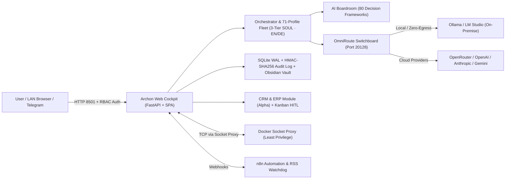

<div align="center">


# ARCHON OS - SISTEMA OPERATIVO AGÉNTICO

**Sistema operativo multiagente autohospedado para fundadores, equipos y especialistas de dominio**

[](../../LICENSE)
[](../../CHANGELOG.md)
[-emerald.svg)](../../agent_profiles.json)
[](../../prompt_studio_catalog.json)
[](../../Dockerfile)
[](../../SECURITY.md)

[🇬🇧 English](../../README.md) · [🇩🇪 Deutsch](../../README.de.md) · **🇪🇸 Español** · [🇫🇷 Français](../../README.fr.md) · [🇮🇹 Italiano](../../README.it.md) · [🇯🇵 日本語](../../README.ja.md) · [🇰🇷 한국어](../../README.ko.md) · [🇳🇱 Nederlands](../../README.nl.md) · [🇵🇹 Português](../../README.pt.md) · [🇷🇺 Русский](../../README.ru.md) · [🇨🇳 中文](../../README.zh.md)

[🌐 Página de inicio en vivo](https://michaelbeatman.github.io/ARCHON-OS/) | [🤖 Protocolo de instalación de agente de IA](../../INSTALL_AGENT.md) | [⚡ Demo en vivo Zero-Key](#option-c-instant-zero-key-read-only-demo-archon_demo_modetrue) | [📘 Manuales y PDF](#documentation--manuals-pdf) | [🗺️ Hoja de ruta (M0–M113)](../system/ROADMAP_2026.md)

</div>

---

## ¿Qué es Archon OS?

Archon OS es un espacio de trabajo multi-agente autohospedado construido sobre [Hermes Agent](https://github.com/NousResearch/hermes-agent) (Nous Research). Se ejecuta en su propio servidor y orquesta **71 perfiles de agente** (sistema/meta y especialistas de dominio en `agent_profiles.json`) a través de 8 dominios: impuestos, derecho, adquisiciones, ventas, software, bienes raíces, medicina, estrategia. Cada perfil tiene un prompt `SOUL.md` de 3 niveles (Compacto / Pro / Completo), por lo que los agentes solo consumen tokens cuando su dominio es realmente necesario.

Lo que esto significa en la práctica:

- **Decisiones estructuradas, no respuestas de una sola vez.** Un AI Boardroom ejecuta debates multiperspectiva aislados con un prompt de crítica y síntesis a través de 80 marcos de trabajo (OKR, Pre-Mortem, Seis Sombreros para Pensar, …).
- **Control de costos por modelo y por tarea.** OmniRoute dirige cada solicitud a proveedores locales (Ollama, LM Studio) o en la nube y atribuye el costo antes del envío (`cost_estimator.py` verifica los presupuestos).
- **Soberanía de datos.** El enrutamiento Zero-Egress mantiene el trabajo de finanzas, contratos y CRM en modelos locales; los contenedores de trabajo se ejecutan en una red Docker `internal: true` sin ruta a internet.
- **Pista de auditoría a prueba de manipulaciones.** Un registro de auditoría encadenado mediante hash HMAC-SHA256 (ancla externa + verificación de clave de inicio) registra cada envío, incluyendo el proveedor, el modelo y el host.
- **Sus documentos.** Una bóveda de Obsidian más AnythingLLM/Chroma RAG indexan su biblioteca localmente.
- **Operaciones comerciales.** Kanban con puertas de aprobación de cuatro ojos, triaje de correo electrónico, CRM y una suite ERP (ofertas, contratos, facturas, cuentas por cobrar) — **alfa**.

**Pre-1.0, y lo decimos desde el principio:** las interfaces y las claves de configuración cambian entre versiones, el módulo ERP/CRM está en fase alfa y la aplicación de roles multiusuario aún se está reforzando. Si esto le funciona, los problemas y las PR son bienvenidos.

### Estado de la versión actual (`v0.6.0`, 24-11-2026)

El estado de la versión oficial es [CHANGELOG.md](../../CHANGELOG.md). Adiciones clave desde `v0.5.6.0`:

- **Endurecimiento de ejecución M110:** libro mayor de efectos con `UNKNOWN` + conciliación obligatoria, arrendamientos/latidos de trabajadores con verificación de actividad, validador DAG pre-ejecución y un límite de `replan_count`.
- **Actividad 24/7 y rendimiento de la IU:** latido de bucle de eventos asíncrono real en `/livez` (devuelve `503` en caso de bloqueo) conectado al healthcheck de Docker, soporte para webhook de interruptor de hombre muerto externo (`ARCHON_HEARTBEAT_WEBHOOK_URL`), y búsqueda con debounce de 180 ms + renderizado por lotes de 60 elementos en Prompt Studio.
- **Gobernanza:** un PolicyEngine central y un BudgetBank atómico (`reserve → settle/release`); las órdenes firmadas son ahora obligatorias para herramientas privilegiadas como `pay` / `mcp__*`.
- **Fiabilidad:** claves de idempotencia y una bandeja de salida con reintento/DLQ para eventos, webhooks y el programador; el registro de auditoría ahora utiliza HMAC con una clave de entorno y un anclaje en segundo plano no bloqueante.
- **Observabilidad y herramientas:** trazas OTel en el núcleo LLM y DAG, fixtures de reproducción de traza a evaluación, Python 3.13, requisitos de pruebas divididas.
- **Espacio de trabajo:** asistente de incorporación de 4 pasos v2, calendario de operaciones y 11 habilidades de LinkedIn.

> **Nota de configuración y seguridad (auditoría 23.11.2026):** el archivo `settings.json` suministrado **no tiene ningún bloque `auth`**. Por lo tanto, el sistema se ejecuta en un **modo local de usuario único** intencional (administrador de respaldo, sin inicio de sesión) cuando está vinculado a `127.0.0.1`. **Este modo es solo para uso en escritorio local.** Los enlaces que no son de bucle invertido ya fuerzan la autenticación mediante `_must_force_auth()`, pero debe agregar `"auth": {"enabled": true}` antes de cualquier exposición en LAN o producción. Las banderas de salida también están desactivadas por defecto (`privacy.zero_egress = false`, `zero_egress_strict = false`; solo `hard_block_on_local_offline = true`). `config/version.json` reporta **v0.6.0**; el manual en PDF sigue apuntando a v0.5.2.1 — *PDF basiert weiter auf v0.5.2.1, siehe [CHANGELOG.md](../../CHANGELOG.md) für v0.6.0*.

> **Conteos medidos en este checkout:** 71 entradas en `agent_profiles.json`, 71 roles en `roles.json`, 71 perfiles sincronizados en `.hermes/profiles/`, 312 activos de retrato en `static/avatars/`, 832 plantillas de prompt y 11 configuraciones regionales de IU. Los manuales en PDF se generaron para `v0.5.2.1` y aún no se han regenerado para `v0.6.0` — consulte [CHANGELOG.md](../../CHANGELOG.md) para v0.6.0.

### Recorrido del producto

| Prompt Studio (abierto en chat) | 71-Flota de agentes de perfil (SOUL de 3 niveles) |
|---|---|
|  |  |
| **Jerarquía organizacional y equipos** | **Debate en AI Boardroom (80 marcos de trabajo)** |
|  |  |

[](https://star-history.com/#michaelbeatman/ARCHON-OS&Date)

---

## Documentación y manuales (PDF)

| Documento | Inglés (EN) | Alemán (DE) | Alcance |
|---|---|---|---|
| **Manual de usuario y empresa** | [**ARCHON_OS_SYSTEM_MANUAL_2026_EN.pdf**](../system/ARCHON_OS_SYSTEM_MANUAL_2026_EN.pdf) *(97 págs., 1.9 MB)* | [ARCHON_OS_SYSTEM_HANDBUCH_2026.pdf](../system/ARCHON_OS_SYSTEM_HANDBUCH_2026.pdf) *(97 págs., 1.9 MB)* | Instalación, capítulos 1–19, 5 casos de uso, resumen de cifrado/RGPD y glosario de la A a la Z |
| **Lista completa de funciones (PDF: v0.5.2.1 — ver CHANGELOG para v0.6.0)** | [**ARCHON_OS_FEATURE_LIST_2026_EN.pdf**](../system/ARCHON_OS_FEATURE_LIST_2026_EN.pdf) | [ARCHON_OS_FEATURELISTE_2026.pdf](../system/ARCHON_OS_FEATURELISTE_2026.pdf) | Catálogo completo de módulos, edición global bilingüe, modo de demostración en vivo, asistente de configuración inicial, FinOps y seguridad |
| **AI Boardroom: 80 Frameworks** | [**ARCHON_OS_BOARDROOM_FRAMEWORKS_2026_EN.pdf**](../system/ARCHON_OS_BOARDROOM_FRAMEWORKS_2026_EN.pdf) | [ARCHON_OS_BOARDROOM_FRAMEWORKS_2026.pdf](../system/ARCHON_OS_BOARDROOM_FRAMEWORKS_2026.pdf) | Las 80 metodologías estructuradas de Decision Engine (EN y DE) e índice |

*Más guías técnicas y de seguridad:* [Arquitectura del sistema y auditoría](../system/SYSTEM_ARCHITEKTUR_UND_AUDIT_2026.md) · [Hoja de ruta (M0–M113)](../system/ROADMAP_2026.md) · [Guía de cumplimiento de EU AI Act, GoBD PDF y multiinquilino (M43/M49)](../system/EU_AI_ACT_GOBD_COMPLIANCE_GUIDE.md) · [Guía de funciones empresariales y manuales](../system/ENTERPRISE_FEATURES_2026_GUIDE.md) · [Guía del servidor MCP (`/mcp`)](../system/ARCHON_MCP_SERVER_GUIDE.md) · [Guía del modo de demostración en vivo](../system/LIVE_DEMO_MODE_GUIDE.md) · [Guía del asistente de configuración inicial](../system/FIRST_RUN_SETUP_WIZARD_GUIDE.md) · [Guía de ecosistema y migración](../system/ECOSYSTEM_AND_MIGRATION_GUIDE.md) · [Política de seguridad](../../SECURITY.md) · [Registro de cambios](../../CHANGELOG.md)

---

## Chat individual vs. Super-Agent vs. Archon OS

| Capacidad | Chat de IA clásico | "Super-Agent" individual | **Archon Agentic OS** |
|---|---|---|---|
| **Lista de agentes** | 1 asistente genérico | 1 generalista con plugins de herramientas | **71 perfiles distintos** (`agent_profiles.json`) con **`SOUL.md` de 3 niveles** (`Compact` / `Pro` / `Full`) |
| **Decisiones estratégicas** | Respuesta única | Bucle de herramientas iterativo | **AI Boardroom**: debate aislado multiperspectiva, prompt de crítica y síntesis a través de **80 frameworks** |
| **Memoria a largo plazo** | Historial de chat plano | Fragmentos de almacén vectorial | **Sincronización de Obsidian Vault**, tarjetas de puntuación de RR. HH. por agente (`Personalakten/`), bases de datos WAL SQLite y paginación LRU-K |
| **Privacidad y salida** | Todos los datos a APIs en la nube | Claves API en entorno de ejecución | **Zero-Egress Gate y Privacy-Router Hard-Block** (fallo cerrado para finanzas/contratos/CRM cuando el LLM local está desconectado) + **Red de trabajadores `internal: true` (sin ruta a internet)** + **Guardia de doble LLM** |
| **Gobernanza y responsabilidad** | Salida ciega | Llamadas a herramientas sin verificar | **Motor de EU AI Act (Art. 4 / Anexo III)**, **PDF de procedimiento GoBD con 1 clic**, **puertas HITL** y **cadena de auditoría HMAC-SHA256 (Env-Key; incl. prueba de proveedor/modelo/host de LLM-Dispatch por llamada)** |
| **Operaciones comerciales** | Ninguna | Integraciones SaaS externas | **Aislamiento de SQLite multiinquilino (Holding/GmbH/SPV)**, **Kanban (puerta de 4 ojos)**, **triaje de correo electrónico**, **CRM** y **ERP *(Alpha)*** |

---

## Vista previa del sistema

| Mission Control y operaciones | Flota 71-Profile y SOUL de 3 niveles |
|---|---|
|  |  |
| **AI Boardroom (Debate multi-agente)** | **Organigrama y equipos** |
|  |  |

---

## Fundamentos principales (Ecosistema requerido)

Archon OS está construido sobre cuatro componentes esenciales que trabajan juntos. Tanto la **Opción A** como la **Opción B** a continuación gestionan la configuración por usted (Perfil predeterminado estándar):

| Componente | Rol en Archon OS | Cómo se instala |
|---|---|---|
| **1. Docker** *(Desktop / Engine v2)* | Ejecuta Archon OS, Hermes Agent, AnythingLLM, Chroma y Socket Proxy en contenedores aislados | **Ofrecido automáticamente** mediante `winget` (Windows), `brew` (macOS) o `get.docker.com` (Linux) |
| **2. Hermes Agent** *(`nousresearch/hermes-agent`)* | Entorno de ejecución multi-agente central, pasarela de sesión (puerto `8644`) e interfaz de Telegram | **Descargado e iniciado automáticamente** por Docker Compose junto con Archon OS |
| **3. AnythingLLM + Chroma** *(RAG vectorial)* | Potencia **Central Library → RAG** (`http://localhost:3001`) con indexación semántica | **Descargado e iniciado automáticamente** en la pila `Standard` predeterminada |
| **4. Obsidian** *(App de escritorio + Bóveda montada)* | Segundo cerebro en Markdown persistente (`/opt/data/obsidian`) que almacena informes, archivos de RR. HH. y gráficos | Carpetas de la bóveda inicializadas automáticamente en `./obsidian_vault`; instalación de **Obsidian Desktop** ofrecida automáticamente (`winget` / `brew` / Flatpak) |

---

## Instalar Archon OS (2 formas)

### Opción A: Instalar con su agente de IA (1 prompt — Recomendado para desarrolladores)

Abra este repositorio en **Antigravity**, **Claude Code**, **OpenAI Codex**, **Cursor** o **Windsurf** y pegue este prompt:

```text
Read INSTALL_AGENT.md and set up Archon OS on my machine. Run the pre-flight check first and ask me the 6 discovery questions before installing.
```

Su agente de IA comprobará Docker, la memoria RAM y los LLM locales, le preguntará dónde instalar, qué lenguaje/nivel de pila desea, sus claves de API de proveedor o la configuración de Ollama/LM Studio, la exposición a la red y verificará `/health` automáticamente.

---

### Opción B: Instalador interactivo de 1 clic (Apto para usuarios sin CLI)

Ambos instaladores comprueban/ofrecen automáticamente **Docker** y **Obsidian Desktop**, inicializan las carpetas de su bóveda, descargan **Nous Research Hermes Agent**, compilan Archon OS y sincronizan los 71 perfiles de `SOUL.md`.

#### Windows (Configuración mediante doble clic)
1. Clone o descargue y extraiga este repositorio.
2. Haga doble clic en **`setup.bat`** (o haga clic derecho en `setup.ps1` → *Ejecutar con PowerShell*).
3. Responda a las indicaciones guiadas (o presione `Enter` para los valores predeterminados):
- Instalación automática de **Docker Desktop** u **Obsidian Desktop** faltantes (vía `winget`, si lo desea)
- Carpeta de Obsidian Vault (`./obsidian_vault` por defecto)
- Idioma (`en` / `de`) y tamaño de pila (`Standard` [Predeterminado]: Archon + Hermes Agent + AnythingLLM/Chroma RAG + Socket Proxy; `Full Automation`: + n8n + Ollama-Embed; `Minimal Core`)
- Clave API (se recomienda OpenRouter, compartida con Archon y Hermes — o déjela en blanco para Ollama / LM Studio)
- Visibilidad de red (`127.0.0.1` localhost por defecto frente a `0.0.0.0` LAN)
4. Su navegador se abrirá automáticamente en `http://localhost:8501`. Luego abra `./obsidian_vault` en Obsidian Desktop (*"Abrir carpeta como vault"*).

*(Para el uso diario posterior: haga doble clic en `start.bat` para iniciar o en `stop.bat` para apagar correctamente.)*

#### Linux y macOS (Intel y Apple Silicon ARM64)
```bash
git clone https://github.com/michaelbeatman/ARCHON-OS.git
cd ARCHON-OS
chmod +x install.sh
./install.sh
```
*(Use `./install.sh --yes` para una configuración no interactiva; en la primera visita al navegador, el **4-Step Web Setup Wizard** le guiará a través del perfil de la empresa, la verificación de proveedores en vivo, los canales y la activación del dominio.)*

### Opción C: Demo de solo lectura con Zero-Key instantáneo (`ARCHON_DEMO_MODE=true`)

¿Desea explorar el Cockpit completo, el debate del AI Boardroom de 4 fases de **Mittelstand Muster GmbH** (+ MoA opcional), las tarjetas Kanban y 71 perfiles **en 30 segundos sin una sola clave API ni costo de LLM** (o alojar una presentación pública segura en un VPS de 5 €)?

```bash
ARCHON_DEMO_MODE=true docker compose -f docker-compose.demo.yml up --build -d
# Open http://localhost:8501 — read-only ASGI guard, zero token egress!
```

---

## Arquitectura del sistema



### Los 4 pilares de navegación
1. **Comando y operaciones:** Centro de comando de operaciones, Chat maestro, Bandeja de entrada de triaje (Webhooks, correo electrónico, mensajería, aprobaciones), **Flota de agentes de 71 perfiles** (incl. Bot Screen PbD y SOUL de 3 niveles), **Estudio de prompts de 832 plantillas**, Sandbox de showroom.
2. **Cognición y conocimiento:** Internet-Watchdog (RSS/Web Radar), Laboratorio de investigación (triangulación de fuentes múltiples y expedientes), Biblioteca central (Obsidian Vault + RAG de AnythingLLM), AI Boardroom (debate de 4 fases + MoA opcional a través de 80 marcos de trabajo).
3. **Economía y ERP *(Alpha)*:** CRM (direcciones, contactos, pipeline), suite ERP (ofertas, contratos, facturas, cuentas por cobrar/gestión de cobros, recibos), FinOps de tokens de OmniRoute con control de costos por modelo.
4. **Infraestructura y gobernanza:** Organigrama y equipos, Guardian (concurrencia, sesiones, límites de tasa), Centro de control del sistema (asistente de primera ejecución, claves API, enrutamiento, Kernel Watchdog, actualizaciones), flujo de registro de auditoría a prueba de manipulaciones.

---

## La flota de 71 perfiles (8 dominios)

| # | Dominio | Cantidad | Enfoque y directrices |
|---|---|---|---|
| **1** | **Estrategia, Liderazgo y Vida** | 12 | Orquestación de sistemas, copiloto para CEO, fusiones y adquisiciones/decisiones, estrategia personal, OKRs, síntesis entre dominios y control de calidad final |
| **2** | **Comercio, Adquisiciones y Comercio Electrónico** | 7 | Cadena de suministro, previsión de inventario, abastecimiento, negociación con proveedores, Shopify |
| **3** | **Derecho, Impuestos, Finanzas y Seguros** | 11 | Contratos, GDPR, propiedad intelectual, holdings corporativos/fiscales, financiación de deuda, reclamaciones de seguros *(Diálogo de advertencia legal/fiscal obligatorio)* |
| **4** | **Bienes Raíces y Construcción** | 7 | Valoración DCF, zonificación/permisos BauGB, ESG/KfW, gestión de la construcción *(Diálogo de advertencia BauGB/HOAI obligatorio)* |
| **5** | **Creación, Medios y Contenido** | 8 | Redacción publicitaria, guiones de video, discursos, redacción fantasma, diseño de marca UI/UX |
| **6** | **Ventas, CRM, Marketing y Crecimiento** | 11 | Prospección B2B, precios, SEO/GEO, anuncios pagados, retención, gestión de socios |
| **7** | **Tecnología, Software, Datos y QA** | 8 | Arquitectura fullstack, DevOps/CloudSec, optimización de bases de datos, automatización de pruebas |
| **8** | **Medicina, Química, Ciencia e Ingeniería** | 6 | Asesor clínico, normativa EU-MDR/MedTech, química/REACH, farmacéutica/biotecnología, síntesis de literatura, ingeniería industrial *(Diálogo de advertencia EU-MDR/REACH obligatorio)* |

---

## Aviso de seguridad, privacidad y normativa

- **Valor predeterminado de red segura:** Se vincula a `127.0.0.1:8501` de forma predeterminada. Habilite el inicio de sesión multiusuario (`auth.enabled = true`) antes de exponer `ARCHON_BIND_IP=0.0.0.0` en una LAN. El respaldo local de usuario único (sin bloque `auth` en `settings.json`) es **solo para localhost por diseño**; nunca lo trate como un control de acceso para hosts compartidos o de producción.
- **Proxy de socket de confianza cero:** La gestión de contenedores se enruta a través de `docker-socket-proxy` en una red interna aislada (`archon-admin_net`).
- **Defensa contra inyección de prompts:** La sanitización en cuarentena de doble LLM (`backend/dual_llm_sanitizer.py`) aísla correos electrónicos o contenido web externos no confiables antes de la ejecución de herramientas.
- **Sin asesoramiento profesional:** Los resultados de perfiles legales, fiscales, financieros, de construcción o especialistas médicos/químicos son **solo para soporte de decisiones internas** y no constituyen asesoramiento legal, fiscal, de inversión, de ingeniería o médico con licencia ([DISCLAIMER.md](../../DISCLAIMER.md), [LICENSE](../../LICENSE) y [THIRD_PARTY_LICENSES.md](../../THIRD_PARTY_LICENSES.md)).
- **Avatares sintéticos:** Los 312 activos de retratos locales en `static/avatars/` son retratos sintéticos generados por IA (Gemini Nano Banana 2) que representan personajes ficticios; consulte [THIRD_PARTY_LICENSES.md](../../THIRD_PARTY_LICENSES.md).

---

## Estructura del proyecto y documentación

```text
ARCHON-OS/
├── archon/                  # Modular FastAPI routers & core runtime (routers/, core/, services/)
├── backend/                 # Auth/RBAC, audit log, privacy router, CRM/ERP, workflow DAG, ~160 modules
├── static/                  # Border-first SPA UI, 11 locales & interactive liability modals
├── frontend/                # Next.js 16 / React 19 cockpit (/crm, /workflows, /cockpit)
├── .hermes/profiles/        # 71 synced SOUL.md profiles (Hermes runtime)
├── .agents/skills/          # Agent skills (LinkedIn suite, SEO, security, MCP bridges, ...)
├── data/                    # Runtime state: ops.db / business.db / memory.db, tenants, secrets, backups
├── obsidian_vault/          # Markdown Second Brain (HR, projects, radar, content)
├── scripts/                 # Bilingual SOUL & profile.yaml sync (sync_soul_modes.py), backups
├── plugins/                 # cost_guard, security_audit_hook, system_metrics, workflow_nodes
├── deploy/ecosystem/        # Self-hosting manifests & ecosystem integration guides
├── docs/system/             # System Architecture, Roadmap (M0–M113) & PDFs
├── INSTALL_AGENT.md         # Structured onboarding guide for AI Coding Agents
├── setup.bat / setup.ps1    # Interactive 1-Click Installer for Windows
├── install.sh               # Interactive Multi-Arch Installer for Linux & macOS
├── docker-compose.yml       # Full production container stack (non-root, socket-proxy, omniroute)
├── docker-compose.demo.yml  # Zero-key read-only showcase container (ARCHON_DEMO_MODE=true)
├── LICENSE                  # MIT License (SPDX: MIT)
├── SECURITY.md              # Zero-Trust Security Architecture & Vulnerability Policy
└── DISCLAIMER.md            # Regulatory & Professional Liability Notice
```

- **Manual de usuario y empresa (EN, PDF):** [docs/system/ARCHON_OS_SYSTEM_MANUAL_2026_EN.pdf](../system/ARCHON_OS_SYSTEM_MANUAL_2026_EN.pdf) *(Alemán: [DE PDF](../system/ARCHON_OS_SYSTEM_HANDBUCH_2026.pdf))*
- **Lista completa de funciones y catálogo del sistema (PDF: v0.5.2.1 — consulte CHANGELOG para v0.6.0, EN):** [docs/system/ARCHON_OS_FEATURE_LIST_2026_EN.pdf](../system/ARCHON_OS_FEATURE_LIST_2026_EN.pdf)
- **Motor de decisiones y 80 marcos de trabajo de sala de juntas (EN, PDF):** [docs/system/ARCHON_OS_BOARDROOM_FRAMEWORKS_2026_EN.pdf](../system/ARCHON_OS_BOARDROOM_FRAMEWORKS_2026_EN.pdf)
- **Hoja de ruta detallada (M0–M113):** [docs/system/ROADMAP_2026.md](../system/ROADMAP_2026.md)
- **Guía del modo de demostración en vivo (`ARCHON_DEMO_MODE`):** [docs/system/LIVE_DEMO_MODE_GUIDE.md](../system/LIVE_DEMO_MODE_GUIDE.md)
- **Guía del asistente de configuración inicial:** [docs/system/FIRST_RUN_SETUP_WIZARD_GUIDE.md](../system/FIRST_RUN_SETUP_WIZARD_GUIDE.md)
- **Guía de ecosistema y migración:** [docs/system/ECOSYSTEM_AND_MIGRATION_GUIDE.md](../system/ECOSYSTEM_AND_MIGRATION_GUIDE.md)
- **Arquitectura del sistema y auditoría:** [docs/system/SYSTEM_ARCHITEKTUR_UND_AUDIT_2026.md](../system/SYSTEM_ARCHITEKTUR_UND_AUDIT_2026.md)
- **Guía de control de tipos MyPy:** [docs/system/MYPY_TYPE_GATE_GUIDE.md](../system/MYPY_TYPE_GATE_GUIDE.md)
- **Guía de cadena de herramientas de análisis estático:** [docs/system/STATIC_ANALYSIS_TOOLCHAIN_GUIDE.md](../system/STATIC_ANALYSIS_TOOLCHAIN_GUIDE.md)
