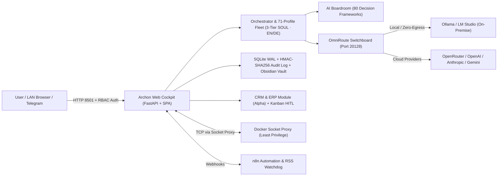

<div align="center">


# ARCHON OS - SYSTÈME D'EXPLOITATION AGENTIQUE

**Système d'exploitation multi-agents auto-hébergé pour fondateurs, équipes et spécialistes de domaine**

[](../../LICENSE)
[](../../CHANGELOG.md)
[-emerald.svg)](../../agent_profiles.json)
[](../../prompt_studio_catalog.json)
[](../../Dockerfile)
[](../../SECURITY.md)

[🇬🇧 English](../../README.md) · [🇩🇪 Deutsch](../../README.de.md) · [🇪🇸 Español](../../README.es.md) · **🇫🇷 Français** · [🇮🇹 Italiano](../../README.it.md) · [🇯🇵 日本語](../../README.ja.md) · [🇰🇷 한국어](../../README.ko.md) · [🇳🇱 Nederlands](../../README.nl.md) · [🇵🇹 Português](../../README.pt.md) · [🇷🇺 Русский](../../README.ru.md) · [🇨🇳 中文](../../README.zh.md)

[🌐 Page d'accueil en direct](https://michaelbeatman.github.io/ARCHON-OS/) | [🤖 Protocole d'installation d'agent IA](../../INSTALL_AGENT.md) | [⚡ Démo en direct Zero-Key](#option-c-instant-zero-key-read-only-demo-archon_demo_modetrue) | [📘 Manuels et PDF](#documentation--manuals-pdf) | [🗺️ Feuille de route (M0–M113)](../system/ROADMAP_2026.md)

</div>

---

## Qu'est-ce qu'Archon OS ?

Archon OS est un espace de travail multi-agents auto-hébergé basé sur [Hermes Agent](https://github.com/NousResearch/hermes-agent) (Nous Research). Il s'exécute sur votre propre serveur et orchestre **71 profils d'agents** (système/méta et spécialistes de domaine dans `agent_profiles.json`) répartis sur 8 domaines — fiscalité, droit, approvisionnement, ventes, logiciel, immobilier, médecine, stratégie. Chaque profil dispose d'un prompt `SOUL.md` à 3 niveaux (Compact / Pro / Full), afin que les agents ne consomment des jetons que lorsque leur domaine est réellement sollicité.

Ce que cela signifie en pratique :

- **Des décisions structurées, pas des réponses uniques.** Un AI Boardroom organise des débats multi-perspectives isolés avec un prompt de critique et une synthèse basée sur 80 cadres (OKR, Pre-Mortem, Six Thinking Hats, …).
- **Contrôle des coûts par modèle et par tâche.** OmniRoute achemine chaque requête vers des fournisseurs locaux (Ollama, LM Studio) ou cloud et attribue le coût avant l'envoi (`cost_estimator.py` vérifie les budgets).
- **Souveraineté des données.** Le routage Zero-Egress maintient le travail financier, contractuel et CRM sur des modèles locaux ; les conteneurs de travail s'exécutent dans un réseau Docker `internal: true` sans accès à Internet.
- **Piste d'audit infalsifiable.** Un journal d'audit chaîné par hash HMAC-SHA256 (ancrage externe + vérification de clé au démarrage) enregistre chaque envoi, incluant le fournisseur, le modèle et l'hôte.
- **Vos documents.** Un coffre Obsidian ainsi que la RAG AnythingLLM/Chroma indexent votre bibliothèque localement.
- **Opérations commerciales.** Kanban avec des portes d'approbation à quatre yeux, tri des e-mails, CRM et une suite ERP (offres, contrats, factures, créances) — **alpha**.

**Pré-1.0, et nous le disons d'emblée :** les interfaces et les clés de configuration changent entre les versions, le module ERP/CRM est en alpha, et l'application des rôles multi-utilisateurs est encore en cours de renforcement. Si cela vous convient, les problèmes et les PR sont les bienvenus.

### État de la version actuelle (`v0.6.0`, 24/11/2026)

L'état de la version faisant autorité est [CHANGELOG.md](../../CHANGELOG.md). Ajouts clés depuis `v0.5.6.0` :

- **Renforcement de l'exécution M110 :** registre d'effets avec `UNKNOWN` + réconciliation obligatoire, baux/signaux de vie des travailleurs avec vérification de disponibilité, validateur DAG de pré-exécution et une limite de `replan_count`.
- **Disponibilité 24/7 et performances de l'interface :** signal de vie réel de la boucle d'événements asynchrone dans `/livez` (renvoie `503` en cas de blocage) connecté au healthcheck Docker, prise en charge de webhook externe de type « dead-man-switch » (`ARCHON_HEARTBEAT_WEBHOOK_URL`), et recherche avec debounce de 180 ms + rendu par lots de 60 éléments dans Prompt Studio.
- **Gouvernance :** un PolicyEngine central et une BudgetBank atomique (`réserve → règlement/libération`) ; les mandats signés sont désormais obligatoires pour les outils privilégiés tels que `pay` / `mcp__*`.
- **Fiabilité :** clés d'idempotence et boîte d'envoi avec réessai/DLQ pour les événements, webhooks et le planificateur ; le journal d'audit utilise désormais HMAC avec une clé d'environnement et un ancrage en arrière-plan non bloquant.
- **Observabilité et outils :** traces OTel dans le noyau LLM et le DAG, fixtures de relecture trace-to-eval, Python 3.13, exigences de tests fractionnés.
- **Espace de travail :** assistant d'intégration en 4 étapes v2, calendrier des opérations et 11 compétences LinkedIn.

> **Note de configuration et de sécurité (audit 23/11/2026) :** le fichier `settings.json` fourni ne contient **aucun bloc `auth`**. Le système fonctionne donc dans un **mode mono-utilisateur local intentionnel** (admin de secours, pas de connexion) lorsqu'il est lié à `127.0.0.1`. **Ce mode est réservé à une utilisation locale sur ordinateur.** Les liaisons non-loopback forcent déjà l'authentification via `_must_force_auth()`, mais vous devez ajouter `"auth": {"enabled": true}` avant toute exposition sur un réseau local ou en production. Les indicateurs de sortie sont également désactivés par défaut (`privacy.zero_egress = false`, `zero_egress_strict = false` ; seul `hard_block_on_local_offline = true` est actif). `config/version.json` indique **v0.6.0** ; le manuel PDF cible toujours v0.5.2.1 — *PDF basiert weiter auf v0.5.2.1, siehe [CHANGELOG.md](../../CHANGELOG.md) für v0.6.0*.

> **Comptages mesurés dans ce checkout :** 71 entrées dans `agent_profiles.json`, 71 rôles dans `roles.json`, 71 profils synchronisés dans `.hermes/profiles/`, 312 ressources de portrait dans `static/avatars/`, 832 modèles de prompt et 11 locales d'interface. Les manuels PDF ont été générés pour `v0.5.2.1` et n'ont pas encore été régénérés pour `v0.6.0` — voir [CHANGELOG.md](../../CHANGELOG.md) pour v0.6.0.

### Visite du produit

| Prompt Studio (ouvert dans le chat) | 71-Flotte d'agents de profil (SOUL à 3 niveaux) |
|---|---|
|  |  |
| **Hiérarchie organisationnelle et équipes** | **Débat de l'AI Boardroom (80 cadres)** |
|  |  |

[](https://star-history.com/#michaelbeatman/ARCHON-OS&Date)

---

## Documentation et manuels (PDF)

| Document | Anglais (EN) | Allemand (DE) | Portée |
|---|---|---|---|
| **Manuel de l'utilisateur et de l'entreprise** | [**ARCHON_OS_SYSTEM_MANUAL_2026_EN.pdf**](../system/ARCHON_OS_SYSTEM_MANUAL_2026_EN.pdf) *(97 p., 1,9 Mo)* | [ARCHON_OS_SYSTEM_HANDBUCH_2026.pdf](../system/ARCHON_OS_SYSTEM_HANDBUCH_2026.pdf) *(97 p., 1,9 Mo)* | Installation, Chapitres 1–19, 5 cas d'utilisation, aperçu du chiffrement/RGPD et glossaire A–Z |
| **Liste complète des fonctionnalités (PDF : v0.5.2.1 — voir CHANGELOG pour v0.6.0)** | [**ARCHON_OS_FEATURE_LIST_2026_EN.pdf**](../system/ARCHON_OS_FEATURE_LIST_2026_EN.pdf) | [ARCHON_OS_FEATURELISTE_2026.pdf](../system/ARCHON_OS_FEATURELISTE_2026.pdf) | Catalogue complet des modules, édition mondiale bilingue, mode démo en direct, assistant de première configuration, FinOps et sécurité |
| **AI Boardroom : 80 cadres** | [**ARCHON_OS_BOARDROOM_FRAMEWORKS_2026_EN.pdf**](../system/ARCHON_OS_BOARDROOM_FRAMEWORKS_2026_EN.pdf) | [ARCHON_OS_BOARDROOM_FRAMEWORKS_2026.pdf](../system/ARCHON_OS_BOARDROOM_FRAMEWORKS_2026.pdf) | L'ensemble des 80 méthodologies structurées de moteur de décision (EN & DE) et index |

*Autres guides techniques et de sécurité :* [Architecture système et audit](../system/SYSTEM_ARCHITEKTUR_UND_AUDIT_2026.md) · [Feuille de route (M0–M113)](../system/ROADMAP_2026.md) · [EU AI Act, Guide PDF GoBD et multi-tenant (M43/M49)](../system/EU_AI_ACT_GOBD_COMPLIANCE_GUIDE.md) · [Guide des fonctionnalités et playbooks d'entreprise](../system/ENTERPRISE_FEATURES_2026_GUIDE.md) · [Guide du serveur MCP (`/mcp`)](../system/ARCHON_MCP_SERVER_GUIDE.md) · [Guide du mode démo en direct](../system/LIVE_DEMO_MODE_GUIDE.md) · [Guide de l'assistant de configuration initiale](../system/FIRST_RUN_SETUP_WIZARD_GUIDE.md) · [Guide de l'écosystème et de migration](../system/ECOSYSTEM_AND_MIGRATION_GUIDE.md) · [Politique de sécurité](../../SECURITY.md) · [Journal des modifications](../../CHANGELOG.md)

---

## Chat simple vs Super-Agent vs Archon OS

| Capacité | Chat IA classique | "Super-Agent" unique | **Archon Agentic OS** |
|---|---|---|---|
| **Liste des agents** | 1 assistant générique | 1 généraliste avec plugins d'outils | **71 profils distincts** (`agent_profiles.json`) avec **`SOUL.md` à 3 niveaux** (`Compact` / `Pro` / `Full`) |
| **Décisions stratégiques** | Réponse unique | Boucle d'outils itérative | **AI Boardroom** : débat multi-perspectives isolé, invite de critique et synthèse à travers **80 cadres** |
| **Mémoire à long terme** | Historique de chat plat | Extraits de stockage vectoriel | **Synchronisation Obsidian Vault**, fiches d'évaluation RH par agent (`Personalakten/`), bases de données WAL SQLite et pagination LRU-K |
| **Confidentialité et sortie** | Toutes les données vers les API cloud | Clés API dans l'environnement d'exécution | **Zero-Egress Gate et Privacy-Router Hard-Block** (échec sécurisé pour finance/contrats/CRM lorsque le LLM local est hors ligne) + **Réseau de travailleurs `internal: true` (pas de route internet)** + **Double garde LLM** |
| **Gouvernance et responsabilité** | Sortie aveugle | Appels d'outils non vérifiés | **Moteur EU AI Act (Art. 4 / Annexe III)**, **PDF procédural GoBD en 1 clic**, **portes HITL** et **chaîne d'audit HMAC-SHA256 (Env-Key ; incl. preuve du fournisseur/modèle/hôte LLM-Dispatch par appel)** |
| **Opérations commerciales** | Aucune | Intégrations SaaS externes | **Isolation SQLite multi-tenant (Holding/GmbH/SPV)**, **Kanban (porte à 4 yeux)**, **tri des e-mails**, **CRM** et **ERP *(Alpha)*** |

---

## Aperçu du système

| Mission Control & Opérations | 71-Flotte de profils & 3-Niveaux SOUL |
|---|---|
|  |  |
| **AI Boardroom (Débat multi-agents)** | **Organigramme & Équipes** |
|  |  |

---

## Fondations principales (Écosystème requis)

Archon OS est construit sur quatre composants essentiels travaillant ensemble. L'**Option A** et l'**Option B** ci-dessous gèrent la configuration pour vous (Profil par défaut standard) :

| Composant | Rôle dans Archon OS | Comment il est installé |
|---|---|---|
| **1. Docker** *(Desktop / Engine v2)* | Exécute Archon OS, Hermes Agent, AnythingLLM, Chroma et Socket Proxy dans des conteneurs isolés | **Proposé automatiquement** via `winget` (Windows), `brew` (macOS) ou `get.docker.com` (Linux) |
| **2. Hermes Agent** *(`nousresearch/hermes-agent`)* | Runtime multi-agent principal, passerelle de session (port `8644`) et interface Telegram | **Récupéré & démarré automatiquement** par Docker Compose avec Archon OS |
| **3. AnythingLLM + Chroma** *(RAG vectoriel)* | Alimente la **Central Library → RAG** (`http://localhost:3001`) avec une indexation sémantique | **Récupéré et démarré automatiquement** dans la pile `Standard` par défaut |
| **4. Obsidian** *(Application de bureau + Coffre monté)* | Second cerveau Markdown persistant (`/opt/data/obsidian`) stockant les rapports, les fichiers RH et les graphiques | Dossiers du coffre auto-initialisés dans `./obsidian_vault` ; installation d'**Obsidian Desktop** proposée automatiquement (`winget` / `brew` / Flatpak) |

---

## Installer Archon OS (2 méthodes)

### Option A : Installer avec votre agent IA (1 invite — Recommandé pour les développeurs)

Ouvrez ce dépôt dans **Antigravity**, **Claude Code**, **OpenAI Codex**, **Cursor** ou **Windsurf** et collez cette invite :

```text
Read INSTALL_AGENT.md and set up Archon OS on my machine. Run the pre-flight check first and ask me the 6 discovery questions before installing.
```

Votre agent IA vérifiera Docker, la RAM et les LLM locaux, vous demandera où installer, quel niveau de langage/pile vous souhaitez, vos clés API de fournisseur ou votre configuration Ollama/LM Studio, l'exposition réseau, et vérifiera `/health` automatiquement.

---

### Option B : Installateur interactif en 1 clic (Adapté aux utilisateurs sans CLI)

Les deux installateurs vérifient/proposent automatiquement **Docker** et **Obsidian Desktop**, initialisent vos dossiers de coffre, récupèrent **Nous Research Hermes Agent**, construisent Archon OS et synchronisent les 71 profils `SOUL.md`.

#### Windows (Configuration par double-clic)
1. Clonez ou téléchargez et extrayez ce dépôt.
2. Double-cliquez sur **`setup.bat`** (ou faites un clic droit sur `setup.ps1` → *Exécuter avec PowerShell*).
3. Répondez aux invites guidées (ou appuyez sur `Entrée` pour les valeurs par défaut) :
- Installation automatique de **Docker Desktop** ou **Obsidian Desktop** manquants (via `winget`, si souhaité)
- Dossier du coffre Obsidian (`./obsidian_vault` par défaut)
- Langue (`en` / `de`) & Taille de la pile (`Standard` [Par défaut] : Archon + Hermes Agent + AnythingLLM/Chroma RAG + Socket Proxy ; `Full Automation` : + n8n + Ollama-Embed ; `Minimal Core`)
- Clé API (OpenRouter recommandé, partagée avec Archon & Hermes — ou laissez vide pour Ollama / LM Studio)
- Visibilité réseau (`127.0.0.1` localhost par défaut ou `0.0.0.0` LAN)
4. Votre navigateur s'ouvre automatiquement sur `http://localhost:8501`. Ensuite, ouvrez `./obsidian_vault` dans Obsidian Desktop (*"Ouvrir le dossier en tant que coffre"*).

*(Pour une utilisation quotidienne ultérieure : double-cliquez sur `start.bat` pour lancer ou `stop.bat` pour arrêter proprement.)*

#### Linux & macOS (Intel & Apple Silicon ARM64)
```bash
git clone https://github.com/michaelbeatman/ARCHON-OS.git
cd ARCHON-OS
chmod +x install.sh
./install.sh
```
*(Utilisez `./install.sh --yes` pour une installation non interactive ; lors de la première visite dans le navigateur, l'**Assistant de configuration Web en 4 étapes** vous guide à travers le profil de l'entreprise, la vérification des fournisseurs en direct, les canaux et l'activation du domaine.)*

### Option C : Démo en lecture seule instantanée sans clé (`ARCHON_DEMO_MODE=true`)

Vous souhaitez explorer le Cockpit complet, le débat de l'AI Boardroom en 4 phases de **Mittelstand Muster GmbH** (+ MoA en option), les cartes Kanban et 71 profils **en 30 secondes sans aucune clé API ni coût LLM** (ou héberger une présentation publique sécurisée sur un VPS à 5 €) ?

```bash
ARCHON_DEMO_MODE=true docker compose -f docker-compose.demo.yml up --build -d
# Open http://localhost:8501 — read-only ASGI guard, zero token egress!
```

---

## Architecture système



### Les 4 piliers de navigation
1. **Commandement et opérations :** Centre de commandement des opérations, Master Chat, boîte de réception de triage (Webhooks, e-mail, messagerie, approbations), **flotte d'agents de 71 profils** (incluant Bot Screen PbD et SOUL à 3 niveaux), **studio de prompts de 832 modèles**, bac à sable Showroom.
2. **Cognition et connaissances :** Internet-Watchdog (radar RSS/Web), laboratoire de recherche (triangulation multi-sources et dossiers), bibliothèque centrale (coffre Obsidian + RAG AnythingLLM), AI Boardroom (débat en 4 phases + MoA en option sur 80 cadres).
3. **Économie et ERP *(Alpha)* :** CRM (adresses, contacts, pipeline), suite ERP (offres, contrats, factures, créances/relances, reçus), FinOps de jetons OmniRoute avec contrôle des coûts par modèle.
4. **Infrastructure et gouvernance :** Organigramme et équipes, Guardian (concurrence, sessions, limites de débit), centre de contrôle système (assistant de première exécution, clés API, routage, Kernel Watchdog, mises à jour), flux de journal d'audit inviolable.

---

## La flotte de 71 profils (8 domaines)

| # | Domaine | Nombre | Focus & Garde-fous |
|---|---|---|---|
| **1** | **Stratégie, Leadership & Vie** | 12 | Orchestration système, copilote PDG, M&A/décisions, stratégie personnelle, OKRs, synthèse inter-domaines & QA finale |
| **2** | **Commerce, Approvisionnement & E-Commerce** | 7 | Chaîne logistique, prévision des stocks, sourcing, négociation fournisseurs, Shopify |
| **3** | **Droit, Fiscalité, Finance & Assurance** | 11 | Contrats, RGPD, PI, holdings d'entreprise/fiscales, financement par emprunt, réclamations d'assurance *(Dialogue d'avertissement juridique/fiscal obligatoire)* |
| **4** | **Immobilier & Construction** | 7 | Valorisation DCF, zonage/permis BauGB, ESG/KfW, gestion de construction *(Dialogue d'avertissement BauGB/HOAI obligatoire)* |
| **5** | **Création, Médias & Contenu** | 8 | Rédaction, scripts vidéo, discours, ghostwriting, design de marque UI/UX |
| **6** | **Ventes, CRM, Marketing & Croissance** | 11 | Prospection B2B, tarification, SEO/GEO, publicités payantes, rétention, gestion des partenaires |
| **7** | **Tech, Logiciel, Données & QA** | 8 | Architecture fullstack, DevOps/CloudSec, réglage DB, automatisation des tests |
| **8** | **Médecine, Chimie, Science & Ingénierie** | 6 | Conseiller clinique, réglementation EU-MDR/MedTech, chimie/REACH, pharma/biotech, synthèse documentaire, ingénierie industrielle *(Dialogue d'avertissement EU-MDR/REACH obligatoire)* |

---

## Sécurité, Confidentialité & Avis réglementaire

- **Paramètre réseau sécurisé :** Se lie par défaut à `127.0.0.1:8501`. Activez la connexion multi-utilisateurs (`auth.enabled = true`) avant d'exposer `ARCHON_BIND_IP=0.0.0.0` sur un réseau local (LAN). Le mode de secours local mono-utilisateur (absence de bloc `auth` dans `settings.json`) est **limité à localhost par conception** — ne le considérez jamais comme un contrôle d'accès pour des hôtes partagés ou de production.
- **Proxy de socket Zero-Trust :** La gestion des conteneurs passe par `docker-socket-proxy` sur un réseau interne isolé (`archon-admin_net`).
- **Défense contre l'injection de prompts :** La désinfection par quarantaine via double LLM (`backend/dual_llm_sanitizer.py`) isole les e-mails ou contenus web externes non approuvés avant l'exécution des outils.
- **Aucun conseil professionnel :** Les résultats issus de profils juridiques, fiscaux, financiers, de construction ou de spécialistes médicaux/chimiques sont **destinés uniquement au support de décision interne** et ne constituent pas des conseils juridiques, fiscaux, d'investissement, d'ingénierie ou médicaux agréés ([DISCLAIMER.md](../../DISCLAIMER.md), [LICENSE](../../LICENSE) & [THIRD_PARTY_LICENSES.md](../../THIRD_PARTY_LICENSES.md)).
- **Avatars synthétiques :** Les 312 ressources de portraits locaux dans `static/avatars/` sont des portraits synthétiques générés par IA (Gemini Nano Banana 2) représentant des personnages fictifs ; voir [THIRD_PARTY_LICENSES.md](../../THIRD_PARTY_LICENSES.md).

---

## Structure du projet et documentation

```text
ARCHON-OS/
├── archon/                  # Modular FastAPI routers & core runtime (routers/, core/, services/)
├── backend/                 # Auth/RBAC, audit log, privacy router, CRM/ERP, workflow DAG, ~160 modules
├── static/                  # Border-first SPA UI, 11 locales & interactive liability modals
├── frontend/                # Next.js 16 / React 19 cockpit (/crm, /workflows, /cockpit)
├── .hermes/profiles/        # 71 synced SOUL.md profiles (Hermes runtime)
├── .agents/skills/          # Agent skills (LinkedIn suite, SEO, security, MCP bridges, ...)
├── data/                    # Runtime state: ops.db / business.db / memory.db, tenants, secrets, backups
├── obsidian_vault/          # Markdown Second Brain (HR, projects, radar, content)
├── scripts/                 # Bilingual SOUL & profile.yaml sync (sync_soul_modes.py), backups
├── plugins/                 # cost_guard, security_audit_hook, system_metrics, workflow_nodes
├── deploy/ecosystem/        # Self-hosting manifests & ecosystem integration guides
├── docs/system/             # System Architecture, Roadmap (M0–M113) & PDFs
├── INSTALL_AGENT.md         # Structured onboarding guide for AI Coding Agents
├── setup.bat / setup.ps1    # Interactive 1-Click Installer for Windows
├── install.sh               # Interactive Multi-Arch Installer for Linux & macOS
├── docker-compose.yml       # Full production container stack (non-root, socket-proxy, omniroute)
├── docker-compose.demo.yml  # Zero-key read-only showcase container (ARCHON_DEMO_MODE=true)
├── LICENSE                  # MIT License (SPDX: MIT)
├── SECURITY.md              # Zero-Trust Security Architecture & Vulnerability Policy
└── DISCLAIMER.md            # Regulatory & Professional Liability Notice
```

- **Manuel utilisateur et entreprise (EN, PDF) :** [docs/system/ARCHON_OS_SYSTEM_MANUAL_2026_EN.pdf](../system/ARCHON_OS_SYSTEM_MANUAL_2026_EN.pdf) *(Allemand : [DE PDF](../system/ARCHON_OS_SYSTEM_HANDBUCH_2026.pdf))*
- **Liste complète des fonctionnalités et catalogue système (PDF : v0.5.2.1 — voir CHANGELOG pour v0.6.0, EN) :** [docs/system/ARCHON_OS_FEATURE_LIST_2026_EN.pdf](../system/ARCHON_OS_FEATURE_LIST_2026_EN.pdf)
- **Moteur de décision et 80 cadres de salle de conseil (EN, PDF) :** [docs/system/ARCHON_OS_BOARDROOM_FRAMEWORKS_2026_EN.pdf](../system/ARCHON_OS_BOARDROOM_FRAMEWORKS_2026_EN.pdf)
- **Feuille de route détaillée (M0–M113) :** [docs/system/ROADMAP_2026.md](../system/ROADMAP_2026.md)
- **Guide du mode de démonstration en direct (`ARCHON_DEMO_MODE`) :** [docs/system/LIVE_DEMO_MODE_GUIDE.md](../system/LIVE_DEMO_MODE_GUIDE.md)
- **Guide de l'assistant de configuration initiale :** [docs/system/FIRST_RUN_SETUP_WIZARD_GUIDE.md](../system/FIRST_RUN_SETUP_WIZARD_GUIDE.md)
- **Guide de l'écosystème et de migration :** [docs/system/ECOSYSTEM_AND_MIGRATION_GUIDE.md](../system/ECOSYSTEM_AND_MIGRATION_GUIDE.md)
- **Architecture système et audit :** [docs/system/SYSTEM_ARCHITEKTUR_UND_AUDIT_2026.md](../system/SYSTEM_ARCHITEKTUR_UND_AUDIT_2026.md)
- **Guide de la passerelle de typage MyPy :** [docs/system/MYPY_TYPE_GATE_GUIDE.md](../system/MYPY_TYPE_GATE_GUIDE.md)
- **Guide de la chaîne d'outils d'analyse statique :** [docs/system/STATIC_ANALYSIS_TOOLCHAIN_GUIDE.md](../system/STATIC_ANALYSIS_TOOLCHAIN_GUIDE.md)
