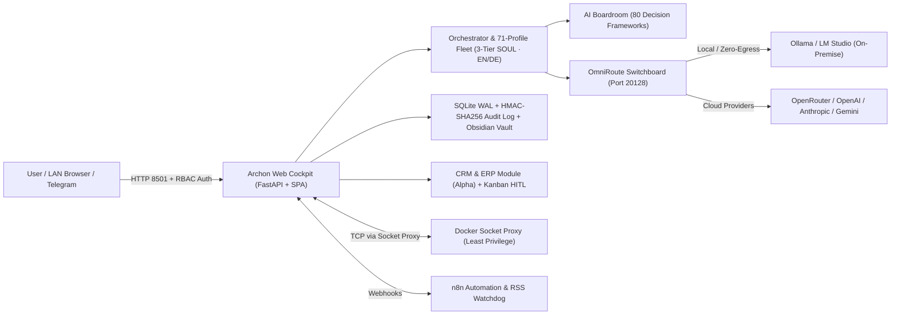

<div align="center">


# ARCHON OS - SISTEMA OPERATIVO AGENTICO

**Sistema Operativo Multi-Agente Self-Hosted per Fondatori, Team e Specialisti di Dominio**

[](../../LICENSE)
[](../../CHANGELOG.md)
[-emerald.svg)](../../agent_profiles.json)
[](../../prompt_studio_catalog.json)
[](../../Dockerfile)
[](../../SECURITY.md)

[🇬🇧 English](../../README.md) · [🇩🇪 Deutsch](../../README.de.md) · [🇪🇸 Español](../../README.es.md) · [🇫🇷 Français](../../README.fr.md) · **🇮🇹 Italiano** · [🇯🇵 日本語](../../README.ja.md) · [🇰🇷 한국어](../../README.ko.md) · [🇳🇱 Nederlands](../../README.nl.md) · [🇵🇹 Português](../../README.pt.md) · [🇷🇺 Русский](../../README.ru.md) · [🇨🇳 中文](../../README.zh.md)

[🌐 Pagina di destinazione live](https://michaelbeatman.github.io/ARCHON-OS/) | [🤖 Protocollo di installazione AI Agent](../../INSTALL_AGENT.md) | [⚡ Demo live Zero-Key](#option-c-instant-zero-key-read-only-demo-archon_demo_modetrue) | [📘 Manuali e PDF](#documentation--manuals-pdf) | [🗺️ Roadmap (M0–M113)](../system/ROADMAP_2026.md)

</div>

---

## Cos'è Archon OS?

Archon OS è uno spazio di lavoro multi-agente self-hosted basato su [Hermes Agent](https://github.com/NousResearch/hermes-agent) (Nous Research). Viene eseguito sul tuo server e orchestra **71 profili agente** (di sistema/meta e specialisti di dominio in `agent_profiles.json`) in 8 domini: fiscale, legale, approvvigionamento, vendite, software, immobiliare, medicina, strategia. Ogni profilo ha un prompt `SOUL.md` a 3 livelli (Compact / Pro / Full), in modo che gli agenti consumino token solo quando il loro dominio è effettivamente necessario.

Cosa significa in pratica:

- **Decisioni strutturate, non risposte singole.** Un AI Boardroom gestisce dibattiti multi-prospettiva isolati con un prompt di critica e sintesi basato su 80 framework (OKR, Pre-Mortem, Six Thinking Hats, …).
- **Controllo dei costi per modello e per attività.** OmniRoute instrada ogni richiesta verso provider locali (Ollama, LM Studio) o cloud e attribuisce il costo prima dell'invio (`cost_estimator.py` verifica i budget).
- **Sovranità dei dati.** L'instradamento Zero-Egress mantiene il lavoro su finanza, contratti e CRM su modelli locali; i container di lavoro vengono eseguiti in una rete Docker `internal: true` senza accesso a internet.
- **Audit trail a prova di manomissione.** Un registro di audit concatenato tramite hash HMAC-SHA256 (ancoraggio esterno + controllo chiave di avvio) registra ogni invio, inclusi provider, modello e host.
- **I tuoi documenti.** Un vault Obsidian più RAG con AnythingLLM/Chroma indicizza la tua libreria localmente.
- **Operazioni aziendali.** Kanban con controlli di approvazione a quattro occhi, triage email, CRM e una suite ERP (offerte, contratti, fatture, crediti) — **alpha**.

**Pre-1.0, e lo diciamo chiaramente:** le interfacce e le chiavi di configurazione cambiano tra le versioni, il modulo ERP/CRM è in fase alpha e l'applicazione dei ruoli multi-utente è ancora in fase di consolidamento. Se questo ti va bene, segnalazioni di problemi e PR sono benvenute.

### Stato attuale della release (`v0.6.0`, 24-11-2026)

Lo stato autorevole della release è [CHANGELOG.md](../../CHANGELOG.md). Principali aggiunte dalla `v0.5.6.0`:

- **Rafforzamento dell'esecuzione M110:** effect ledger con `UNKNOWN` + riconciliazione obbligatoria, lease/heartbeat dei worker con controllo di liveness, validatore DAG pre-esecuzione e un limite `replan_count`.
- **Liveness 24/7 e prestazioni UI:** heartbeat del loop di eventi asincrono reale in `/livez` (restituisce `503` in caso di stallo) collegato all'healthcheck di Docker, supporto per webhook dead-man-switch esterno (`ARCHON_HEARTBEAT_WEBHOOK_URL`) e ricerca con debounce a 180 ms + rendering in batch da 60 elementi in Prompt Studio.
- **Governance:** un PolicyEngine centrale e un BudgetBank atomico (`reserve → settle/release`); i mandati firmati sono ora obbligatori per strumenti privilegiati come `pay` / `mcp__*`.
- **Affidabilità:** chiavi di idempotenza e una outbox con retry/DLQ per eventi, webhook e scheduler; il registro di audit ora utilizza HMAC con una chiave d'ambiente e un ancoraggio in background non bloccante.
- **Osservabilità e strumenti:** tracce OTel nel kernel LLM e nel DAG, fixture di replay trace-to-eval, Python 3.13, requisiti di split test.
- **Area di lavoro:** procedura guidata di onboarding v2 in 4 passaggi, calendario delle operazioni e 11 competenze LinkedIn.

> **Nota su configurazione e sicurezza (audit 23.11.2026):** il file `settings.json` fornito **non contiene alcun blocco `auth`**. Il sistema viene quindi eseguito in una **modalità locale a utente singolo** intenzionale (admin di fallback, nessun login) quando associato a `127.0.0.1`. **Questa modalità è destinata esclusivamente all'uso desktop locale.** I bind non loopback forzano già l'autenticazione tramite `_must_force_auth()`, ma è necessario aggiungere `"auth": {"enabled": true}` prima di qualsiasi esposizione su LAN o in produzione. Anche i flag di egress sono disattivati per impostazione predefinita (`privacy.zero_egress = false`, `zero_egress_strict = false`; solo `hard_block_on_local_offline = true`). `config/version.json` riporta **v0.6.0**; il manuale PDF fa ancora riferimento a v0.5.2.1 — *PDF basiert weiter auf v0.5.2.1, siehe [CHANGELOG.md](../../CHANGELOG.md) für v0.6.0*.

> **Conteggi misurati in questo checkout:** 71 voci in `agent_profiles.json`, 71 ruoli in `roles.json`, 71 profili sincronizzati in `.hermes/profiles/`, 312 risorse ritratto in `static/avatars/`, 832 modelli di prompt e 11 localizzazioni dell'interfaccia utente. I manuali PDF sono stati generati per `v0.5.2.1` e non sono ancora stati rigenerati per `v0.6.0` — vedere [CHANGELOG.md](../../CHANGELOG.md) per v0.6.0.

### Tour del prodotto

| Prompt Studio (aperto in chat) | 71-Flotta di agenti del profilo (SOUL a 3 livelli) |
|---|---|
|  |  |
| **Gerarchia organizzativa e team** | **Dibattito AI Boardroom (80 framework)** |
|  |  |

[](https://star-history.com/#michaelbeatman/ARCHON-OS&Date)

---

## Documentazione e manuali (PDF)

| Documento | Inglese (EN) | Tedesco (DE) | Ambito |
|---|---|---|---|
| **Manuale utente e aziendale** | [**ARCHON_OS_SYSTEM_MANUAL_2026_EN.pdf**](../system/ARCHON_OS_SYSTEM_MANUAL_2026_EN.pdf) *(97 pag., 1,9 MB)* | [ARCHON_OS_SYSTEM_HANDBUCH_2026.pdf](../system/ARCHON_OS_SYSTEM_HANDBUCH_2026.pdf) *(97 pag., 1,9 MB)* | Installazione, Capitoli 1–19, 5 casi d'uso, Panoramica crittografia/GDPR e glossario A–Z |
| **Elenco completo delle funzionalità (PDF: v0.5.2.1 — vedi CHANGELOG per v0.6.0)** | [**ARCHON_OS_FEATURE_LIST_2026_EN.pdf**](../system/ARCHON_OS_FEATURE_LIST_2026_EN.pdf) | [ARCHON_OS_FEATURELISTE_2026.pdf](../system/ARCHON_OS_FEATURELISTE_2026.pdf) | Catalogo completo dei moduli, Edizione globale bilingue, Modalità demo live, Configurazione guidata al primo avvio, FinOps e sicurezza |
| **AI Boardroom: 80 Frameworks** | [**ARCHON_OS_BOARDROOM_FRAMEWORKS_2026_EN.pdf**](../system/ARCHON_OS_BOARDROOM_FRAMEWORKS_2026_EN.pdf) | [ARCHON_OS_BOARDROOM_FRAMEWORKS_2026.pdf](../system/ARCHON_OS_BOARDROOM_FRAMEWORKS_2026.pdf) | Tutte le 80 metodologie strutturate del Decision Engine (EN & DE) e indice |

*Altre guide tecniche e di sicurezza:* [Architettura di sistema e audit](../system/SYSTEM_ARCHITEKTUR_UND_AUDIT_2026.md) · [Roadmap (M0–M113)](../system/ROADMAP_2026.md) · [Guida EU AI Act, GoBD PDF e Multi-Tenant (M43/M49)](../system/EU_AI_ACT_GOBD_COMPLIANCE_GUIDE.md) · [Guida alle funzionalità Enterprise e Playbook](../system/ENTERPRISE_FEATURES_2026_GUIDE.md) · [Guida al server MCP (`/mcp`)](../system/ARCHON_MCP_SERVER_GUIDE.md) · [Guida alla modalità Live Demo](../system/LIVE_DEMO_MODE_GUIDE.md) · [Guida alla procedura guidata di primo avvio](../system/FIRST_RUN_SETUP_WIZARD_GUIDE.md) · [Guida all'ecosistema e alla migrazione](../system/ECOSYSTEM_AND_MIGRATION_GUIDE.md) · [Policy di sicurezza](../../SECURITY.md) · [Registro delle modifiche](../../CHANGELOG.md)

---

## Chat singola vs. Super-Agent vs. Archon OS

| Funzionalità | Chat AI classica | "Super-Agent" singolo | **Archon Agentic OS** |
|---|---|---|---|
| **Elenco agenti** | 1 assistente generico | 1 generalista con plugin di strumenti | **71 profili distinti** (`agent_profiles.json`) con **`SOUL.md` a 3 livelli** (`Compact` / `Pro` / `Full`) |
| **Decisioni strategiche** | Risposta immediata | Ciclo di strumenti iterativo | **AI Boardroom**: dibattito isolato multi-prospettiva, prompt di critica e sintesi attraverso **80 framework** |
| **Memoria a lungo termine** | Cronologia chat piatta | Frammenti di archivio vettoriale | **Sincronizzazione Obsidian Vault**, scorecard HR per agente (`Personalakten/`), DB SQLite WAL e paging LRU-K |
| **Privacy ed Egress** | Tutti i dati verso API cloud | Chiavi API in ambiente runtime | **Zero-Egress Gate e Privacy-Router Hard-Block** (fail-closed per finanza/contratti/CRM quando l'LLM locale è offline) + **Rete Worker `internal: true` (nessun percorso internet)** + **Dual-LLM Guard** |
| **Governance e responsabilità** | Output cieco | Chiamate di strumenti non verificate | **Motore EU AI Act (Art. 4 / Allegato III)**, **PDF procedurale GoBD in 1 clic**, **HITL Gates** e **Catena di audit HMAC-SHA256 (Env-Key; incl. prova provider/modello/host LLM-Dispatch per chiamata)** |
| **Operazioni aziendali** | Nessuna | Integrazioni SaaS esterne | **Isolamento SQLite Multi-Tenant (Holding/GmbH/SPV)**, **Kanban (controllo a 4 occhi)**, **Triage email**, **CRM** ed **ERP *(Alpha)*** |

---

## Anteprima del sistema

| Mission Control & Operazioni | 71-Profile Fleet & 3-Tier SOUL |
|---|---|
|  |  |
| **AI Boardroom (Dibattito multi-agente)** | **Organigramma & Team** |
|  |  |

---

## Fondamenta principali (Ecosistema richiesto)

Archon OS è costruito su quattro componenti essenziali che lavorano insieme. Sia l'**Opzione A** che l'**Opzione B** qui sotto gestiscono la configurazione per te (Profilo predefinito standard):

| Componente | Ruolo in Archon OS | Come viene installato |
|---|---|---|
| **1. Docker** *(Desktop / Engine v2)* | Esegue Archon OS, Hermes Agent, AnythingLLM, Chroma e Socket Proxy in container isolati | **Offerto automaticamente** tramite `winget` (Windows), `brew` (macOS) o `get.docker.com` (Linux) |
| **2. Hermes Agent** *(`nousresearch/hermes-agent`)* | Runtime multi-agente principale, gateway di sessione (porta `8644`) e interfaccia Telegram | **Scaricato e avviato automaticamente** da Docker Compose insieme ad Archon OS |
| **3. AnythingLLM + Chroma** *(Vector RAG)* | Alimenta **Central Library → RAG** (`http://localhost:3001`) con indicizzazione semantica | **Scaricato e avviato automaticamente** nello stack `Standard` predefinito |
| **4. Obsidian** *(App Desktop + Vault montato)* | Secondo cervello Markdown persistente (`/opt/data/obsidian`) che archivia report, file HR e grafici | Cartelle del Vault inizializzate automaticamente in `./obsidian_vault`; installazione di **Obsidian Desktop** offerta automaticamente (`winget` / `brew` / Flatpak) |

---

## Installa Archon OS (2 modi)

### Opzione A: Installa con il tuo AI Agent (1 prompt — Consigliato per sviluppatori)

Apri questo repository in **Antigravity**, **Claude Code**, **OpenAI Codex**, **Cursor** o **Windsurf** e incolla questo prompt:

```text
Read INSTALL_AGENT.md and set up Archon OS on my machine. Run the pre-flight check first and ask me the 6 discovery questions before installing.
```

Il tuo AI agent controllerà Docker, RAM e LLM locali, ti chiederà dove installare, quale linguaggio/livello di stack desideri, le tue chiavi API del provider o la configurazione di Ollama/LM Studio, l'esposizione di rete e verificherà automaticamente `/health`.

---

### Opzione B: Installer interattivo 1-Click (Adatto a chi non usa la CLI)

Entrambi gli installer controllano/offrono automaticamente **Docker** e **Obsidian Desktop**, inizializzano le cartelle del tuo Vault, scaricano **Nous Research Hermes Agent**, compilano Archon OS e sincronizzano tutti i 71 profili `SOUL.md`.

#### Windows (Configurazione con doppio clic)
1. Clona o scarica ed estrai questo repository.
2. Fare doppio clic su **`setup.bat`** (o fare clic con il tasto destro su `setup.ps1` → *Esegui con PowerShell*).
3. Rispondere ai prompt guidati (o premere `Enter` per i valori predefiniti):
- Installazione automatica di **Docker Desktop** o **Obsidian Desktop** mancanti (tramite `winget`, se desiderato)
- Cartella Obsidian Vault (predefinita `./obsidian_vault`)
- Lingua (`en` / `de`) e Dimensione dello stack (`Standard` [Predefinito]: Archon + Hermes Agent + AnythingLLM/Chroma RAG + Socket Proxy; `Full Automation`: + n8n + Ollama-Embed; `Minimal Core`)
- Chiave API (consigliata OpenRouter, condivisa con Archon e Hermes — o lasciare vuoto per Ollama / LM Studio)
- Visibilità di rete (predefinita `127.0.0.1` localhost vs. `0.0.0.0` LAN)
4. Il browser si apre automaticamente su `http://localhost:8501`. Quindi aprire `./obsidian_vault` in Obsidian Desktop (*"Apri cartella come vault"*).

*(Per l'uso quotidiano successivo: fare doppio clic su `start.bat` per avviare o `stop.bat` per arrestare correttamente.)*

#### Linux e macOS (Intel e Apple Silicon ARM64)
```bash
git clone https://github.com/michaelbeatman/ARCHON-OS.git
cd ARCHON-OS
chmod +x install.sh
./install.sh
```
*(Usa `./install.sh --yes` per un'installazione non interattiva; al primo accesso tramite browser, la **4-Step Web Setup Wizard** ti guiderà attraverso il profilo aziendale, il controllo live del provider, i canali e l'attivazione del dominio.)*

### Opzione C: Demo in sola lettura Zero-Key istantanea (`ARCHON_DEMO_MODE=true`)

Vuoi esplorare l'intero Cockpit, il dibattito dell'AI Boardroom in 4 fasi di **Mittelstand Muster GmbH** (+ MoA opzionale), le schede Kanban e 71 profili **in 30 secondi senza una singola chiave API o costi LLM** (o ospitare una vetrina pubblica sicura su un VPS da €5)?

```bash
ARCHON_DEMO_MODE=true docker compose -f docker-compose.demo.yml up --build -d
# Open http://localhost:8501 — read-only ASGI guard, zero token egress!
```

---

## Architettura di sistema



### I 4 pilastri di navigazione
1. **Comando e Operazioni:** Centro di comando operativo, Master Chat, Triage Inbox (Webhooks, Email, Messenger, Approvazioni), **Flotta di agenti da 71 profili** (incl. Bot Screen PbD e SOUL a 3 livelli), **Prompt Studio da 832 modelli**, Showroom Sandbox.
2. **Cognizione e Conoscenza:** Internet-Watchdog (RSS/Web Radar), Laboratorio di ricerca (triangolazione multi-fonte e dossier), Biblioteca centrale (Obsidian Vault + RAG AnythingLLM), AI Boardroom (dibattito in 4 fasi + MoA opzionale su 80 framework).
3. **Economia ed ERP *(Alpha)*:** CRM (indirizzi, contatti, pipeline), suite ERP (offerte, contratti, fatture, crediti/solleciti, ricevute), FinOps dei token OmniRoute con controllo dei costi per modello.
4. **Infrastruttura e Governance:** Organigramma e team, Guardian (concorrenza, sessioni, limiti di frequenza), Centro di controllo del sistema (procedura guidata di primo avvio, chiavi API, routing, Kernel Watchdog, aggiornamenti), flusso di log di controllo a prova di manomissione.

---

## La flotta da 71 profili (8 domini)

| # | Dominio | Conteggio | Focus & Linee guida |
|---|---|---|---|
| **1** | **Strategia, Leadership & Vita** | 12 | Orchestrazione di sistema, copilot per CEO, M&A/decisioni, strategia personale, OKR, sintesi cross-dominio & QA finale |
| **2** | **Commercio, Approvvigionamento & E-Commerce** | 7 | Catena di distribuzione, previsione delle scorte, sourcing, negoziazione con i fornitori, Shopify |
| **3** | **Legale, Fiscale, Finanza & Assicurazioni** | 11 | Contratti, GDPR, IP, holding societarie/fiscali, finanziamento del debito, richieste di risarcimento assicurativo *(Finestra di dialogo obbligatoria di avviso legale/fiscale)* |
| **4** | **Immobiliare & Edilizia** | 7 | Valutazione DCF, permessi di zonizzazione/BauGB, ESG/KfW, gestione della costruzione *(Finestra di dialogo obbligatoria di avviso BauGB/HOAI)* |
| **5** | **Creazione, Media & Contenuti** | 8 | Copywriting, script video, keynote, ghostwriting, design del brand UI/UX |
| **6** | **Vendite, CRM, Marketing & Crescita** | 11 | Outreach B2B, prezzi, SEO/GEO, annunci a pagamento, retention, gestione dei partner |
| **7** | **Tecnologia, Software, Dati & QA** | 8 | Architettura fullstack, DevOps/CloudSec, ottimizzazione DB, automazione dei test |
| **8** | **Medicina, Chimica, Scienza & Ingegneria** | 6 | Consulente clinico, normativa EU-MDR/MedTech, chimica/REACH, farmaceutica/biotech, sintesi della letteratura, ingegneria industriale *(Finestra di dialogo obbligatoria di avviso EU-MDR/REACH)* |

---

## Avviso su sicurezza, privacy e normative

- **Impostazione predefinita di rete sicura:** Si associa a `127.0.0.1:8501` per impostazione predefinita. Abilitare l'accesso multi-utente (`auth.enabled = true`) prima di esporre `ARCHON_BIND_IP=0.0.0.0` su una LAN. Il fallback locale per utente singolo (nessun blocco `auth` in `settings.json`) è **progettato esclusivamente per localhost** — non considerarlo mai come un controllo di accesso per host condivisi o di produzione.
- **Proxy socket Zero-Trust:** La gestione dei container avviene tramite `docker-socket-proxy` su una rete interna isolata (`archon-admin_net`).
- **Difesa contro l'iniezione di prompt:** La sanificazione in quarantena a doppio LLM (`backend/dual_llm_sanitizer.py`) isola email o contenuti web esterni non attendibili prima dell'esecuzione degli strumenti.
- **Nessuna consulenza professionale:** L'output proveniente da profili legali, fiscali, finanziari, edili o specialistici medici/chimici è **solo per il supporto alle decisioni interne** e non costituisce consulenza legale, fiscale, di investimento, ingegneristica o medica autorizzata ([DISCLAIMER.md](../../DISCLAIMER.md), [LICENSE](../../LICENSE) & [THIRD_PARTY_LICENSES.md](../../THIRD_PARTY_LICENSES.md)).
- **Avatar sintetici:** Tutti i 312 asset di ritratti locali in `static/avatars/` sono ritratti sintetici generati dall'IA (Gemini Nano Banana 2) che rappresentano personaggi fittizi; vedere [THIRD_PARTY_LICENSES.md](../../THIRD_PARTY_LICENSES.md).

---

## Struttura del progetto e documentazione

```text
ARCHON-OS/
├── archon/                  # Modular FastAPI routers & core runtime (routers/, core/, services/)
├── backend/                 # Auth/RBAC, audit log, privacy router, CRM/ERP, workflow DAG, ~160 modules
├── static/                  # Border-first SPA UI, 11 locales & interactive liability modals
├── frontend/                # Next.js 16 / React 19 cockpit (/crm, /workflows, /cockpit)
├── .hermes/profiles/        # 71 synced SOUL.md profiles (Hermes runtime)
├── .agents/skills/          # Agent skills (LinkedIn suite, SEO, security, MCP bridges, ...)
├── data/                    # Runtime state: ops.db / business.db / memory.db, tenants, secrets, backups
├── obsidian_vault/          # Markdown Second Brain (HR, projects, radar, content)
├── scripts/                 # Bilingual SOUL & profile.yaml sync (sync_soul_modes.py), backups
├── plugins/                 # cost_guard, security_audit_hook, system_metrics, workflow_nodes
├── deploy/ecosystem/        # Self-hosting manifests & ecosystem integration guides
├── docs/system/             # System Architecture, Roadmap (M0–M113) & PDFs
├── INSTALL_AGENT.md         # Structured onboarding guide for AI Coding Agents
├── setup.bat / setup.ps1    # Interactive 1-Click Installer for Windows
├── install.sh               # Interactive Multi-Arch Installer for Linux & macOS
├── docker-compose.yml       # Full production container stack (non-root, socket-proxy, omniroute)
├── docker-compose.demo.yml  # Zero-key read-only showcase container (ARCHON_DEMO_MODE=true)
├── LICENSE                  # MIT License (SPDX: MIT)
├── SECURITY.md              # Zero-Trust Security Architecture & Vulnerability Policy
└── DISCLAIMER.md            # Regulatory & Professional Liability Notice
```

- **Manuale utente e aziendale (EN, PDF):** [docs/system/ARCHON_OS_SYSTEM_MANUAL_2026_EN.pdf](../system/ARCHON_OS_SYSTEM_MANUAL_2026_EN.pdf) *(Tedesco: [DE PDF](../system/ARCHON_OS_SYSTEM_HANDBUCH_2026.pdf))*
- **Elenco completo delle funzionalità e catalogo di sistema (PDF: v0.5.2.1 — vedere CHANGELOG per v0.6.0, EN):** [docs/system/ARCHON_OS_FEATURE_LIST_2026_EN.pdf](../system/ARCHON_OS_FEATURE_LIST_2026_EN.pdf)
- **Motore decisionale e 80 framework per sale riunioni (EN, PDF):** [docs/system/ARCHON_OS_BOARDROOM_FRAMEWORKS_2026_EN.pdf](../system/ARCHON_OS_BOARDROOM_FRAMEWORKS_2026_EN.pdf)
- **Roadmap dettagliata (M0–M113):** [docs/system/ROADMAP_2026.md](../system/ROADMAP_2026.md)
- **Guida alla modalità demo live (`ARCHON_DEMO_MODE`):** [docs/system/LIVE_DEMO_MODE_GUIDE.md](../system/LIVE_DEMO_MODE_GUIDE.md)
- **Guida alla procedura guidata di configurazione iniziale:** [docs/system/FIRST_RUN_SETUP_WIZARD_GUIDE.md](../system/FIRST_RUN_SETUP_WIZARD_GUIDE.md)
- **Guida all'ecosistema e alla migrazione:** [docs/system/ECOSYSTEM_AND_MIGRATION_GUIDE.md](../system/ECOSYSTEM_AND_MIGRATION_GUIDE.md)
- **Architettura di sistema e audit:** [docs/system/SYSTEM_ARCHITEKTUR_UND_AUDIT_2026.md](../system/SYSTEM_ARCHITEKTUR_UND_AUDIT_2026.md)
- **Guida al gate dei tipi MyPy:** [docs/system/MYPY_TYPE_GATE_GUIDE.md](../system/MYPY_TYPE_GATE_GUIDE.md)
- **Guida alla toolchain di analisi statica:** [docs/system/STATIC_ANALYSIS_TOOLCHAIN_GUIDE.md](../system/STATIC_ANALYSIS_TOOLCHAIN_GUIDE.md)
