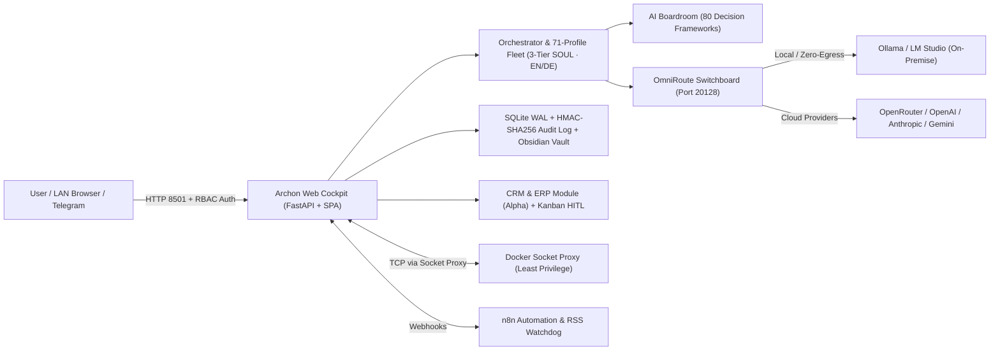

<div align="center">


# ARCHON OS - エージェント型オペレーティングシステム

**創業者、チーム、専門家のためのセルフホスト型マルチエージェントオペレーティングシステム**

[](../../LICENSE)
[](../../CHANGELOG.md)
[-emerald.svg)](../../agent_profiles.json)
[](../../prompt_studio_catalog.json)
[](../../Dockerfile)
[](../../SECURITY.md)

[🇬🇧 English](../../README.md) · [🇩🇪 Deutsch](../../README.de.md) · [🇪🇸 Español](../../README.es.md) · [🇫🇷 Français](../../README.fr.md) · [🇮🇹 Italiano](../../README.it.md) · **🇯🇵 日本語** · [🇰🇷 한국어](../../README.ko.md) · [🇳🇱 Nederlands](../../README.nl.md) · [🇵🇹 Português](../../README.pt.md) · [🇷🇺 Русский](../../README.ru.md) · [🇨🇳 中文](../../README.zh.md)

[🌐 ライブランディングページ](https://michaelbeatman.github.io/ARCHON-OS/) | [🤖 AIエージェントインストールプロトコル](../../INSTALL_AGENT.md) | [⚡ ゼロキーライブデモ](#option-c-instant-zero-key-read-only-demo-archon_demo_modetrue) | [📘 マニュアル＆PDF](#documentation--manuals-pdf) | [🗺️ ロードマップ (M0–M113)](../system/ROADMAP_2026.md)

</div>

---

## Archon OSとは？

Archon OSは、[Hermes Agent](https://github.com/NousResearch/hermes-agent) (Nous Research) 上に構築されたセルフホスト型のマルチエージェントワークスペースです。独自のサーバー上で動作し、税務、法務、調達、営業、ソフトウェア、不動産、医療、戦略の8つのドメインにわたる**71のプロファイル**（`agent_profiles.json`内のシステム/メタおよびドメインスペシャリスト）をオーケストレーションします。各プロファイルには3段階の`SOUL.md`プロンプト（Compact / Pro / Full）が用意されており、エージェントはドメインが必要な場合にのみトークンを消費します。

実際には何を意味するのか：

- **単発の回答ではなく、構造化された意思決定。** AI Boardroomは、批判的プロンプトと55のフレームワーク（OKR、プレモーテム、6つの思考帽子など）を横断した統合を用いて、分離された多角的な議論を実行します。
- **モデルおよびタスクごとのコスト管理。** OmniRouteは各リクエストをローカル（Ollama、LM Studio）またはクラウドプロバイダーにルーティングし、ディスパッチ前にコストを割り当てます（`cost_estimator.py`が予算をチェックします）。
- **データ主権。** Zero-Egressルーティングにより、財務、契約、CRMの作業はローカルモデルに保持されます。ワーカーコンテナは、インターネットルートを持たない`internal: true`のDockerネットワーク内で実行されます。
- **改ざん検知可能な監査証跡。** HMAC-SHA256ハッシュチェーン監査ログ（外部アンカー + 起動キーチェック）が、プロバイダー、モデル、ホストを含むすべてのディスパッチを記録します。
- **ドキュメント管理。** ObsidianボルトとAnythingLLM/Chroma RAGが、ライブラリをローカルでインデックス化します。
- **ビジネスオペレーション。** 4つの承認ゲートを備えたKanban、メールトリアージ、CRM、およびERPスイート（見積書、契約書、請求書、売掛金） — **アルファ版**。

**1.0未満であり、あらかじめお伝えしておきます：** インターフェースや設定キーはリリースごとに変更される可能性があり、ERP/CRMモジュールはアルファ版であり、マルチユーザーのロール強制は現在も強化中です。これをご理解いただける場合、IssueやPRを歓迎します。

### 現在のリリース状態 (`v0.5.7.9`, 2026-11-24)

公式のリリース状態は [CHANGELOG.md](../../CHANGELOG.md) です。`v0.5.6.0` 以降の主な追加機能:

- **M110 実行の強化:** `UNKNOWN` 状態と必須の照合を備えた Effect-Ledger、生存確認付きのワーカーリース/ハートビート、実行前DAGバリデーター、および `replan_count` の上限設定。
- **24時間365日の生存監視とUIパフォーマンス:** `/livez` におけるリアルな非同期イベントループのハートビート（停止時に `503` を返却）を Docker ヘルスチェックに統合。外部デッドマン・スイッチのウェブフックサポート (`ARCHON_HEARTBEAT_WEBHOOK_URL`)、および Prompt Studio での 180ms デバウンス検索と60アイテムのバッチレンダリング。
- **ガバナンス:** 中央集権的な PolicyEngine とアトミックな BudgetBank (`reserve → settle/release`)。`pay` / `mcp__*` などの特権ツールには署名付き令状が必須となりました。
- **信頼性:** イベント、ウェブフック、スケジューラー向けの冪等性キーと再試行/DLQを備えたアウトボックス。監査ログは環境キーを用いた HMAC と非ブロッキングのバックグラウンドアンカーを使用。
- **可観測性とツール:** LLM カーネルと DAG における OTel トレース、トレースから評価へのリプレイフィクスチャ、Python 3.13、分割テスト要件。
- **ワークスペース:** 4ステップのオンボーディングウィザード v2、オペレーションカレンダー、11の LinkedIn スキル。

> **設定とセキュリティに関する注意 (2026年11月23日の監査):** 出荷時の `settings.json` には **`auth` ブロックが一切含まれていません**。そのため、システムは `127.0.0.1` にバインドされている場合、意図的に **ローカルシングルユーザーモード**（フォールバック管理者、ログインなし）で動作します。**このモードはローカルデスクトップでの使用専用です。** ループバック以外へのバインドは `_must_force_auth()` により強制的に認証されますが、LAN や本番環境で公開する前に必ず `"auth": {"enabled": true}` を追加してください。Egress フラグもデフォルトでオフになっています (`privacy.zero_egress = false`, `zero_egress_strict = false`; `hard_block_on_local_offline = true` のみ有効)。`config/version.json` は **v0.5.7.9** を報告します。PDF マニュアルは依然として v0.5.2.1 を対象としています — *PDF basiert weiter auf v0.5.2.1, siehe [CHANGELOG.md](../../CHANGELOG.md) für v0.5.7.9*.

> **このチェックアウトで計測された数:** `agent_profiles.json` に71エントリ、`roles.json` に71ロール、`.hermes/profiles/` に71の同期済みプロファイル、`static/avatars/` に312のポートレートアセット、832のプロンプトテンプレート、11のUIロケール。PDF マニュアルは `v0.5.2.1` 用に生成されており、`v0.5.7.9` 用にはまだ再生成されていません — v0.5.7.9 については [CHANGELOG.md](../../CHANGELOG.md) を参照してください。

### 製品ツアー

| Prompt Studio (チャットで開く) | 71-Profile Agent Fleet (3層 SOUL) |
|---|---|
|  |  |
| **組織階層とチーム** | **AI Boardroom 討論 (55のフレームワーク)** |
|  |  |

[](https://star-history.com/#michaelbeatman/ARCHON-OS&Date)

---

## ドキュメントとマニュアル (PDF)

| ドキュメント | 英語 (EN) | ドイツ語 (DE) | 範囲 |
|---|---|---|---|
| **ユーザーおよび企業向けマニュアル** | [**ARCHON_OS_SYSTEM_MANUAL_2026_EN.pdf**](../system/ARCHON_OS_SYSTEM_MANUAL_2026_EN.pdf) *(97ページ、1.9 MB)* | [ARCHON_OS_SYSTEM_HANDBUCH_2026.pdf](../system/ARCHON_OS_SYSTEM_HANDBUCH_2026.pdf) *(97ページ、1.9 MB)* | インストール、第1章～第19章、5つのユースケース、暗号化/GDPRの概要およびA–Z用語集 |
| **完全な機能リスト (PDF: v0.5.2.1 — v0.5.7.9 の CHANGELOG を参照)** | [**ARCHON_OS_FEATURE_LIST_2026_EN.pdf**](../system/ARCHON_OS_FEATURE_LIST_2026_EN.pdf) | [ARCHON_OS_FEATURELISTE_2026.pdf](../system/ARCHON_OS_FEATURELISTE_2026.pdf) | 全モジュールカタログ、バイリンガルグローバル版、ライブデモモード、初回実行ウィザード、FinOpsおよびセキュリティ |
| **AI Boardroom: 80 Frameworks** | [**ARCHON_OS_BOARDROOM_FRAMEWORKS_2026_EN.pdf**](../system/ARCHON_OS_BOARDROOM_FRAMEWORKS_2026_EN.pdf) | [ARCHON_OS_BOARDROOM_FRAMEWORKS_2026.pdf](../system/ARCHON_OS_BOARDROOM_FRAMEWORKS_2026.pdf) | 55種類の構造化された意思決定エンジン手法（英語・ドイツ語）およびインデックス |
*[System Manual](../system/ARCHON_OS_SYSTEM_MANUAL_2026_JA.pdf) · [Complete Feature List](../system/ARCHON_OS_FEATURELISTE_2026_JA.pdf) · [AI Boardroom: 80 Frameworks](../system/ARCHON_OS_BOARDROOM_FRAMEWORKS_2026_JA.pdf)*

*その他の技術・セキュリティガイド:* [システムアーキテクチャと監査](../system/SYSTEM_ARCHITEKTUR_UND_AUDIT_2026.md) · [ロードマップ (M0–M113)](../system/ROADMAP_2026.md) · [EU AI Act、GoBD PDFおよびマルチテナントガイド (M43/M49)](../system/EU_AI_ACT_GOBD_COMPLIANCE_GUIDE.md) · [エンタープライズ機能とプレイブックガイド](../system/ENTERPRISE_FEATURES_2026_GUIDE.md) · [MCPサーバー (`/mcp`) ガイド](../system/ARCHON_MCP_SERVER_GUIDE.md) · [ライブデモモードガイド](../system/LIVE_DEMO_MODE_GUIDE.md) · [初回セットアップウィザードガイド](../system/FIRST_RUN_SETUP_WIZARD_GUIDE.md) · [エコシステムと移行ガイド](../system/ECOSYSTEM_AND_MIGRATION_GUIDE.md) · [セキュリティポリシー](../../SECURITY.md) · [変更履歴](../../CHANGELOG.md)

---

## シングルチャット vs. スーパーエージェント vs. Archon OS

| 機能 | 従来のAIチャット | 単一の「スーパーエージェント」 | **Archon Agentic OS** |
|---|---|---|---|
| **エージェント名簿** | 汎用アシスタント1体 | ツールプラグインを備えた汎用型1体 | **71種類の個別プロファイル** (`agent_profiles.json`)、**3段階の `SOUL.md`** (`Compact` / `Pro` / `Full`) |
| **戦略的決定** | 一問一答 | 反復的なツールループ | **AI Boardroom**: 分離された多角的な議論、批判的プロンプト、**55のフレームワーク**による統合 |
| **長期記憶** | フラットなチャット履歴 | ベクターストアの断片 | **Obsidian Vault同期**、エージェントごとの人事スコアカード (`Personalakten/`)、WAL SQLite DBおよびLRU-Kページング |
| **プライバシーと外部送信** | すべてのデータをクラウドAPIへ | 実行環境内のAPIキー | **Zero-Egressゲートとプライバシー・ルーターによるハードブロック**（ローカルLLMがオフライン時の財務/契約/CRMのフェイルクローズ）+ **`internal: true` ワーカーネットワーク（インターネット経路なし）** + **デュアルLLMガード** |
| **ガバナンスと責任** | ブラインド出力 | 未チェックのツール呼び出し | **EU AI Actエンジン (第4条 / 附属書III)**、**ワンクリックGoBD手順PDF**、**HITLゲート**および**HMAC-SHA256監査チェーン (環境キー; 呼び出しごとのLLMディスパッチプロバイダー/モデル/ホスト証明を含む)** |
| **ビジネス運用** | なし | 外部SaaS連携 | **マルチテナントSQLite分離 (Holding/GmbH/SPV)**、**Kanban (4つの目によるゲート)**、**メールトリアージ**、**CRM**および**ERP *(Alpha)*** |

---

## システムプレビュー

| ミッション・コントロール＆オペレーションズ | 71-Profile フリート＆3-Tier SOUL |
|---|---|
|  |  |
| **AI Boardroom (マルチエージェント討論)** | **組織図 & チーム** |
|  |  |

---

## コア基盤 (必須エコシステム)

Archon OSは、連携して動作する4つの不可欠なコンポーネントの上に構築されています。以下の**Option A**と**Option B**はどちらもセットアップを自動化します (標準デフォルトプロファイル):

| コンポーネント | Archon OSにおける役割 | インストール方法 |
|---|---|---|
| **1. Docker** *(Desktop / Engine v2)* | Archon OS、Hermes Agent、AnythingLLM、Chroma、Socket Proxyを分離されたコンテナ内で実行 | `winget` (Windows)、`brew` (macOS)、または `get.docker.com` (Linux) 経由で**自動提案** |
| **2. Hermes Agent** *(`nousresearch/hermes-agent`)* | コアマルチエージェントランタイム、セッションゲートウェイ (ポート `8644`)、Telegramインターフェース | Docker ComposeによりArchon OSと併せて**自動的にプルおよび起動** |
| **3. AnythingLLM + Chroma** *(Vector RAG)* | **Central Library → RAG** (`http://localhost:3001`) をセマンティックインデックスで強化 | デフォルトの `Standard` スタックで **自動的にプルおよび起動** |
| **4. Obsidian** *(デスクトップアプリ + マウント済みVault)* | レポート、人事ファイル、グラフを保存する永続的なMarkdownセカンドブレイン (`/opt/data/obsidian`) | Vaultフォルダは `./obsidian_vault` に自動初期化。**Obsidian Desktop** のインストールを自動提案 (`winget` / `brew` / Flatpak) |

---

## Archon OSのインストール (2つの方法)

### オプションA: AIエージェントによるインストール (プロンプト1つ — 開発者向け推奨)

このリポジトリを **Antigravity**、**Claude Code**、**OpenAI Codex**、**Cursor**、または **Windsurf** で開き、以下のプロンプトを貼り付けてください:

```text
Read INSTALL_AGENT.md and set up Archon OS on my machine. Run the pre-flight check first and ask me the 6 discovery questions before installing.
```

AIエージェントがDocker、RAM、ローカルLLMを確認し、インストール先、言語/スタック階層、プロバイダーのAPIキーまたはOllama/LM Studioの設定、ネットワーク公開範囲を尋ね、自動的に `/health` を検証します。

---

### オプションB: インタラクティブな1クリックインストーラー (CLI不要)

どちらのインストーラーも、**Docker** と **Obsidian Desktop** の確認/提案、Vaultフォルダの初期化、**Nous Research Hermes Agent** のプル、Archon OSのビルド、および71個の `SOUL.md` プロファイルの同期を自動的に行います。

#### Windows (ダブルクリックセットアップ)
1. このリポジトリをクローンするか、ダウンロードして解凍します。
2. **`setup.bat`** をダブルクリックします（または `setup.ps1` を右クリックして *PowerShell で実行* を選択します）。
3. ガイドに従ってプロンプトに応答します（デフォルト値を使用する場合は `Enter` を押してください）：
- 不足している **Docker Desktop** または **Obsidian Desktop** の自動インストール（必要に応じて `winget` 経由）
- Obsidian Vault フォルダー（デフォルトは `./obsidian_vault`）
- 言語 (`en` / `de`) およびスタックサイズ (`Standard` [デフォルト]: Archon + Hermes Agent + AnythingLLM/Chroma RAG + Socket Proxy; `Full Automation`: + n8n + Ollama-Embed; `Minimal Core`)
- API キー（OpenRouter を推奨、Archon と Hermes で共有 — Ollama / LM Studio を使用する場合は空欄のままにしてください）
- ネットワークの可視性（デフォルトの `127.0.0.1` localhost または `0.0.0.0` LAN）
4. ブラウザが自動的に `http://localhost:8501` で開きます。次に、Obsidian Desktop で `./obsidian_vault` を開きます（*"フォルダーを Vault として開く"*）。

*(その後の日常的な使用：`start.bat` をダブルクリックして起動、または `stop.bat` を実行して正常にシャットダウンします。)*

#### Linux および macOS (Intel および Apple Silicon ARM64)
```bash
git clone https://github.com/michaelbeatman/ARCHON-OS.git
cd ARCHON-OS
chmod +x install.sh
./install.sh
```
*(非対話型セットアップには `./install.sh --yes` を使用してください。ブラウザで初めてアクセスすると、**4-Step Web Setup Wizard** が会社プロファイル、ライブプロバイダーチェック、チャネル、ドメイン有効化の手順を案内します。)*

### オプション C: インスタント Zero-Key 読み取り専用デモ (`ARCHON_DEMO_MODE=true`)

**Mittelstand Muster GmbH** の4フェーズ AI Boardroom 討論（オプションの MoA を含む）、Kanban カード、71のプロファイルを、**API キーや LLM コストを一切かけずに 30 秒で**体験したいですか（または €5 の VPS で安全な公開ショーケースをホストしたいですか）？

```bash
ARCHON_DEMO_MODE=true docker compose -f docker-compose.demo.yml up --build -d
# Open http://localhost:8501 — read-only ASGI guard, zero token egress!
```

---

## システムアーキテクチャ



### 4つのナビゲーションの柱
1. **コマンド＆オペレーション:** オペレーションコマンドセンター、マスターチャット、トリアージインボックス（Webhooks、メール、メッセンジャー、承認）、**71プロファイルのエージェントフリート**（Bot Screen PbD および 3層 SOUL を含む）、**832テンプレートのプロンプトスタジオ**、ショールームサンドボックス。
2. **認知＆知識:** インターネットウォッチドッグ（RSS/Web レーダー）、リサーチラボ（マルチソースの三角測量とドキュメント）、中央ライブラリ（Obsidian Vault + AnythingLLM RAG）、AI Boardroom（55のフレームワークにわたる4フェーズの討論 + オプションの MoA）。
3. **経済＆ERP *(Alpha)*:** CRM（住所、連絡先、パイプライン）、ERP スイート（見積書、契約書、請求書、売掛金/督促、領収書）、モデルごとのコスト管理を備えた OmniRoute トークン FinOps。
4. **インフラストラクチャ＆ガバナンス:** 組織図＆チーム、ガーディアン（同時実行、セッション、レート制限）、システムコントロールセンター（初回実行ウィザード、API キー、ルーティング、カーネルウォッチドッグ、アップデート）、改ざん検知監査ログストリーム。

---

## 71プロファイルのフリート（8ドメイン）

| # | ドメイン | 数 | フォーカスとガードレール |
|---|---|---|---|
| **1** | **戦略、リーダーシップ、ライフ** | 12 | システムオーケストレーション、CEOコパイロット、M&A/意思決定、個人戦略、OKR、ドメイン横断的統合および最終QA |
| **2** | **コマース、調達、Eコマース** | 7 | サプライチェーン、在庫予測、ソーシング、ベンダー交渉、Shopify |
| **3** | **法務、税務、財務、保険** | 11 | 契約、GDPR、知的財産、法人/税務ホールディングス、負債ファイナンス、保険請求 *(必須の法務/税務警告ダイアログ)* |
| **4** | **不動産、建設** | 7 | DCF評価、ゾーニング/BauGB許可、ESG/KfW、建設管理 *(必須のBauGB/HOAI警告ダイアログ)* |
| **5** | **クリエイション、メディア、コンテンツ** | 8 | コピーライティング、動画スクリプト、基調講演、ゴーストライティング、UI/UXブランドデザイン |
| **6** | **セールス、CRM、マーケティング、成長** | 11 | B2Bアウトリーチ、価格設定、SEO/GEO、有料広告、リテンション、パートナー管理 |
| **7** | **技術、ソフトウェア、データ、QA** | 8 | フルスタックアーキテクチャ、DevOps/CloudSec、DBチューニング、テスト自動化 |
| **8** | **医学、化学、科学、エンジニアリング** | 6 | 臨床アドバイザー、EU-MDR/MedTech規制、化学/REACH、製薬/バイオテクノロジー、文献統合、産業エンジニアリング *(必須のEU-MDR/REACH警告ダイアログ)* |

---

## セキュリティ、プライバシー、規制に関する通知

- **ネットワークのデフォルト設定:** デフォルトで `127.0.0.1:8501` にバインドされます。LAN上で `ARCHON_BIND_IP=0.0.0.0` を公開する前に、マルチユーザーログイン (`auth.enabled = true`) を有効にしてください。ローカルのシングルユーザーフォールバック (`settings.json` に `auth` ブロックがない状態) は、**設計上localhost専用**です。共有ホストや本番環境ホストのアクセス制御として決して扱わないでください。
- **ゼロトラストソケットプロキシ:** コンテナ管理は、分離された内部ネットワーク (`archon-admin_net`) 上の `docker-socket-proxy` を介してルーティングされます。
- **プロンプトインジェクション防御:** デュアルLLM検疫サニタイズ (`backend/dual_llm_sanitizer.py`) により、ツール実行前に信頼できない外部メールやWebコンテンツを分離します。
- **専門的な助言の非提供:** 法務、税務、財務、建設、または医療/化学の専門家プロファイルからの出力は、**内部的な意思決定支援のみを目的**としており、ライセンスが必要な法務、税務、投資、エンジニアリング、または医療上の助言を構成するものではありません ([DISCLAIMER.md](../../DISCLAIMER.md)、[LICENSE](../../LICENSE) および [THIRD_PARTY_LICENSES.md](../../THIRD_PARTY_LICENSES.md))。
- **合成アバター:** `static/avatars/` にある312個のローカルポートレート資産はすべて、架空の人物を表す合成AI生成ポートレート (Gemini Nano Banana 2) です。詳細は [THIRD_PARTY_LICENSES.md](../../THIRD_PARTY_LICENSES.md) を参照してください。

---

## プロジェクト構造とドキュメント

```text
ARCHON-OS/
├── archon/                  # Modular FastAPI routers & core runtime (routers/, core/, services/)
├── backend/                 # Auth/RBAC, audit log, privacy router, CRM/ERP, workflow DAG, ~160 modules
├── static/                  # Border-first SPA UI, 11 locales & interactive liability modals
├── frontend/                # Next.js 16 / React 19 cockpit (/crm, /workflows, /cockpit)
├── .hermes/profiles/        # 71 synced SOUL.md profiles (Hermes runtime)
├── .agents/skills/          # Agent skills (LinkedIn suite, SEO, security, MCP bridges, ...)
├── data/                    # Runtime state: ops.db / business.db / memory.db, tenants, secrets, backups
├── obsidian_vault/          # Markdown Second Brain (HR, projects, radar, content)
├── scripts/                 # Bilingual SOUL & profile.yaml sync (sync_soul_modes.py), backups
├── plugins/                 # cost_guard, security_audit_hook, system_metrics, workflow_nodes
├── deploy/ecosystem/        # Self-hosting manifests & ecosystem integration guides
├── docs/system/             # System Architecture, Roadmap (M0–M113) & PDFs
├── INSTALL_AGENT.md         # Structured onboarding guide for AI Coding Agents
├── setup.bat / setup.ps1    # Interactive 1-Click Installer for Windows
├── install.sh               # Interactive Multi-Arch Installer for Linux & macOS
├── docker-compose.yml       # Full production container stack (non-root, socket-proxy, omniroute)
├── docker-compose.demo.yml  # Zero-key read-only showcase container (ARCHON_DEMO_MODE=true)
├── LICENSE                  # MIT License (SPDX: MIT)
├── SECURITY.md              # Zero-Trust Security Architecture & Vulnerability Policy
└── DISCLAIMER.md            # Regulatory & Professional Liability Notice
```

- **ユーザーおよび会社マニュアル (EN, PDF):** [docs/system/ARCHON_OS_SYSTEM_MANUAL_2026_EN.pdf](../system/ARCHON_OS_SYSTEM_MANUAL_2026_EN.pdf) *(ドイツ語: [DE PDF](../system/ARCHON_OS_SYSTEM_HANDBUCH_2026.pdf))*
- **完全な機能リストおよびシステムカタログ (PDF: v0.5.2.1 — v0.5.7.9 の CHANGELOG を参照, EN):** [docs/system/ARCHON_OS_FEATURE_LIST_2026_EN.pdf](../system/ARCHON_OS_FEATURE_LIST_2026_EN.pdf)
- **意思決定エンジンおよび55のボードルームフレームワーク (EN, PDF):** [docs/system/ARCHON_OS_BOARDROOM_FRAMEWORKS_2026_EN.pdf](../system/ARCHON_OS_BOARDROOM_FRAMEWORKS_2026_EN.pdf)
- **詳細ロードマップ (M0–M113):** [docs/system/ROADMAP_2026.md](../system/ROADMAP_2026.md)
- **ライブデモモードガイド (`ARCHON_DEMO_MODE`):** [docs/system/LIVE_DEMO_MODE_GUIDE.md](../system/LIVE_DEMO_MODE_GUIDE.md)
- **初回セットアップウィザードガイド:** [docs/system/FIRST_RUN_SETUP_WIZARD_GUIDE.md](../system/FIRST_RUN_SETUP_WIZARD_GUIDE.md)
- **エコシステムおよび移行ガイド:** [docs/system/ECOSYSTEM_AND_MIGRATION_GUIDE.md](../system/ECOSYSTEM_AND_MIGRATION_GUIDE.md)
- **システムアーキテクチャおよび監査:** [docs/system/SYSTEM_ARCHITEKTUR_UND_AUDIT_2026.md](../system/SYSTEM_ARCHITEKTUR_UND_AUDIT_2026.md)
- **MyPy型ゲートガイド:** [docs/system/MYPY_TYPE_GATE_GUIDE.md](../system/MYPY_TYPE_GATE_GUIDE.md)
- **静的解析ツールチェーンガイド:** [docs/system/STATIC_ANALYSIS_TOOLCHAIN_GUIDE.md](../system/STATIC_ANALYSIS_TOOLCHAIN_GUIDE.md)
