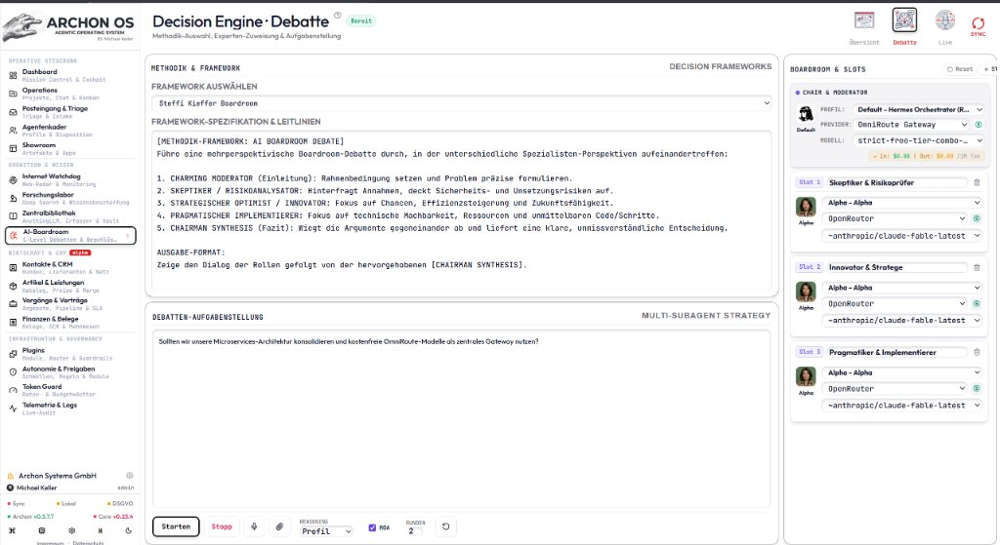
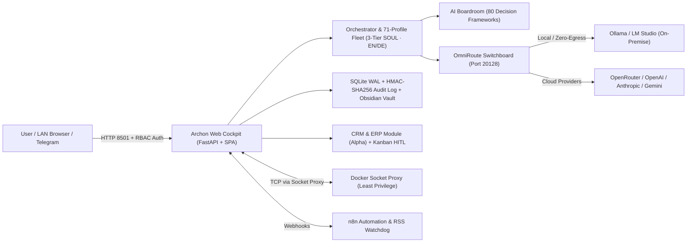

<div align="center">


# ARCHON OS - 에이전트 운영 체제

**창업자, 팀 및 도메인 전문가를 위한 자체 호스팅 멀티 에이전트 운영 체제**

[](../../LICENSE)
[](../../CHANGELOG.md)
[-emerald.svg)](../../agent_profiles.json)
[](../../prompt_studio_catalog.json)
[](../../Dockerfile)
[](../../SECURITY.md)

[🇬🇧 English](../../README.md) · [🇩🇪 Deutsch](../../README.de.md) · [🇪🇸 Español](../../README.es.md) · [🇫🇷 Français](../../README.fr.md) · [🇮🇹 Italiano](../../README.it.md) · [🇯🇵 日本語](../../README.ja.md) · **🇰🇷 한국어** · [🇳🇱 Nederlands](../../README.nl.md) · [🇵🇹 Português](../../README.pt.md) · [🇷🇺 Русский](../../README.ru.md) · [🇨🇳 中文](../../README.zh.md)

[🌐 라이브 랜딩 페이지](https://michaelbeatman.github.io/ARCHON-OS/) | [🤖 AI 에이전트 설치 프로토콜](../../INSTALL_AGENT.md) | [⚡ 제로 키 라이브 데모](#option-c-instant-zero-key-read-only-demo-archon_demo_modetrue) | [📘 매뉴얼 및 PDF](#documentation--manuals-pdf) | [🗺️ 로드맵 (M0–M113)](../system/ROADMAP_2026.md)

</div>

---

## Archon OS란 무엇인가요?

Archon OS는 [Hermes Agent](https://github.com/NousResearch/hermes-agent) (Nous Research)를 기반으로 구축된 자체 호스팅 멀티 에이전트 워크스페이스입니다. 이 시스템은 귀하의 서버에서 실행되며 세금, 법률, 조달, 영업, 소프트웨어, 부동산, 의학, 전략 등 8개 도메인에 걸쳐 **71개의 에이전트 프로필**(system/meta 및 `agent_profiles.json` 내 도메인 전문가)을 오케스트레이션합니다. 각 프로필은 3단계 `SOUL.md` 프롬프트(Compact / Pro / Full)를 갖추고 있어, 에이전트는 해당 도메인이 실제로 필요할 때만 토큰을 소비합니다.

실제로 의미하는 바는 다음과 같습니다:

- **단발성 답변이 아닌 구조화된 의사결정.** AI Boardroom은 80개의 프레임워크(OKR, Pre-Mortem, Six Thinking Hats 등)를 활용하여 비판적 프롬프트와 종합을 거치는 독립적인 다각적 토론을 실행합니다.
- **모델 및 작업별 비용 제어.** OmniRoute는 각 요청을 로컬(Ollama, LM Studio) 또는 클라우드 제공업체로 라우팅하며, 발송 전 비용을 산정합니다(`cost_estimator.py`가 예산을 확인).
- **데이터 주권.** Zero-Egress 라우팅은 재무, 계약 및 CRM 작업을 로컬 모델에서 유지하며, 워커 컨테이너는 인터넷 경로가 없는 `internal: true` Docker 네트워크에서 실행됩니다.
- **위변조 방지 감사 추적.** HMAC-SHA256 해시 체인 감사 로그(외부 앵커 + 시작 키 확인)는 제공업체, 모델, 호스트를 포함한 모든 발송 기록을 저장합니다.
- **귀하의 문서.** Obsidian 볼트와 AnythingLLM/Chroma RAG가 귀하의 라이브러리를 로컬에서 인덱싱합니다.
- **비즈니스 운영.** 4-eyes 승인 게이트가 포함된 Kanban, 이메일 분류, CRM 및 ERP 제품군(견적, 계약, 송장, 미수금)을 제공합니다 — **알파 버전**.

**1.0 이전 버전임을 미리 밝힙니다:** 릴리스마다 인터페이스와 구성 키가 변경될 수 있으며, ERP/CRM 모듈은 알파 단계이고, 다중 사용자 역할 적용은 여전히 강화 작업 중입니다. 이러한 환경이 괜찮으시다면, 이슈와 PR을 환영합니다.

### 현재 릴리스 상태 (`v0.5.7.9`, 2026-11-24)

공식 릴리스 상태는 [CHANGELOG.md](../../CHANGELOG.md)입니다. `v0.5.6.0` 이후 주요 추가 사항:

- **M110 실행 강화:** `UNKNOWN` 상태 및 필수 조정이 포함된 Effect-Ledger, 활성 상태 확인이 포함된 워커 임대/하트비트, 실행 전 DAG 검사기 및 `replan_count` 제한.
- **24/7 활성 상태 및 UI 성능:** Docker 상태 확인에 연결된 `/livez`의 실제 비동기 이벤트 루프 하트비트(정지 시 `503` 반환), 외부 데드맨 스위치 웹훅 지원(`ARCHON_HEARTBEAT_WEBHOOK_URL`), Prompt Studio의 180ms 디바운스 검색 및 60개 항목 일괄 렌더링.
- **거버넌스:** 중앙 집중식 PolicyEngine 및 원자적 BudgetBank(`예약 → 정산/해제`); `pay` / `mcp__*`와 같은 권한 있는 도구에는 서명된 영장이 필수입니다.
- **신뢰성:** 이벤트, 웹훅 및 스케줄러를 위한 멱등성 키와 재시도/DLQ가 포함된 아웃박스; 감사 로그는 이제 환경 키와 비차단 백그라운드 앵커를 사용하는 HMAC을 사용합니다.
- **관측 가능성 및 도구:** LLM 커널 및 DAG의 OTel 추적, 추적-평가 재생 픽스처, Python 3.13, 분할 테스트 요구 사항.
- **워크스페이스:** 4단계 온보딩 마법사 v2, 운영 캘린더 및 11개의 LinkedIn 기술.

> **구성 및 보안 참고 사항(2026.11.23 감사):** 제공된 `settings.json`에는 **`auth` 블록이 전혀 없습니다**. 따라서 시스템은 `127.0.0.1`에 바인딩될 때 의도적으로 **로컬 단일 사용자 모드**(폴백 관리자, 로그인 없음)로 실행됩니다. **이 모드는 로컬 데스크톱 전용입니다.** 루프백이 아닌 바인딩은 이미 `_must_force_auth()`를 통해 인증을 강제하지만, LAN 또는 프로덕션 환경에 노출하기 전에 `"auth": {"enabled": true}`를 추가해야 합니다. Egress 플래그도 기본적으로 꺼져 있습니다(`privacy.zero_egress = false`, `zero_egress_strict = false`; `hard_block_on_local_offline = true`만 활성화). `config/version.json`은 **v0.5.7.9**을 보고합니다. PDF 매뉴얼은 여전히 v0.5.2.1을 대상으로 합니다 — *PDF basiert weiter auf v0.5.2.1, siehe [CHANGELOG.md](../../CHANGELOG.md) für v0.5.7.9*.

> **현재 체크아웃에서 측정된 수치:** `agent_profiles.json`의 71개 항목, `roles.json`의 71개 역할, `.hermes/profiles/`의 71개 동기화된 프로필, `static/avatars/`의 312개 초상화 에셋, 832개의 프롬프트 템플릿 및 11개의 UI 로케일. PDF 매뉴얼은 `v0.5.2.1`용으로 생성되었으며 아직 `v0.5.7.9`용으로 재생성되지 않았습니다. v0.5.7.9에 대한 내용은 [CHANGELOG.md](../../CHANGELOG.md)를 참조하십시오.

### 제품 둘러보기

| Prompt Studio (채팅에서 열림) | 71-Profile Agent Fleet (3계층 SOUL) |
|---|---|
|  |  |
| **조직 계층 및 팀** | **AI Boardroom 토론 (80개 프레임워크)** |
|  |  |

[](https://star-history.com/#michaelbeatman/ARCHON-OS&Date)

---

## 문서 및 매뉴얼 (PDF)

| 문서 | 영어 (EN) | 독일어 (DE) | 범위 |
|---|---|---|---|
| **사용자 및 기업 매뉴얼** | [**ARCHON_OS_SYSTEM_MANUAL_2026_EN.pdf**](../system/ARCHON_OS_SYSTEM_MANUAL_2026_EN.pdf) *(97쪽, 1.9 MB)* | [ARCHON_OS_SYSTEM_HANDBUCH_2026.pdf](../system/ARCHON_OS_SYSTEM_HANDBUCH_2026.pdf) *(97쪽, 1.9 MB)* | 설치, 1~19장, 5가지 사용 사례, 암호화/GDPR 개요 및 A–Z 용어집 |
| **전체 기능 목록 (PDF: v0.5.2.1 — v0.5.7.9에 대한 CHANGELOG 참조)** | [**ARCHON_OS_FEATURE_LIST_2026_EN.pdf**](../system/ARCHON_OS_FEATURE_LIST_2026_EN.pdf) | [ARCHON_OS_FEATURELISTE_2026.pdf](../system/ARCHON_OS_FEATURELISTE_2026.pdf) | 전체 모듈 카탈로그, 이중 언어 글로벌 에디션, 라이브 데모 모드, 초기 실행 마법사, FinOps 및 보안 |
| **AI Boardroom: 80 Frameworks** | [**ARCHON_OS_BOARDROOM_FRAMEWORKS_2026_EN.pdf**](../system/ARCHON_OS_BOARDROOM_FRAMEWORKS_2026_EN.pdf) | [ARCHON_OS_BOARDROOM_FRAMEWORKS_2026.pdf](../system/ARCHON_OS_BOARDROOM_FRAMEWORKS_2026.pdf) | 80가지 구조화된 의사결정 엔진 방법론(EN & DE) 및 색인 전체 |
*[System Manual](../system/ARCHON_OS_SYSTEM_MANUAL_2026_KO.pdf) · [Complete Feature List](../system/ARCHON_OS_FEATURELISTE_2026_KO.pdf) · [AI Boardroom: 80 Frameworks](../system/ARCHON_OS_BOARDROOM_FRAMEWORKS_2026_KO.pdf)*

*추가 기술 및 보안 가이드:* [시스템 아키텍처 및 감사](../system/SYSTEM_ARCHITEKTUR_UND_AUDIT_2026.md) · [로드맵 (M0–M113)](../system/ROADMAP_2026.md) · [EU AI Act, GoBD PDF 및 멀티 테넌트 가이드 (M43/M49)](../system/EU_AI_ACT_GOBD_COMPLIANCE_GUIDE.md) · [엔터프라이즈 기능 및 플레이북 가이드](../system/ENTERPRISE_FEATURES_2026_GUIDE.md) · [MCP 서버 (`/mcp`) 가이드](../system/ARCHON_MCP_SERVER_GUIDE.md) · [라이브 데모 모드 가이드](../system/LIVE_DEMO_MODE_GUIDE.md) · [초기 설정 마법사 가이드](../system/FIRST_RUN_SETUP_WIZARD_GUIDE.md) · [생태계 및 마이그레이션 가이드](../system/ECOSYSTEM_AND_MIGRATION_GUIDE.md) · [보안 정책](../../SECURITY.md) · [변경 로그](../../CHANGELOG.md)

---

## 단일 채팅 vs. 슈퍼 에이전트 vs. Archon OS

| 기능 | 클래식 AI 채팅 | 단일 "슈퍼 에이전트" | **Archon Agentic OS** |
|---|---|---|---|
| **에이전트 목록** | 범용 어시스턴트 1개 | 도구 플러그인이 포함된 제너럴리스트 1개 | **71개의 개별 프로필** (`agent_profiles.json`) 및 **3단계 `SOUL.md`** (`Compact` / `Pro` / `Full`) |
| **전략적 의사결정** | 일회성 답변 | 반복적인 도구 루프 | **AI Boardroom**: 격리된 다각적 토론, 비판 프롬프트 및 **80개 프레임워크** 전반의 종합 |
| **장기 기억** | 평면적 채팅 기록 | 벡터 저장소 스니펫 | **Obsidian Vault 동기화**, 에이전트별 인사 성과표(`Personalakten/`), WAL SQLite DB 및 LRU-K 페이징 |
| **개인정보 보호 및 데이터 유출** | 모든 데이터를 클라우드 API로 전송 | 런타임 환경의 API 키 | **Zero-Egress 게이트 및 개인정보 보호 라우터 하드 블록** (로컬 LLM 오프라인 시 금융/계약/CRM에 대해 fail-closed) + **`internal: true` 워커 네트워크 (인터넷 경로 없음)** + **듀얼 LLM 가드** |
| **거버넌스 및 책임** | 맹목적 출력 | 검증되지 않은 도구 호출 | **EU AI Act 엔진 (제4조 / 부속서 III)**, **원클릭 GoBD 절차 PDF**, **HITL 게이트** 및 **HMAC-SHA256 감사 체인 (Env-Key; 호출별 LLM-Dispatch 제공자/모델/호스트 증명 포함)** |
| **비즈니스 운영** | 없음 | 외부 SaaS 통합 | **멀티 테넌트 SQLite 격리 (지주회사/GmbH/SPV)**, **Kanban (4-eyes 게이트)**, **이메일 분류**, **CRM** 및 **ERP *(알파)*** |

---

## 시스템 미리보기

| Mission Control & 운영 | 71-프로필 플릿 & 3-계층 SOUL |
|---|---|
|  |  |
| **AI Boardroom (멀티 에이전트 토론)** | **조직도 & 팀** |
|  |  |

---

## 핵심 기반 (필수 생태계)

Archon OS는 함께 작동하는 네 가지 필수 구성 요소로 구축되었습니다. 아래의 **Option A**와 **Option B** 모두 사용자를 위해 설정을 처리합니다 (표준 기본 프로필):

| 구성 요소 | Archon OS에서의 역할 | 설치 방법 |
|---|---|---|
| **1. Docker** *(Desktop / Engine v2)* | 기본 7개 컨테이너(Archon OS, OmniRoute, Hermes Agent, AnythingLLM, Chroma, Socket Proxy, Autoheal — 선택 프로필 포함 최대 24개)를 격리 실행 | `winget`(Windows), `brew`(macOS) 또는 `get.docker.com`(Linux)을 통해 **자동 제공** |
| **2. Hermes Agent** *(`nousresearch/hermes-agent`)* | 핵심 멀티 에이전트 런타임, 세션 게이트웨이(포트 `8644`) 및 Telegram 인터페이스 | Docker Compose에 의해 Archon OS와 함께 **자동으로 풀 및 시작됨** |
| **3. AnythingLLM + Chroma** *(벡터 RAG)* | 시맨틱 인덱싱을 통해 **Central Library → RAG** (`http://localhost:3001`) 구동 | 기본 `Standard` 스택에서 **자동으로 가져오기 및 시작** |
| **4. Obsidian** *(데스크톱 앱 + 마운트된 볼트)* | 보고서, HR 파일 및 그래프를 저장하는 영구적인 Markdown 제2의 뇌 (`/opt/data/obsidian`) | 볼트 폴더는 `./obsidian_vault`에 자동 초기화; **Obsidian Desktop** 설치 자동 제안 (`winget` / `brew` / Flatpak) |

---

## Archon OS 설치 (2가지 방법)

### 옵션 A: AI 에이전트로 설치 (프롬프트 1개 — 개발자 권장)

이 저장소를 **Antigravity**, **Claude Code**, **OpenAI Codex**, **Cursor** 또는 **Windsurf**에서 열고 다음 프롬프트를 붙여넣으세요:

```text
Read INSTALL_AGENT.md and set up Archon OS on my machine. Run the pre-flight check first and ask me the 6 discovery questions before installing.
```

AI 에이전트가 Docker, RAM, 로컬 LLM을 확인하고, 설치 위치, 원하는 언어/스택 계층, 제공업체 API 키 또는 Ollama/LM Studio 설정, 네트워크 노출 여부를 질문하며 `/health`를 자동으로 검증합니다.

---

### 옵션 B: 대화형 1-클릭 설치 프로그램 (CLI를 사용하지 않는 사용자용)

두 설치 프로그램 모두 **Docker**와 **Obsidian Desktop**을 자동으로 확인/제안하고, 볼트 폴더를 초기화하며, **Nous Research Hermes Agent**를 가져오고, Archon OS를 빌드하며, 71개의 모든 `SOUL.md` 프로필을 동기화합니다.

#### Windows (더블 클릭 설정)
1. 이 저장소를 복제하거나 다운로드하여 압축을 푸세요.
2. **`setup.bat`**를 더블 클릭하거나(또는 `setup.ps1`을 마우스 오른쪽 버튼으로 클릭 → *PowerShell에서 실행*).
3. 안내되는 프롬프트에 응답하십시오(기본값을 사용하려면 `Enter`를 누르십시오):
- 누락된 **Docker Desktop** 또는 **Obsidian Desktop** 자동 설치(원할 경우 `winget`을 통해)
- Obsidian Vault 폴더(기본값 `./obsidian_vault`)
- 언어(`en` / `de`) 및 스택 크기(`Standard` [기본값]: Archon + Hermes Agent + AnythingLLM/Chroma RAG + Socket Proxy; `Full Automation`: + n8n + Ollama-Embed; `Minimal Core`)
- API 키(OpenRouter 권장, Archon 및 Hermes와 공유 — Ollama / LM Studio를 사용하는 경우 비워 두십시오)
- 네트워크 가시성(`127.0.0.1` localhost 기본값 vs. `0.0.0.0` LAN)
4. 브라우저가 `http://localhost:8501`에서 자동으로 열립니다. 그런 다음 Obsidian Desktop에서 `./obsidian_vault`를 엽니다(*"Open folder as vault"*).

*(이후 매일 사용할 때는 `start.bat`를 더블 클릭하여 실행하거나 `stop.bat`를 사용하여 안전하게 종료하십시오.)*

#### Linux 및 macOS (Intel 및 Apple Silicon ARM64)
```bash
git clone https://github.com/michaelbeatman/ARCHON-OS.git
cd ARCHON-OS
chmod +x install.sh
./install.sh
```
*(비대화형 설정을 위해 `./install.sh --yes`를 사용하세요. 브라우저 첫 접속 시 **4단계 웹 설정 마법사**가 회사 프로필, 라이브 공급자 확인, 채널 및 도메인 활성화를 안내합니다.)*

### 옵션 C: 즉시 사용 가능한 제로 키 읽기 전용 데모 (`ARCHON_DEMO_MODE=true`)

**단 하나의 API 키나 LLM 비용 없이 30초 만에** 전체 콕핏, **Mittelstand Muster GmbH** 4단계 AI Boardroom 토론(+ 선택적 MoA), Kanban 카드 및 71개 프로필을 탐색하거나(또는 €5 VPS에서 안전한 공개 쇼케이스를 호스팅하거나) 싶으신가요?

```bash
ARCHON_DEMO_MODE=true docker compose -f docker-compose.demo.yml up --build -d
# Open http://localhost:8501 — read-only ASGI guard, zero token egress!
```

---

## 시스템 아키텍처



### 4가지 탐색 기둥
1. **명령 및 운영:** 운영 명령 센터, 마스터 채팅, 트리아지 받은 편지함(웹훅, 이메일, 메신저, 승인), **71개 프로필 에이전트 플릿**(Bot Screen PbD 및 3계층 SOUL 포함), **832개 템플릿 프롬프트 스튜디오**, 쇼룸 샌드박스.
2. **인지 및 지식:** 인터넷 감시자(RSS/웹 레이더), 연구소(다중 소스 삼각측량 및 도서), 중앙 라이브러리(Obsidian Vault + AnythingLLM RAG), AI Boardroom(80개 프레임워크에 걸친 4단계 토론 + 선택적 MoA).
3. **경제 및 ERP *(알파)*:** CRM(주소, 연락처, 파이프라인), ERP 제품군(제안서, 계약서, 송장, 미수금/독촉, 영수증), 모델별 비용 제어가 포함된 OmniRoute 토큰 FinOps.
4. **인프라 및 거버넌스:** 조직도 및 팀, 가디언(동시성, 세션, 속도 제한), 시스템 제어 센터(초기 실행 마법사, API 키, 라우팅, 커널 감시자, 업데이트), 변조 방지 감사 로그 스트림.

---

## 71개 프로필 플릿 (8개 도메인)

| # | 도메인 | 개수 | 초점 및 가드레일 |
|---|---|---|---|
| **1** | **전략, 리더십 및 삶** | 12 | 시스템 오케스트레이션, CEO 코파일럿, M&A/의사결정, 개인 전략, OKR, 도메인 간 합성 및 최종 QA |
| **2** | **상거래, 조달 및 이커머스** | 7 | 공급망, 재고 예측, 소싱, 공급업체 협상, Shopify |
| **3** | **법률, 세무, 금융 및 보험** | 11 | 계약, GDPR, IP, 기업/세무 지주, 부채 금융, 보험 청구 *(필수 법률/세무 경고 대화상자)* |
| **4** | **부동산 및 건설** | 7 | DCF 가치 평가, 용도 지역/BauGB 허가, ESG/KfW, 건설 관리 *(필수 BauGB/HOAI 경고 대화상자)* |
| **5** | **창작, 미디어 및 콘텐츠** | 8 | 카피라이팅, 비디오 스크립트, 기조연설, 대필, UI/UX 브랜드 디자인 |
| **6** | **영업, CRM, 마케팅 및 성장** | 11 | B2B 아웃리치, 가격 책정, SEO/GEO, 유료 광고, 리텐션, 파트너 관리 |
| **7** | **기술, 소프트웨어, 데이터 및 QA** | 8 | 풀스택 아키텍처, DevOps/CloudSec, DB 튜닝, 테스트 자동화 |
| **8** | **의학, 화학, 과학 및 공학** | 6 | 임상 자문, EU-MDR/MedTech 규제, 화학/REACH, 제약/바이오테크, 문헌 합성, 산업 공학 *(필수 EU-MDR/REACH 경고 대화상자)* |

---

## 보안, 개인정보 보호 및 규제 고지

- **안전한 네트워크 기본값:** 기본적으로 `127.0.0.1:8501`에 바인딩됩니다. LAN에서 `ARCHON_BIND_IP=0.0.0.0`을 노출하기 전에 다중 사용자 로그인(`auth.enabled = true`)을 활성화하십시오. 로컬 단일 사용자 대체 모드(`settings.json`에 `auth` 블록이 없는 경우)는 **설계상 localhost 전용**이므로, 공유 호스트나 프로덕션 호스트에 대한 액세스 제어 수단으로 절대 사용하지 마십시오.
- **제로 트러스트 소켓 프록시:** 컨테이너 관리는 격리된 내부 네트워크(`archon-admin_net`)의 `docker-socket-proxy`를 통해 라우팅됩니다.
- **프롬프트 인젝션 방어:** 이중 LLM 격리 정화(`backend/dual_llm_sanitizer.py`) 기능은 도구 실행 전에 신뢰할 수 없는 외부 이메일/웹 콘텐츠를 격리합니다.
- **전문적인 조언 아님:** 법률, 세무, 재무, 건설 또는 의료/화학 전문가 프로필의 출력물은 **내부 의사결정 지원용으로만 사용**해야 하며, 공인된 법률, 세무, 투자, 엔지니어링 또는 의료 자문을 구성하지 않습니다([DISCLAIMER.md](../../DISCLAIMER.md), [LICENSE](../../LICENSE) 및 [THIRD_PARTY_LICENSES.md](../../THIRD_PARTY_LICENSES.md)).
- **합성 아바타:** `static/avatars/`에 있는 312개의 모든 로컬 인물 사진 에셋은 가상의 인물을 나타내는 합성 AI 생성 초상화(Gemini Nano Banana 2)입니다. [THIRD_PARTY_LICENSES.md](../../THIRD_PARTY_LICENSES.md)를 참조하십시오.

---

## 프로젝트 구조 및 문서

```text
ARCHON-OS/
├── archon/                  # Modular FastAPI routers & core runtime (routers/, core/, services/)
├── backend/                 # Auth/RBAC, audit log, privacy router, CRM/ERP, workflow DAG, ~160 modules
├── static/                  # Border-first SPA UI, 11 locales & interactive liability modals
├── frontend/                # Next.js 16 / React 19 cockpit (/crm, /workflows, /cockpit)
├── .hermes/profiles/        # 71 synced SOUL.md profiles (Hermes runtime)
├── .agents/skills/          # Agent skills (LinkedIn suite, SEO, security, MCP bridges, ...)
├── data/                    # Runtime state: ops.db / business.db / memory.db, tenants, secrets, backups
├── obsidian_vault/          # Markdown Second Brain (HR, projects, radar, content)
├── scripts/                 # Bilingual SOUL & profile.yaml sync (sync_soul_modes.py), backups
├── plugins/                 # cost_guard, security_audit_hook, system_metrics, workflow_nodes
├── deploy/ecosystem/        # Self-hosting manifests & ecosystem integration guides
├── docs/system/             # System Architecture, Roadmap (M0–M113) & PDFs
├── INSTALL_AGENT.md         # Structured onboarding guide for AI Coding Agents
├── setup.bat / setup.ps1    # Interactive 1-Click Installer for Windows
├── install.sh               # Interactive Multi-Arch Installer for Linux & macOS
├── docker-compose.yml       # Full production container stack (non-root, socket-proxy, omniroute)
├── docker-compose.demo.yml  # Zero-key read-only showcase container (ARCHON_DEMO_MODE=true)
├── LICENSE                  # MIT License (SPDX: MIT)
├── SECURITY.md              # Zero-Trust Security Architecture & Vulnerability Policy
└── DISCLAIMER.md            # Regulatory & Professional Liability Notice
```

- **사용자 및 회사 매뉴얼 (영문, PDF):** [docs/system/ARCHON_OS_SYSTEM_MANUAL_2026_EN.pdf](../system/ARCHON_OS_SYSTEM_MANUAL_2026_EN.pdf) *(독일어: [DE PDF](../system/ARCHON_OS_SYSTEM_HANDBUCH_2026.pdf))*
- **전체 기능 목록 및 시스템 카탈로그 (PDF: v0.5.2.1 — v0.5.7.9에 대한 CHANGELOG 참조, 영문):** [docs/system/ARCHON_OS_FEATURE_LIST_2026_EN.pdf](../system/ARCHON_OS_FEATURE_LIST_2026_EN.pdf)
- **의사결정 엔진 및 80개 이사회 프레임워크 (영문, PDF):** [docs/system/ARCHON_OS_BOARDROOM_FRAMEWORKS_2026_EN.pdf](../system/ARCHON_OS_BOARDROOM_FRAMEWORKS_2026_EN.pdf)
- **상세 로드맵 (M0–M113):** [docs/system/ROADMAP_2026.md](../system/ROADMAP_2026.md)
- **라이브 데모 모드 가이드 (`ARCHON_DEMO_MODE`):** [docs/system/LIVE_DEMO_MODE_GUIDE.md](../system/LIVE_DEMO_MODE_GUIDE.md)
- **초기 설정 마법사 가이드:** [docs/system/FIRST_RUN_SETUP_WIZARD_GUIDE.md](../system/FIRST_RUN_SETUP_WIZARD_GUIDE.md)
- **생태계 및 마이그레이션 가이드:** [docs/system/ECOSYSTEM_AND_MIGRATION_GUIDE.md](../system/ECOSYSTEM_AND_MIGRATION_GUIDE.md)
- **시스템 아키텍처 및 감사:** [docs/system/SYSTEM_ARCHITEKTUR_UND_AUDIT_2026.md](../system/SYSTEM_ARCHITEKTUR_UND_AUDIT_2026.md)
- **MyPy 타입 게이트 가이드:** [docs/system/MYPY_TYPE_GATE_GUIDE.md](../system/MYPY_TYPE_GATE_GUIDE.md)
- **정적 분석 툴체인 가이드:** [docs/system/STATIC_ANALYSIS_TOOLCHAIN_GUIDE.md](../system/STATIC_ANALYSIS_TOOLCHAIN_GUIDE.md)
