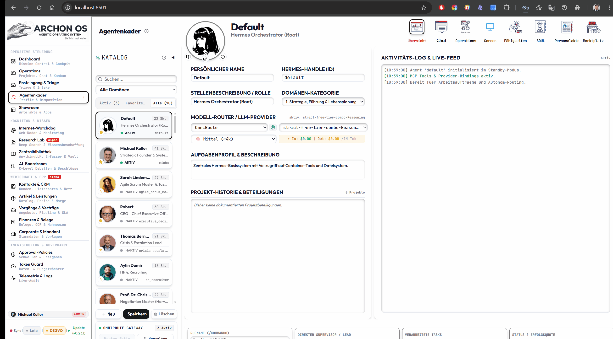
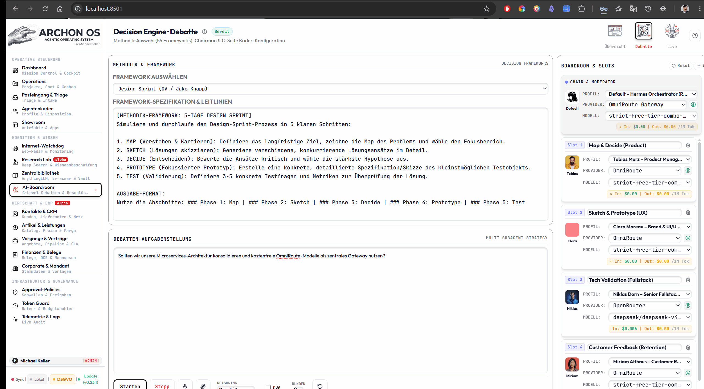
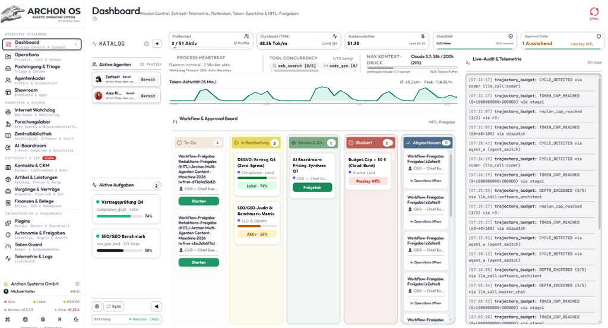
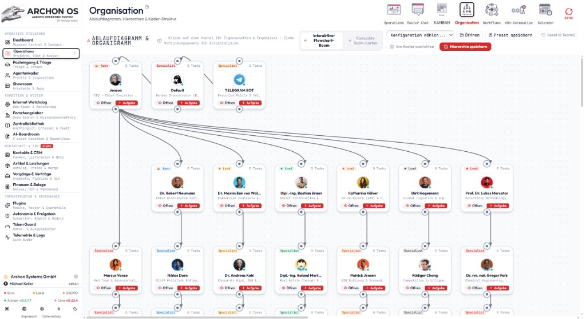
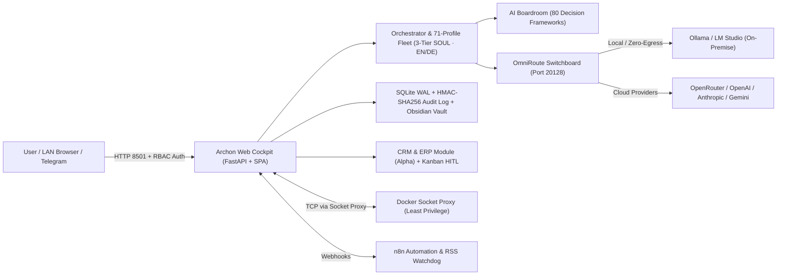

<div align="center">


# ARCHON OS - AGENTIC OPERATING SYSTEM

**Self-Hosted Multi-Agent Operating System voor oprichters, teams & domeinspecialisten**

[](../../LICENSE)
[](../../CHANGELOG.md)
[-emerald.svg)](../../agent_profiles.json)
[](../../prompt_studio_catalog.json)
[](../../Dockerfile)
[](../../SECURITY.md)

[🇬🇧 English](../../README.md) · [🇩🇪 Deutsch](../../README.de.md) · [🇪🇸 Español](../../README.es.md) · [🇫🇷 Français](../../README.fr.md) · [🇮🇹 Italiano](../../README.it.md) · [🇯🇵 日本語](../../README.ja.md) · [🇰🇷 한국어](../../README.ko.md) · **🇳🇱 Nederlands** · [🇵🇹 Português](../../README.pt.md) · [🇷🇺 Русский](../../README.ru.md) · [🇨🇳 中文](../../README.zh.md)

[🌐 Live landingspagina](https://michaelbeatman.github.io/ARCHON-OS/) | [🤖 AI Agent Installatieprotocol](../../INSTALL_AGENT.md) | [⚡ Zero-Key Live Demo](#option-c-instant-zero-key-read-only-demo-archon_demo_modetrue) | [📘 Handleidingen & PDF's](#documentation--manuals-pdf) | [🗺️ Roadmap (M0–M113)](../system/ROADMAP_2026.md)

</div>

---

## Wat is Archon OS?

Archon OS is een self-hosted multi-agent werkruimte gebouwd op [Hermes Agent](https://github.com/NousResearch/hermes-agent) (Nous Research). Het draait op je eigen server en orkestreert **71 agentprofielen** (systeem/meta en domeinspecialisten in `agent_profiles.json`) verdeeld over 8 domeinen — belasting, recht, inkoop, verkoop, software, vastgoed, geneeskunde, strategie. Elk profiel heeft een `SOUL.md` prompt met 3 niveaus (Compact / Pro / Full), zodat agents alleen tokens verbruiken wanneer hun domein daadwerkelijk nodig is.

Wat dat in de praktijk betekent:

- **Gestructureerde beslissingen, geen eenmalige antwoorden.** Een AI Boardroom voert geïsoleerde debatten vanuit meerdere perspectieven met een kritiek-prompt en synthese over 80 frameworks (OKR, Pre-Mortem, Six Thinking Hats, …).
- **Kostenbeheersing per model en per taak.** OmniRoute stuurt elk verzoek naar lokale (Ollama, LM Studio) of cloudproviders en wijst kosten toe vóór verzending (`cost_estimator.py` controleert budgetten).
- **Datasouvereiniteit.** Zero-Egress routing houdt financiële, contract- en CRM-werkzaamheden op lokale modellen; worker-containers draaien in een `internal: true` Docker-netwerk zonder internetverbinding.
- **Manipulatiebestendig audittrail.** Een HMAC-SHA256 hash-chained auditlogboek (externe anker + opstart-sleutelcontrole) registreert elke verzending, inclusief provider, model en host.
- **Jouw documenten.** Een Obsidian vault plus AnythingLLM/Chroma RAG indexeert jouw bibliotheek lokaal.
- **Bedrijfsvoering.** Kanban met vier-ogen-principe goedkeuringspoorten, e-mailtriage, CRM en een ERP-suite (offertes, contracten, facturen, vorderingen) — **alpha**.

**Pre-1.0, en dat zeggen we vooraf:** interfaces en configuratiesleutels veranderen tussen releases, de ERP/CRM-module is alpha, en de handhaving van rollen voor meerdere gebruikers wordt nog verder aangescherpt. Als dat voor jou werkt, zijn issues en PRs welkom.

### Huidige release-status (`v0.5.7.9`, 24-11-2026)

De officiële release-status staat in [CHANGELOG.md](../../CHANGELOG.md). Belangrijkste toevoegingen sinds `v0.5.6.0`:

- **M110 Execution Hardening:** effect ledger met `UNKNOWN` + verplichte reconciliatie, worker leases/heartbeats met een liveness-check, pre-execution DAG-validator en een `replan_count` limiet.
- **24/7 Liveness & UI-prestaties:** echte async event-loop heartbeat in `/livez` (geeft `503` bij vastlopen) gekoppeld aan de Docker healthcheck, ondersteuning voor externe dead-man-switch webhook (`ARCHON_HEARTBEAT_WEBHOOK_URL`), en 180 ms gedebouncte zoekopdrachten + batch-rendering van 60 items in Prompt Studio.
- **Governance:** één centrale PolicyEngine en een atomische BudgetBank (`reserve → settle/release`); ondertekende warrants zijn nu verplicht voor bevoorrechte tools zoals `pay` / `mcp__*`.
- **Betrouwbaarheid:** idempotency-keys en een outbox met retry/DLQ voor events, webhooks en de scheduler; het auditlogboek gebruikt nu HMAC met een omgevingssleutel en een niet-blokkerende achtergrond-anchor.
- **Observability & tooling:** OTel-traces in de LLM-kernel en DAG, trace-to-eval replay-fixtures, Python 3.13, gesplitste testvereisten.
- **Workspace:** 4-staps onboarding-wizard v2, operations-kalender en 11 LinkedIn-vaardigheden.

> **Configuratie- & beveiligingsnotitie (audit 23-11-2026):** de meegeleverde `settings.json` bevat **totaal geen `auth` blok**. Het systeem draait daarom in een bewuste **lokale modus voor één gebruiker** (fallback admin, geen login) wanneer gebonden aan `127.0.0.1`. **Deze modus is uitsluitend voor lokaal desktopgebruik.** Niet-loopback bindingen forceren al authenticatie via `_must_force_auth()`, maar u moet `"auth": {"enabled": true}` toevoegen vóór enige blootstelling aan LAN of productie. Egress-vlaggen staan standaard ook uit (`privacy.zero_egress = false`, `zero_egress_strict = false`; alleen `hard_block_on_local_offline = true`). `config/version.json` rapporteert **v0.5.7.9**; de PDF-handleiding richt zich nog op v0.5.2.1 — *PDF basiert weiter op v0.5.2.1, zie [CHANGELOG.md](../../CHANGELOG.md) voor v0.5.7.9*.

> **Aantallen gemeten in deze checkout:** 71 items in `agent_profiles.json`, 71 rollen in `roles.json`, 71 gesynchroniseerde profielen in `.hermes/profiles/`, 312 portret-assets in `static/avatars/`, 832 prompt-templates en 11 UI-talen. De PDF-handleidingen zijn gegenereerd voor `v0.5.2.1` en zijn nog niet opnieuw gegenereerd voor `v0.5.7.9` — zie [CHANGELOG.md](../../CHANGELOG.md) voor v0.5.7.9.

### Producttour

| Prompt Studio (geopend in chat) | 71-Profiel Agent Fleet (3-laags SOUL) |
|---|---|
|  |  |
| **Organisatiehiërarchie & Teams** | **AI Boardroom Debat (80 frameworks)** |
|  |  |

[](https://star-history.com/#michaelbeatman/ARCHON-OS&Date)

---

## Documentatie & Handleidingen (PDF)

| Document | Engels (EN) | Duits (DE) | Reikwijdte |
|---|---|---|---|
| **Gebruikers- & Bedrijfshandleiding** | [**ARCHON_OS_SYSTEM_MANUAL_2026_EN.pdf**](../system/ARCHON_OS_SYSTEM_MANUAL_2026_EN.pdf) *(97 pag., 1,9 MB)* | [ARCHON_OS_SYSTEM_HANDBUCH_2026.pdf](../system/ARCHON_OS_SYSTEM_HANDBUCH_2026.pdf) *(97 pag., 1,9 MB)* | Installatie, Hoofdstukken 1–19, 5 Use Cases, Overzicht Versleuteling/AVG & A–Z Woordenlijst |
| **Volledige Functielijst (PDF: v0.5.2.1 — zie CHANGELOG voor v0.5.7.9)** | [**ARCHON_OS_FEATURE_LIST_2026_EN.pdf**](../system/ARCHON_OS_FEATURE_LIST_2026_EN.pdf) | [ARCHON_OS_FEATURELISTE_2026.pdf](../system/ARCHON_OS_FEATURELISTE_2026.pdf) | Volledige modulecatalogus, Tweetalige Global Edition, Live Demo-modus, First-Run Wizard, FinOps & Beveiliging |
| **AI Boardroom: 80 Frameworks** | [**ARCHON_OS_BOARDROOM_FRAMEWORKS_2026_EN.pdf**](../system/ARCHON_OS_BOARDROOM_FRAMEWORKS_2026_EN.pdf) | [ARCHON_OS_BOARDROOM_FRAMEWORKS_2026.pdf](../system/ARCHON_OS_BOARDROOM_FRAMEWORKS_2026.pdf) | Alle 55 gestructureerde Decision Engine-methodologieën (EN & DE) & index |
*[System Manual](../system/ARCHON_OS_SYSTEM_MANUAL_2026_NL.pdf) · [Complete Feature List](../system/ARCHON_OS_FEATURELISTE_2026_NL.pdf) · [AI Boardroom: 80 Frameworks](../system/ARCHON_OS_BOARDROOM_FRAMEWORKS_2026_NL.pdf)*

*Meer technische & beveiligingshandleidingen:* [Systeemarchitectuur & Audit](../system/SYSTEM_ARCHITEKTUR_UND_AUDIT_2026.md) · [Roadmap (M0–M113)](../system/ROADMAP_2026.md) · [EU AI Act, GoBD PDF & Multi-Tenant Gids (M43/M49)](../system/EU_AI_ACT_GOBD_COMPLIANCE_GUIDE.md) · [Enterprise Functies & Playbooks Gids](../system/ENTERPRISE_FEATURES_2026_GUIDE.md) · [MCP Server (`/mcp`) Gids](../system/ARCHON_MCP_SERVER_GUIDE.md) · [Live Demo Modus Gids](../system/LIVE_DEMO_MODE_GUIDE.md) · [Eerste Installatie Wizard Gids](../system/FIRST_RUN_SETUP_WIZARD_GUIDE.md) · [Ecosysteem & Migratie Gids](../system/ECOSYSTEM_AND_MIGRATION_GUIDE.md) · [Beveiligingsbeleid](../../SECURITY.md) · [Wijzigingslogboek](../../CHANGELOG.md)

---

## Een Chat vs. Super-Agent vs. Archon OS

| Mogelijkheid | Klassieke AI Chat | Enkele "Super-Agent" | **Archon Agentic OS** |
|---|---|---|---|
| **Agentenlijst** | 1 generieke assistent | 1 generalist met tool-plugins | **71 afzonderlijke profielen** (`agent_profiles.json`) met **3-laags `SOUL.md`** (`Compact` / `Pro` / `Full`) |
| **Strategische Beslissingen** | Eénmalig antwoord | Iteratieve tool-loop | **AI Boardroom**: geïsoleerd debat met meerdere perspectieven, kritiek-prompt & synthese via **80 frameworks** |
| **Lange-termijngeheugen** | Vlakke chatgeschiedenis | Vector store fragmenten | **Obsidian Vault synchronisatie**, HR-scorekaarten per agent (`Personalakten/`), WAL SQLite DB's & LRU-K paging |
| **Privacy & Egress** | Alle data naar cloud-API's | API-sleutels in runtime-omgeving | **Zero-Egress Gate & Privacy-Router Hard-Block** (fail-closed voor financiën/contracten/CRM wanneer lokale LLM offline is) + **`internal: true` Worker Network (geen internetroute)** + **Dual-LLM Guard** |
| **Governance & Aansprakelijkheid** | Blinde output | Ongecontroleerde tool-aanroepen | **EU AI Act Engine (Art. 4 / Bijlage III)**, **1-Klik GoBD Procedurele PDF**, **HITL Gates** & **HMAC-SHA256 Audit Chain (Env-Key; incl. per-call LLM-Dispatch provider/model/host bewijs)** |
| **Bedrijfsvoering** | Geen | Externe SaaS-integraties | **Multi-Tenant SQLite Isolatie (Holding/GmbH/SPV)**, **Kanban (4-ogen principe)**, **E-mail Triage**, **CRM** & **ERP *(Alpha)*** |

---

## Systeemvoorbeeld

| Missiebeheer & Operaties | 71-Profiel Vloot & 3-Laags SOUL |
|---|---|
|  |  |
| **AI Boardroom (Multi-Agent Debat)** | **Organigram & Teams** |
|  |  |

---

## Kernfundamenten (Vereist Ecosysteem)

Archon OS is gebouwd op vier essentiële componenten die samenwerken. Zowel **Option A** als **Option B** hieronder regelen de installatie voor u (Standaard Standaardprofiel):

| Component | Rol in Archon OS | Hoe het wordt geïnstalleerd |
|---|---|---|
| **1. Docker** *(Desktop / Engine v2)* | Draait Archon OS, Hermes Agent, AnythingLLM, Chroma en Socket Proxy in geïsoleerde containers | **Automatisch aangeboden** via `winget` (Windows), `brew` (macOS) of `get.docker.com` (Linux) |
| **2. Hermes Agent** *(`nousresearch/hermes-agent`)* | Kern multi-agent runtime, sessie-gateway (poort `8644`) en Telegram-interface | **Automatisch opgehaald & gestart** door Docker Compose naast Archon OS |
| **3. AnythingLLM + Chroma** *(Vector RAG)* | Voedt **Central Library → RAG** (`http://localhost:3001`) met semantische indexering | **Automatisch opgehaald & gestart** in de standaard `Standard` stack |
| **4. Obsidian** *(Desktop App + Gekoppelde Vault)* | Persistente Markdown Second Brain (`/opt/data/obsidian`) voor het opslaan van rapporten, HR-bestanden en grafieken | Vault-mappen automatisch geïnitialiseerd in `./obsidian_vault`; **Obsidian Desktop** installatie automatisch aangeboden (`winget` / `brew` / Flatpak) |

---

## Installeer Archon OS (2 manieren)

### Optie A: Installeren met je AI-agent (1 prompt — Aanbevolen voor ontwikkelaars)

Open deze repository in **Antigravity**, **Claude Code**, **OpenAI Codex**, **Cursor** of **Windsurf** en plak deze prompt:

```text
Read INSTALL_AGENT.md and set up Archon OS on my machine. Run the pre-flight check first and ask me the 6 discovery questions before installing.
```

Je AI-agent controleert Docker, RAM en lokale LLM's, vraagt je waar je wilt installeren, welke taal/stack-laag je wilt, je provider API-sleutels of Ollama/LM Studio-configuratie, netwerkblootstelling en verifieert automatisch `/health`.

---

### Optie B: Interactief 1-klik installatieprogramma (Zero-CLI vriendelijk)

Beide installatieprogramma's controleren/bieden automatisch **Docker** en **Obsidian Desktop** aan, initialiseren je Vault-mappen, halen **Nous Research Hermes Agent** op, bouwen Archon OS en synchroniseren alle 71 `SOUL.md` profielen.

#### Windows (Dubbelklik-installatie)
1. Kloon of download & pak deze repository uit.
2. Dubbelklik op **`setup.bat`** (of klik met de rechtermuisknop op `setup.ps1` → *Uitvoeren met PowerShell*).
3. Beantwoord de begeleide vragen (of druk op `Enter` voor de standaardinstellingen):
- Automatische installatie van ontbrekende **Docker Desktop** of **Obsidian Desktop** (via `winget`, indien gewenst)
- Obsidian Vault-map (`./obsidian_vault` standaard)
- Taal (`en` / `de`) & Stackgrootte (`Standard` [Standaard]: Archon + Hermes Agent + AnythingLLM/Chroma RAG + Socket Proxy; `Full Automation`: + n8n + Ollama-Embed; `Minimal Core`)
- API-sleutel (OpenRouter aanbevolen, gedeeld met Archon & Hermes — of laat leeg voor Ollama / LM Studio)
- Netwerkzichtbaarheid (`127.0.0.1` localhost standaard vs. `0.0.0.0` LAN)
4. Uw browser opent automatisch op `http://localhost:8501`. Open vervolgens `./obsidian_vault` in Obsidian Desktop (*"Open folder as vault"*).

*(Voor dagelijks gebruik daarna: dubbelklik op `start.bat` om op te starten of `stop.bat` om veilig af te sluiten.)*

#### Linux & macOS (Intel & Apple Silicon ARM64)
```bash
git clone https://github.com/michaelbeatman/ARCHON-OS.git
cd ARCHON-OS
chmod +x install.sh
./install.sh
```
*(Gebruik `./install.sh --yes` voor een niet-interactieve installatie; bij het eerste browserbezoek leidt de **4-Step Web Setup Wizard** u door het bedrijfsprofiel, de live provider-check, kanalen en domeinactivatie.)*

### Optie C: Directe Zero-Key Read-Only Demo (`ARCHON_DEMO_MODE=true`)

Wilt u de volledige Cockpit, het **Mittelstand Muster GmbH** 4-fasen AI Boardroom-debat (+ optionele MoA), Kanban-kaarten en 71 profielen verkennen **in 30 seconden zonder een enkele API-sleutel of LLM-kosten** (of een veilige publieke showcase hosten op een VPS van €5)?

```bash
ARCHON_DEMO_MODE=true docker compose -f docker-compose.demo.yml up --build -d
# Open http://localhost:8501 — read-only ASGI guard, zero token egress!
```

---

## Systeemarchitectuur



### De 4 Navigatiepijlers
1. **Command & Operations:** Operations Command Center, Master Chat, Triage Inbox (Webhooks, E-mail, Messenger, Goedkeuringen), **71-Profile Agent Fleet** (incl. Bot Screen PbD & 3-tier SOUL), **832-Template Prompt Studio**, Showroom Sandbox.
2. **Cognition & Knowledge:** Internet-Watchdog (RSS/Web Radar), Research Lab (multi-source triangulatie & dossiers), Central Library (Obsidian Vault + AnythingLLM RAG), AI Boardroom (4-fasen debat + optionele MoA over 80 frameworks).
3. **Economy & ERP *(Alpha)*:** CRM (adressen, contacten, pipeline), ERP-suite (offertes, contracten, facturen, vorderingen/aanmaningen, bonnen), OmniRoute token FinOps met kostenbeheersing per model.
4. **Infrastructure & Governance:** Org-Chart & Teams, Guardian (Concurrency, Sessies, Rate Limits), System Control Center (First-Run Wizard, API-sleutels, Routing, Kernel Watchdog, Updates), Tamper-Evident Audit Log Stream.

---

## De 71-Profile Fleet (8 Domeinen)

| # | Domein | Aantal | Focus & Richtlijnen |
|---|---|---|---|
| **1** | **Strategie, Leiderschap & Leven** | 12 | Systeemorkestratie, CEO-copiloot, M&A/besluitvorming, persoonlijke strategie, OKR's, domeinoverschrijdende synthese & eindcontrole |
| **2** | **Handel, Inkoop & E-commerce** | 7 | Supply chain, voorraadvoorspelling, sourcing, leveranciersonderhandelingen, Shopify |
| **3** | **Recht, Belastingen, Financiën & Verzekeringen** | 11 | Contracten, AVG, IE, bedrijfs-/belastingstructuren, schuldfinanciering, verzekeringsclaims *(Verplicht juridisch/fiscaal waarschuwingsdialoogvenster)* |
| **4** | **Vastgoed & Bouw** | 7 | DCF-waardering, bestemmingsplannen/BauGB-vergunningen, ESG/KfW, bouwmanagement *(Verplicht BauGB/HOAI-waarschuwingsdialoogvenster)* |
| **5** | **Creatie, Media & Content** | 8 | Copywriting, videoscripts, keynotes, ghostwriting, UI/UX-merkontwerp |
| **6** | **Verkoop, CRM, Marketing & Groei** | 11 | B2B-outreach, prijsstelling, SEO/GEO, betaalde advertenties, retentie, partnermanagement |
| **7** | **Tech, Software, Data & QA** | 8 | Fullstack-architectuur, DevOps/CloudSec, DB-optimalisatie, testautomatisering |
| **8** | **Geneeskunde, Chemie, Wetenschap & Techniek** | 6 | Klinisch adviseur, EU-MDR/MedTech-regelgeving, chemie/REACH, farma/biotech, literatuursynthese, industriële techniek *(Verplicht EU-MDR/REACH-waarschuwingsdialoogvenster)* |

---

## Beveiliging, Privacy & Regelgevende Kennisgeving

- **Veilig netwerk-standaard:** Bindt standaard aan `127.0.0.1:8501`. Schakel multi-user login (`auth.enabled = true`) in voordat `ARCHON_BIND_IP=0.0.0.0` op een LAN wordt blootgesteld. De lokale single-user fallback (geen `auth` blok in `settings.json`) is **ontworpen voor alleen localhost** — beschouw dit nooit als toegangscontrole voor gedeelde of productiehosts.
- **Zero-Trust Socket Proxy:** Containerbeheer verloopt via `docker-socket-proxy` op een geïsoleerd intern netwerk (`archon-admin_net`).
- **Verdediging tegen Prompt Injection:** Dual-LLM quarantaine-sanitering (`backend/dual_llm_sanitizer.py`) isoleert niet-vertrouwde externe e-mails/webinhoud vóór uitvoering van tools.
- **Geen professioneel advies:** Output van juridische, fiscale, financiële, bouw- of medische/chemische specialistische profielen is **uitsluitend voor interne besluitvormingsondersteuning** en vormt geen erkend juridisch, fiscaal, beleggings-, technisch of medisch advies ([DISCLAIMER.md](../../DISCLAIMER.md), [LICENSE](../../LICENSE) & [THIRD_PARTY_LICENSES.md](../../THIRD_PARTY_LICENSES.md)).
- **Synthetische Avatars:** Alle 312 lokale portretassets in `static/avatars/` zijn synthetische, door AI gegenereerde portretten (Gemini Nano Banana 2) die fictieve personen vertegenwoordigen; zie [THIRD_PARTY_LICENSES.md](../../THIRD_PARTY_LICENSES.md).

---

## Projectstructuur & Documentatie

```text
ARCHON-OS/
├── archon/                  # Modular FastAPI routers & core runtime (routers/, core/, services/)
├── backend/                 # Auth/RBAC, audit log, privacy router, CRM/ERP, workflow DAG, ~160 modules
├── static/                  # Border-first SPA UI, 11 locales & interactive liability modals
├── frontend/                # Next.js 16 / React 19 cockpit (/crm, /workflows, /cockpit)
├── .hermes/profiles/        # 71 synced SOUL.md profiles (Hermes runtime)
├── .agents/skills/          # Agent skills (LinkedIn suite, SEO, security, MCP bridges, ...)
├── data/                    # Runtime state: ops.db / business.db / memory.db, tenants, secrets, backups
├── obsidian_vault/          # Markdown Second Brain (HR, projects, radar, content)
├── scripts/                 # Bilingual SOUL & profile.yaml sync (sync_soul_modes.py), backups
├── plugins/                 # cost_guard, security_audit_hook, system_metrics, workflow_nodes
├── deploy/ecosystem/        # Self-hosting manifests & ecosystem integration guides
├── docs/system/             # System Architecture, Roadmap (M0–M113) & PDFs
├── INSTALL_AGENT.md         # Structured onboarding guide for AI Coding Agents
├── setup.bat / setup.ps1    # Interactive 1-Click Installer for Windows
├── install.sh               # Interactive Multi-Arch Installer for Linux & macOS
├── docker-compose.yml       # Full production container stack (non-root, socket-proxy, omniroute)
├── docker-compose.demo.yml  # Zero-key read-only showcase container (ARCHON_DEMO_MODE=true)
├── LICENSE                  # MIT License (SPDX: MIT)
├── SECURITY.md              # Zero-Trust Security Architecture & Vulnerability Policy
└── DISCLAIMER.md            # Regulatory & Professional Liability Notice
```

- **Gebruikers- & Bedrijfshandleiding (EN, PDF):** [docs/system/ARCHON_OS_SYSTEM_MANUAL_2026_EN.pdf](../system/ARCHON_OS_SYSTEM_MANUAL_2026_EN.pdf) *(Duits: [DE PDF](../system/ARCHON_OS_SYSTEM_HANDBUCH_2026.pdf))*
- **Volledige lijst met functies & Systeemcatalogus (PDF: v0.5.2.1 — zie CHANGELOG voor v0.5.7.9, EN):** [docs/system/ARCHON_OS_FEATURE_LIST_2026_EN.pdf](../system/ARCHON_OS_FEATURE_LIST_2026_EN.pdf)
- **Besluitvormingsengine & 80 Boardroom Frameworks (EN, PDF):** [docs/system/ARCHON_OS_BOARDROOM_FRAMEWORKS_2026_EN.pdf](../system/ARCHON_OS_BOARDROOM_FRAMEWORKS_2026_EN.pdf)
- **Gedetailleerde roadmap (M0–M113):** [docs/system/ROADMAP_2026.md](../system/ROADMAP_2026.md)
- **Handleiding voor Live Demo-modus (`ARCHON_DEMO_MODE`):** [docs/system/LIVE_DEMO_MODE_GUIDE.md](../system/LIVE_DEMO_MODE_GUIDE.md)
- **Handleiding voor de installatiewizard bij eerste gebruik:** [docs/system/FIRST_RUN_SETUP_WIZARD_GUIDE.md](../system/FIRST_RUN_SETUP_WIZARD_GUIDE.md)
- **Ecosysteem- & Migratiehandleiding:** [docs/system/ECOSYSTEM_AND_MIGRATION_GUIDE.md](../system/ECOSYSTEM_AND_MIGRATION_GUIDE.md)
- **Systeemarchitectuur & Audit:** [docs/system/SYSTEM_ARCHITEKTUR_UND_AUDIT_2026.md](../system/SYSTEM_ARCHITEKTUR_UND_AUDIT_2026.md)
- **MyPy Type-Gate handleiding:** [docs/system/MYPY_TYPE_GATE_GUIDE.md](../system/MYPY_TYPE_GATE_GUIDE.md)
- **Handleiding voor statische analysetoolchain:** [docs/system/STATIC_ANALYSIS_TOOLCHAIN_GUIDE.md](../system/STATIC_ANALYSIS_TOOLCHAIN_GUIDE.md)
