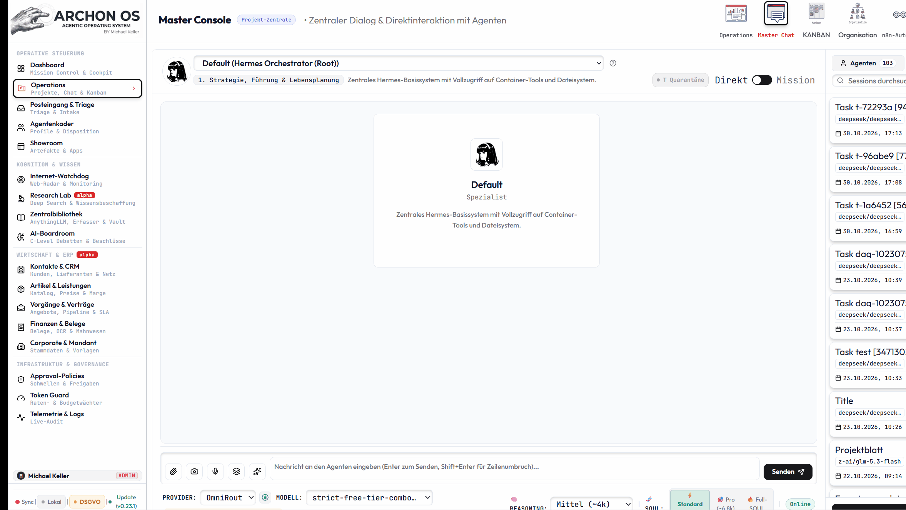
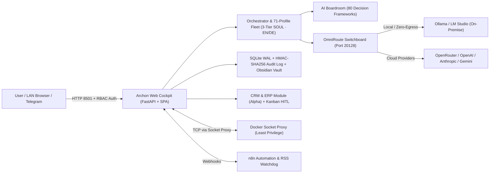

<div align="center">


# ARCHON OS - SISTEMA OPERACIONAL AGÊNTICO

**Sistema Operacional Multiagente Auto-Hospedado para Fundadores, Equipes e Especialistas de Domínio**

[](../../LICENSE)
[](../../CHANGELOG.md)
[-emerald.svg)](../../agent_profiles.json)
[](../../prompt_studio_catalog.json)
[](../../Dockerfile)
[](../../SECURITY.md)

[🇬🇧 English](../../README.md) · [🇩🇪 Deutsch](../../README.de.md) · [🇪🇸 Español](../../README.es.md) · [🇫🇷 Français](../../README.fr.md) · [🇮🇹 Italiano](../../README.it.md) · [🇯🇵 日本語](../../README.ja.md) · [🇰🇷 한국어](../../README.ko.md) · [🇳🇱 Nederlands](../../README.nl.md) · **🇵🇹 Português** · [🇷🇺 Русский](../../README.ru.md) · [🇨🇳 中文](../../README.zh.md)

[🌐 Página Inicial ao Vivo](https://michaelbeatman.github.io/ARCHON-OS/) | [🤖 Protocolo de Instalação de Agente de IA](../../INSTALL_AGENT.md) | [⚡ Demonstração ao Vivo Zero-Key](#option-c-instant-zero-key-read-only-demo-archon_demo_modetrue) | [📘 Manuais e PDFs](#documentation--manuals-pdf) | [🗺️ Roteiro (M0–M113)](../system/ROADMAP_2026.md)

</div>

---

## O que é o Archon OS?

O Archon OS é um espaço de trabalho multiagente auto-hospedado construído sobre o [Hermes Agent](https://github.com/NousResearch/hermes-agent) (Nous Research). Ele é executado em seu próprio servidor e orquestra **71 perfis de agente** (sistema/meta e especialistas de domínio em `agent_profiles.json`) em 8 domínios — tributário, jurídico, compras, vendas, software, imobiliário, medicina, estratégia. Cada perfil possui um prompt `SOUL.md` de 3 níveis (Compacto / Pro / Completo), para que os agentes só consumam tokens quando seu domínio for realmente necessário.

O que isso significa na prática:

- **Decisões estruturadas, não respostas únicas.** Um AI Boardroom executa debates isolados de múltiplas perspectivas com um prompt de crítica e síntese em 55 estruturas (OKR, Pre-Mortem, Seis Chapéus do Pensamento, …).
- **Controle de custos por modelo e por tarefa.** O OmniRoute encaminha cada solicitação para provedores locais (Ollama, LM Studio) ou em nuvem e atribui o custo antes do envio (`cost_estimator.py` verifica orçamentos).
- **Soberania de dados.** O roteamento Zero-Egress mantém o trabalho financeiro, de contratos e de CRM em modelos locais; os contêineres de trabalho são executados em uma rede Docker `internal: true` sem rota para a internet.
- **Trilha de auditoria à prova de violação.** Um log de auditoria encadeado por hash HMAC-SHA256 (âncora externa + verificação de chave de inicialização) registra cada envio, incluindo provedor, modelo e host.
- **Seus documentos.** Um cofre Obsidian mais RAG com AnythingLLM/Chroma indexa sua biblioteca localmente.
- **Operações de negócios.** Kanban com portões de aprovação de quatro olhos, triagem de e-mail, CRM e um conjunto ERP (ofertas, contratos, faturas, contas a receber) — **alfa**.

**Pré-1.0, e dizemos isso de antemão:** interfaces e chaves de configuração mudam entre lançamentos, o módulo ERP/CRM é alfa e a aplicação de funções multiusuário ainda está sendo reforçada. Se isso funciona para você, problemas e PRs são bem-vindos.

### Estado da Versão Atual (`v0.5.7.9`, 24/11/2026)

O estado oficial da versão está em [CHANGELOG.md](../../CHANGELOG.md). Principais adições desde a `v0.5.6.0`:

- **Endurecimento de Execução M110:** Effect-Ledger com `UNKNOWN` + reconciliação obrigatória, leases/heartbeats de worker com verificação de atividade, validador de DAG pré-execução e um limite de `replan_count`.
- **Atividade 24/7 e Desempenho da UI:** heartbeat de loop de eventos assíncrono real em `/livez` (retorna `503` em caso de travamento) conectado ao healthcheck do Docker, suporte a webhook de dead-man-switch externo (`ARCHON_HEARTBEAT_WEBHOOK_URL`) e busca com debounce de 180 ms + renderização em lote de 60 itens no Prompt Studio.
- **Governança:** um PolicyEngine central e um BudgetBank atômico (`reserve → settle/release`); mandados assinados agora são obrigatórios para ferramentas privilegiadas como `pay` / `mcp__*`.
- **Confiabilidade:** chaves de idempotência e uma outbox com retry/DLQ para eventos, webhooks e o agendador; o log de auditoria agora usa HMAC com uma chave de ambiente e um ancorador de segundo plano não bloqueante.
- **Observabilidade e ferramentas:** rastreamentos OTel no kernel LLM e DAG, fixtures de reprodução de trace-to-eval, Python 3.13, requisitos de teste dividido.
- **Espaço de Trabalho:** assistente de integração de 4 etapas v2, calendário de operações e 11 habilidades do LinkedIn.

> **Nota de configuração e segurança (auditoria 23/11/2026):** o `settings.json` fornecido **não possui nenhum bloco `auth`**. Portanto, o sistema é executado em um **modo de usuário único local** intencional (administrador de fallback, sem login) quando vinculado a `127.0.0.1`. **Este modo é apenas para uso em desktop local.** Vinculações que não sejam de loopback já forçam a autenticação via `_must_force_auth()`, mas você deve adicionar `"auth": {"enabled": true}` antes de qualquer exposição em LAN ou produção. As flags de saída também estão desativadas por padrão (`privacy.zero_egress = false`, `zero_egress_strict = false`; apenas `hard_block_on_local_offline = true`). `config/version.json` reporta **v0.5.7.9**; o manual em PDF ainda aponta para v0.5.2.1 — *PDF basiert weiter auf v0.5.2.1, siehe [CHANGELOG.md](../../CHANGELOG.md) für v0.5.7.9*.

> **Contagens medidas neste checkout:** 71 entradas em `agent_profiles.json`, 71 funções em `roles.json`, 71 perfis sincronizados em `.hermes/profiles/`, 312 ativos de retrato em `static/avatars/`, 832 modelos de prompt e 11 localidades de UI. Os manuais em PDF foram gerados para `v0.5.2.1` e ainda não foram regenerados para `v0.5.7.9` — veja [CHANGELOG.md](../../CHANGELOG.md) para v0.5.7.9.

### Tour do Produto

| Prompt Studio (aberto no chat) | 71-Frota de Agentes (SOUL de 3 níveis) |
|---|---|
|  |  |
| **Hierarquia Organizacional e Equipes** | **Debate no AI Boardroom (80 frameworks)** |
|  |  |

[](https://star-history.com/#michaelbeatman/ARCHON-OS&Date)

---

## Documentação e Manuais (PDF)

| Documento | Inglês (EN) | Alemão (DE) | Escopo |
|---|---|---|---|
| **Manual do Usuário e da Empresa** | [**ARCHON_OS_SYSTEM_MANUAL_2026_EN.pdf**](../system/ARCHON_OS_SYSTEM_MANUAL_2026_EN.pdf) *(97 págs., 1,9 MB)* | [ARCHON_OS_SYSTEM_HANDBUCH_2026.pdf](../system/ARCHON_OS_SYSTEM_HANDBUCH_2026.pdf) *(97 págs., 1,9 MB)* | Instalação, Capítulos 1–19, 5 Casos de Uso, Visão Geral de Criptografia/GDPR e Glossário de A a Z |
| **Lista Completa de Recursos (PDF: v0.5.2.1 — veja o CHANGELOG para v0.5.7.9)** | [**ARCHON_OS_FEATURE_LIST_2026_EN.pdf**](../system/ARCHON_OS_FEATURE_LIST_2026_EN.pdf) | [ARCHON_OS_FEATURELISTE_2026.pdf](../system/ARCHON_OS_FEATURELISTE_2026.pdf) | Catálogo completo de módulos, Edição Global Bilíngue, Modo de Demonstração ao Vivo, Assistente de Primeira Execução, FinOps e Segurança |
| **AI Boardroom: 80 Frameworks** | [**ARCHON_OS_BOARDROOM_FRAMEWORKS_2026_EN.pdf**](../system/ARCHON_OS_BOARDROOM_FRAMEWORKS_2026_EN.pdf) | [ARCHON_OS_BOARDROOM_FRAMEWORKS_2026.pdf](../system/ARCHON_OS_BOARDROOM_FRAMEWORKS_2026.pdf) | Todas as 55 metodologias estruturadas de Motor de Decisão (EN & DE) & índice |
*[System Manual](../system/ARCHON_OS_SYSTEM_MANUAL_2026_PT.pdf) · [Complete Feature List](../system/ARCHON_OS_FEATURELISTE_2026_PT.pdf) · [AI Boardroom: 80 Frameworks](../system/ARCHON_OS_BOARDROOM_FRAMEWORKS_2026_PT.pdf)*

*Mais guias técnicos & de segurança:* [Arquitetura de Sistema & Auditoria](../system/SYSTEM_ARCHITEKTUR_UND_AUDIT_2026.md) · [Roteiro (M0–M113)](../system/ROADMAP_2026.md) · [EU AI Act, Guia GoBD PDF & Multi-Tenant (M43/M49)](../system/EU_AI_ACT_GOBD_COMPLIANCE_GUIDE.md) · [Guia de Recursos Corporativos & Playbooks](../system/ENTERPRISE_FEATURES_2026_GUIDE.md) · [Guia do Servidor MCP (`/mcp`)](../system/ARCHON_MCP_SERVER_GUIDE.md) · [Guia do Modo de Demonstração ao Vivo](../system/LIVE_DEMO_MODE_GUIDE.md) · [Guia do Assistente de Configuração Inicial](../system/FIRST_RUN_SETUP_WIZARD_GUIDE.md) · [Guia de Ecossistema & Migração](../system/ECOSYSTEM_AND_MIGRATION_GUIDE.md) · [Política de Segurança](../../SECURITY.md) · [Registro de Alterações](../../CHANGELOG.md)

---

## Chat Único vs. Super-Agente vs. Archon OS

| Capacidade | Chat de IA Clássico | "Super-Agente" Único | **Archon Agentic OS** |
|---|---|---|---|
| **Lista de Agentes** | 1 assistente genérico | 1 generalista com plugins de ferramentas | **71 perfis distintos** (`agent_profiles.json`) com **`SOUL.md` de 3 níveis** (`Compact` / `Pro` / `Full`) |
| **Decisões Estratégicas** | Resposta única | Loop iterativo de ferramentas | **AI Boardroom**: debate isolado de múltiplas perspectivas, prompt de crítica & síntese através de **80 frameworks** |
| **Memória de Longo Prazo** | Histórico de chat simples | Trechos de armazenamento vetorial | **Sincronização com Obsidian Vault**, cartões de pontuação de RH por agente (`Personalakten/`), DBs SQLite WAL & paginação LRU-K |
| **Privacidade & Egress** | Todos os dados para APIs em nuvem | Chaves de API em ambiente de execução | **Zero-Egress Gate & Privacy-Router Hard-Block** (falha fechada para finanças/contratos/CRM quando o LLM local está offline) + **Rede de Workers `internal: true` (sem rota de internet)** + **Dual-LLM Guard** |
| **Governança & Responsabilidade** | Saída cega | Chamadas de ferramentas não verificadas | **Motor EU AI Act (Art. 4 / Anexo III)**, **PDF de Procedimento GoBD com 1 Clique**, **Gates HITL** & **Cadeia de Auditoria HMAC-SHA256 (Env-Key; incl. prova de provedor/modelo/host de LLM-Dispatch por chamada)** |
| **Operações de Negócios** | Nenhuma | Integrações SaaS externas | **Isolamento SQLite Multi-Tenant (Holding/GmbH/SPV)**, **Kanban (gate de 4 olhos)**, **Triagem de E-mail**, **CRM** & **ERP *(Alpha)*** |

---

## Pré-visualização do Sistema

| Mission Control & Operações | 71-Frota de Perfil & 3-Níveis SOUL |
|---|---|
|  |  |
| **AI Boardroom (Debate Multi-Agente)** | **Organograma & Equipes** |
|  |  |

---

## Fundamentos Principais (Ecossistema Necessário)

O Archon OS é construído sobre quatro componentes essenciais que trabalham em conjunto. Tanto a **Opção A** quanto a **Opção B** abaixo cuidam da configuração para você (Perfil Padrão):

| Componente | Função no Archon OS | Como é Instalado |
|---|---|---|
| **1. Docker** *(Desktop / Engine v2)* | Executa o Archon OS, Hermes Agent, AnythingLLM, Chroma e Socket Proxy em contêineres isolados | **Oferecido automaticamente** via `winget` (Windows), `brew` (macOS) ou `get.docker.com` (Linux) |
| **2. Hermes Agent** *(`nousresearch/hermes-agent`)* | Runtime multi-agente principal, gateway de sessão (porta `8644`) e interface Telegram | **Baixado & iniciado automaticamente** pelo Docker Compose junto com o Archon OS |
| **3. AnythingLLM + Chroma** *(RAG Vetorial)* | Potencializa a **Central Library → RAG** (`http://localhost:3001`) com indexação semântica | **Baixado e iniciado automaticamente** na stack `Standard` padrão |
| **4. Obsidian** *(App Desktop + Vault Montado)* | Segundo Cérebro em Markdown persistente (`/opt/data/obsidian`) armazenando relatórios, arquivos de RH e gráficos | Pastas do Vault inicializadas automaticamente em `./obsidian_vault`; instalação do **Obsidian Desktop** oferecida automaticamente (`winget` / `brew` / Flatpak) |

---

## Instalar Archon OS (2 Maneiras)

### Opção A: Instalar com seu Agente de IA (1 Prompt — Recomendado para Desenvolvedores)

Abra este repositório no **Antigravity**, **Claude Code**, **OpenAI Codex**, **Cursor** ou **Windsurf** e cole este prompt:

```text
Read INSTALL_AGENT.md and set up Archon OS on my machine. Run the pre-flight check first and ask me the 6 discovery questions before installing.
```

Seu agente de IA verificará o Docker, a RAM e os LLMs locais, perguntará onde instalar, qual idioma/nível de stack você deseja, suas chaves de API de provedor ou configuração do Ollama/LM Studio, exposição de rede e verificará o `/health` automaticamente.

---

### Opção B: Instalador Interativo de 1 Clique (Amigável para Zero-CLI)

Ambos os instaladores verificam/oferecem automaticamente o **Docker** e o **Obsidian Desktop**, inicializam suas pastas de Vault, baixam o **Nous Research Hermes Agent**, compilam o Archon OS e sincronizam todos os 71 perfis `SOUL.md`.

#### Windows (Configuração com Clique Duplo)
1. Clone ou baixe e extraia este repositório.
2. Clique duplo em **`setup.bat`** (ou clique direito em `setup.ps1` → *Executar com PowerShell*).
3. Responda às perguntas orientadas (ou pressione `Enter` para padrões):
- Instale automaticamente faltantes **Docker Desktop** ou **Obsidian Desktop** (via `winget`, se desejado)
- Pasta de Vault Obsidian (`./obsidian_vault` padrão)
- Idioma (`en` / `de`) & Tamanho da Pilha (`Padrão` [Padrão]: Archon + Hermes Agent + AnythingLLM/Chroma RAG + Proxy de Socket; `Automatização Integral`: + n8n + Ollama-Embed; `Núcleo Mínimo`)
- Chave API (OpenRouter recomendado, compartilhada com Archon & Hermes — ou deixe em branco para Ollama / LM Studio)
- Visibilidade da rede (`127.0.0.1` localhost padrão vs. `0.0.0.0` LAN)
4. Seu navegador abre automaticamente em `http://localhost:8501`. Em seguida, abra `./obsidian_vault` no Obsidian Desktop (*"Abrir pasta como vault"*).

*(Para uso diário posterior: clique duplo em `start.bat` para lançar ou `stop.bat` para fechar com elegância.)*

#### Linux & macOS (Intel & Apple Silicon ARM64)
```bash
git clone https://github.com/michaelbeatman/ARCHON-OS.git
cd ARCHON-OS
chmod +x install.sh
./install.sh
```
*(Use `./install.sh --yes` para configuração não interativa; na primeira visita ao navegador, o **4-Step Web Setup Wizard** o guiará pelo perfil da empresa, verificação de provedor ao vivo, canais e ativação de domínio.)*

### Opção C: Demonstração Instantânea Somente Leitura Zero-Key (`ARCHON_DEMO_MODE=true`)

Quer explorar o Cockpit completo, o debate do AI Boardroom de 4 fases da **Mittelstand Muster GmbH** (+ MoA opcional), cartões Kanban e 71 perfis **em 30 segundos sem uma única chave de API ou custo de LLM** (ou hospedar uma vitrine pública segura em um VPS de €5)?

```bash
ARCHON_DEMO_MODE=true docker compose -f docker-compose.demo.yml up --build -d
# Open http://localhost:8501 — read-only ASGI guard, zero token egress!
```

---

## Arquitetura do Sistema



### Os 4 Pilares de Navegação
1. **Comando e Operações:** Centro de Comando de Operações, Chat Mestre, Caixa de Entrada de Triagem (Webhooks, E-mail, Messenger, Aprovações), **Frota de Agentes de 71 Perfis** (incl. Bot Screen PbD e SOUL de 3 níveis), **Estúdio de Prompts de 832 Modelos**, Sandbox de Showroom.
2. **Cognição e Conhecimento:** Internet-Watchdog (RSS/Web Radar), Laboratório de Pesquisa (triangulação de múltiplas fontes e dossiês), Biblioteca Central (Obsidian Vault + RAG AnythingLLM), AI Boardroom (debate de 4 fases + MoA opcional em 80 frameworks).
3. **Economia e ERP *(Alpha)*:** CRM (endereços, contatos, pipeline), suíte ERP (ofertas, contratos, faturas, contas a receber/cobrança, recibos), FinOps de tokens OmniRoute com controle de custo por modelo.
4. **Infraestrutura e Governança:** Organograma e Equipes, Guardian (Concorrência, Sessões, Limites de Taxa), Centro de Controle do Sistema (Assistente de Primeira Execução, Chaves de API, Roteamento, Kernel Watchdog, Atualizações), Fluxo de Log de Auditoria à Prova de Violação.

---

## A Frota de 71 Perfis (8 Domínios)

| # | Domínio | Contagem | Foco & Guardrails |
|---|---|---|---|
| **1** | **Estratégia, Liderança & Vida** | 12 | Orquestração do sistema, copiloto do CEO, M&A/decisões, estratégia pessoal, OKRs, síntese transdisciplinar & QA final |
| **2** | **Comércio, Aquisição & Comércio Eletrônico** | 7 | Cadeia de abastecimento, previsão de estoque, fontes de abastecimento, negociação de fornecedores, Shopify |
| **3** | **Direito, Taxação, Finanças & Seguro** | 11 | Contratos, GDPR, PI, ativos/cobranças fiscais, financiamento de dívida, reivindicações de seguro *(Aviso de Diálogo Legal/Tax Mandatório)* |
| **4** | **Imóveis & Construção** | 7 | Valoração DCF, permissões de zoneamento/BauGB, ESG/KfW, gestão de construção *(Aviso de Diálogo BauGB/HOAI Mandatório)* |
| **5** | **Criação, Mídia & Conteúdo** | 8 | Escrita de copy, roteiros de vídeo, keynotes, ghostwriting, design de marca UI/UX |
| **6** | **Vendas, CRM, Marketing & Crescimento** | 11 | Contato B2B, preços, SEO/GEO, anúncios pagos, retenção, gestão de parceiros |
| **7** | **Tecnologia, Software, Dados & QA** | 8 | Arquitetura fullstack, DevOps/CloudSec, ajuste de banco de dados, automação de testes |
| **8** | **Medicina, Química, Ciência & Engenharia** | 6 | Conselheiro clínico, regulamentação EU-MDR/MedTech, química/REACH, farmacêutica/biotecnologia, síntese literária, engenharia industrial *(Aviso de Diálogo EU-MDR/REACH Mandatório)* |

---

## Segurança, Privacidade & Aviso Regulatório

- **Padrão de Rede Segura:** Vincula-se a `127.0.0.1:8501` por padrão. Habilite o login multiusuário (`auth.enabled = true`) antes de expor `ARCHON_BIND_IP=0.0.0.0` em uma LAN. O fallback local de usuário único (sem o bloco `auth` em `settings.json`) é **exclusivo para localhost por design** — nunca o trate como um controle de acesso para hosts compartilhados ou de produção.
- **Proxy de Socket Zero-Trust:** O gerenciamento de contêineres é roteado através do `docker-socket-proxy` em uma rede interna isolada (`archon-admin_net`).
- **Defesa contra Injeção de Prompt:** A higienização de quarentena com LLM duplo (`backend/dual_llm_sanitizer.py`) isola e-mails/conteúdo web externos não confiáveis antes da execução de ferramentas.
- **Sem Aconselhamento Profissional:** As saídas de perfis especializados em áreas jurídica, fiscal, financeira, de construção ou médica/química são **apenas para suporte à decisão interna** e não constituem aconselhamento legal, fiscal, de investimento, de engenharia ou médico licenciado ([DISCLAIMER.md](../../DISCLAIMER.md), [LICENSE](../../LICENSE) & [THIRD_PARTY_LICENSES.md](../../THIRD_PARTY_LICENSES.md)).
- **Avatares Sintéticos:** Todos os 312 ativos de retrato locais em `static/avatars/` são retratos sintéticos gerados por IA (Gemini Nano Banana 2) representando personas fictícias; veja [THIRD_PARTY_LICENSES.md](../../THIRD_PARTY_LICENSES.md).

---

## Estrutura do Projeto & Documentação

```text
ARCHON-OS/
├── archon/                  # Modular FastAPI routers & core runtime (routers/, core/, services/)
├── backend/                 # Auth/RBAC, audit log, privacy router, CRM/ERP, workflow DAG, ~160 modules
├── static/                  # Border-first SPA UI, 11 locales & interactive liability modals
├── frontend/                # Next.js 16 / React 19 cockpit (/crm, /workflows, /cockpit)
├── .hermes/profiles/        # 71 synced SOUL.md profiles (Hermes runtime)
├── .agents/skills/          # Agent skills (LinkedIn suite, SEO, security, MCP bridges, ...)
├── data/                    # Runtime state: ops.db / business.db / memory.db, tenants, secrets, backups
├── obsidian_vault/          # Markdown Second Brain (HR, projects, radar, content)
├── scripts/                 # Bilingual SOUL & profile.yaml sync (sync_soul_modes.py), backups
├── plugins/                 # cost_guard, security_audit_hook, system_metrics, workflow_nodes
├── deploy/ecosystem/        # Self-hosting manifests & ecosystem integration guides
├── docs/system/             # System Architecture, Roadmap (M0–M113) & PDFs
├── INSTALL_AGENT.md         # Structured onboarding guide for AI Coding Agents
├── setup.bat / setup.ps1    # Interactive 1-Click Installer for Windows
├── install.sh               # Interactive Multi-Arch Installer for Linux & macOS
├── docker-compose.yml       # Full production container stack (non-root, socket-proxy, omniroute)
├── docker-compose.demo.yml  # Zero-key read-only showcase container (ARCHON_DEMO_MODE=true)
├── LICENSE                  # MIT License (SPDX: MIT)
├── SECURITY.md              # Zero-Trust Security Architecture & Vulnerability Policy
└── DISCLAIMER.md            # Regulatory & Professional Liability Notice
```

- **Manual do Usuário & Empresa (EN, PDF):** [docs/system/ARCHON_OS_SYSTEM_MANUAL_2026_EN.pdf](../system/ARCHON_OS_SYSTEM_MANUAL_2026_EN.pdf) *(Alemão: [DE PDF](../system/ARCHON_OS_SYSTEM_HANDBUCH_2026.pdf))*
- **Lista Completa de Recursos & Catálogo do Sistema (PDF: v0.5.2.1 — veja o CHANGELOG para v0.5.7.9, EN):** [docs/system/ARCHON_OS_FEATURE_LIST_2026_EN.pdf](../system/ARCHON_OS_FEATURE_LIST_2026_EN.pdf)
- **Motor de Decisão & 80 Frameworks de Boardroom (EN, PDF):** [docs/system/ARCHON_OS_BOARDROOM_FRAMEWORKS_2026_EN.pdf](../system/ARCHON_OS_BOARDROOM_FRAMEWORKS_2026_EN.pdf)
- **Roteiro Detalhado (M0–M113):** [docs/system/ROADMAP_2026.md](../system/ROADMAP_2026.md)
- **Guia de Modo de Demostração ao Vivo (`ARCHON_DEMO_MODE`):** [docs/system/LIVE_DEMO_MODE_GUIDE.md](../system/LIVE_DEMO_MODE_GUIDE.md)
- **Guia do Guia de Configuração de Primeira Execução:** [docs/system/FIRST_RUN_SETUP_WIZARD_GUIDE.md](../system/FIRST_RUN_SETUP_WIZARD_GUIDE.md)
- **Guia da Ecosistema e Migração:** [docs/system/ECOSYSTEM_AND_MIGRATION_GUIDE.md](../system/ECOSYSTEM_AND_MIGRATION_GUIDE.md)
- **Arquitetura do Sistema e Auditoria:** [docs/system/SYSTEM_ARCHITEKTUR_UND_AUDIT_2026.md](../system/SYSTEM_ARCHITEKTUR_UND_AUDIT_2026.md)
- **Guia do MyPy Type-Gate:** [docs/system/MYPY_TYPE_GATE_GUIDE.md](../system/MYPY_TYPE_GATE_GUIDE.md)
- **Guia da Ferramenta de Análise Estática:** [docs/system/STATIC_ANALYSIS_TOOLCHAIN_GUIDE.md](../system/STATIC_ANALYSIS_TOOLCHAIN_GUIDE.md)
