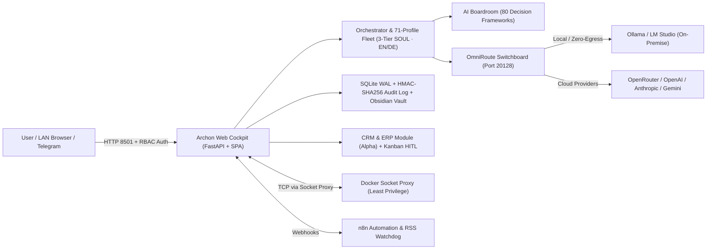

<div align="center">


# ARCHON OS - ОПЕРАЦИОННАЯ СИСТЕМА АГЕНТИЧЕСКОГО ТИПА

**Самостоятельная МногоАгентная Операционная Система для Фондеров, Команд и Специалистов по Доменам**

[](../../LICENSE)
[](../../CHANGELOG.md)
[-емerald.svg)](../../agent_profiles.json)
[](../../prompt_studio_catalog.json)
[](../../Dockerfile)
[](../../SECURITY.md)

[🇬🇧 English](../../README.md) · [🇩🇪 Deutsch](../../README.de.md) · [🇪🇸 Español](../../README.es.md) · [🇫🇷 Français](../../README.fr.md) · [🇮🇹 Italiano](../../README.it.md) · [🇯🇵 日本語](../../README.ja.md) · [🇰🇷 한국어](../../README.ko.md) · [🇳🇱 Nederlands](../../README.nl.md) · [🇵🇹 Português](../../README.pt.md) · **🇷🇺 Русский** · [🇨🇳 中文](../../README.zh.md)

[🌐 Живая Страница Входа](https://michaelbeatman.github.io/ARCHON-OS/) | [🤖 Протокол Установки Агента AI](../../INSTALL_AGENT.md) | [⚡ Демоверсия Нулевой Ключ](#option-c-instant-zero-key-read-only-demo-archon_demo_modetrue) | [📘 Руководства & PDF](#documentation--manuals-pdf) | [🗺️ Маршрут (M0–M113)](../system/ROADMAP_2026.md)

</div>

---

## Что такое Archon OS?

Archon OS — это самохостируемое мультиагентное рабочее пространство, построенное на базе [Hermes Agent](https://github.com/NousResearch/hermes-agent) (Nous Research). Оно работает на вашем собственном сервере и координирует **71 профиль агента** (системные/мета-агенты и профильные специалисты в `agent_profiles.json`) в 8 областях — налоги, право, закупки, продажи, программное обеспечение, недвижимость, медицина, стратегия. Каждый профиль имеет 3-уровневый промпт `SOUL.md` (Compact / Pro / Full), поэтому агенты расходуют токены только тогда, когда их область действительно востребована.

Что это означает на практике:

- **Структурированные решения, а не разовые ответы.** AI Boardroom проводит изолированные многосторонние дискуссии с промптом критического анализа и синтезом по 80 фреймворкам (OKR, Pre-Mortem, Six Thinking Hats, …).
- **Контроль расходов по моделям и задачам.** OmniRoute направляет каждый запрос локальным (Ollama, LM Studio) или облачным провайдерам и рассчитывает стоимость перед отправкой (`cost_estimator.py` проверяет бюджеты).
- **Суверенитет данных.** Маршрутизация Zero-Egress оставляет работу с финансами, контрактами и CRM на локальных моделях; рабочие контейнеры запускаются в сети Docker `internal: true` без доступа к интернету.
- **Защищенный от несанкционированного вмешательства аудиторский след.** Аудиторский журнал с цепочкой хешей HMAC-SHA256 (внешняя привязка + проверка ключа при запуске) записывает каждую отправку, включая провайдера, модель и хост.
- **Ваши документы.** Хранилище Obsidian плюс RAG на базе AnythingLLM/Chroma индексирует вашу библиотеку локально.
- **Бизнес-операции.** Kanban с контролем «четырех глаз», сортировка электронной почты, CRM и пакет ERP (предложения, контракты, счета, дебиторская задолженность) — **альфа-версия**.

**Версия до 1.0, и мы сразу об этом предупреждаем:** интерфейсы и ключи конфигурации меняются между релизами, модуль ERP/CRM находится в стадии альфа-тестирования, а принудительное разграничение ролей для нескольких пользователей все еще дорабатывается. Если вас это устраивает, мы приветствуем сообщения об ошибках и PR.

### Текущее состояние выпуска (`v0.6.0`, 2026-11-24)

Авторитетное состояние выпуска - [CHANGELOG.md](../../CHANGELOG.md). Основные добавления с `v0.5.6.0`:

- **M110 Execution Hardening:** эффект-леджер с `UNKNOWN` + обязательная проверка, leases/heartbeats рабочего процесса с проверкой живости, предвыполнение DAG-валидатора и ограничение `replan_count`.
- **24/7 Liveness & UI Performance:** реальный асинхронный событийный цикл heartbeat в `/livez` (возвращает `503` при остановке) и связанный с Docker healthcheck, внешний dead-man-switch вебхук (`ARCHON_HEARTBEAT_WEBHOOK_URL`), и 180 ms задержка поиска + 60-итемный батч-рендеринг в Prompt Studio.
- **Управление:** один центральный PolicyEngine и атомарный BudgetBank (`reserve → settle/release`); подписанные гарантии теперь обязательны для привилегированных инструментов, таких как `pay` / `mcp__*`.
- **Надежность:** ключи idempotency и буфер с retry/DLQ для событий, вебхуков и планировщика; журнал аудита теперь использует HMAC с ключом окружения и не блокирующий фоновой якорь.
- **Наблюдаемость & инструментарий:** OTel-трейсы в ядре LLM и DAG, фикстуры replay для отладки, Python 3.13, разделенные требования для тестирования.
- **Рабочее место:** 4-этапный визард настройки v2, календарь операций и 11 навык LinkedIn.

> **Параметры конфигурации & безопасность (аудит 23.11.2026):** доставляемый `settings.json` имеет **никакого блока `auth` вообще**. Система поэтому работает в намеренном **локальном режиме для одного пользователя** (fallback администратор, без входа) при привязке к `127.0.0.1`. **Этот режим предназначен только для локального десктопного использования**. Непересыльные привязки уже заставляют аутентификацию через `_must_force_auth()`, но вам нужно добавить `"auth": {"enabled": true}` перед любым LAN или производственным использованием. Флаги выхода также отключены по умолчанию (`privacy.zero_egress = false`, `zero_egress_strict = false`; только `hard_block_on_local_offline = true`). `config/version.json` отображает **v0.6.0**; PDF-руководство все еще целится на v0.5.2.1 — *PDF основано на v0.5.2.1, см. [CHANGELOG.md](../../CHANGELOG.md) для v0.6.0*.

> **Счетчики измерены в этом чекайте:** 71 записей в `agent_profiles.json`, 71 ролей в `roles.json`, 71 синхронизированных профилей в `.hermes/profiles/`, 312 портретных ресурсов в `static/avatars/`, 832 шаблоны запросов и 11 языков UI. PDF-руководства были сгенерированы для `v0.5.2.1` и не были еще регенерированы для `v0.6.0` — см. [CHANGELOG.md](../../CHANGELOG.md) для v0.6.0.

### Обзор продукта

| Prompt Studio (открыто в чате) | 71-Profile Agent Fleet (3-уровневый SOUL) |
|---|---|
|  |  |
| **Иерархия организации и команды** | **Дебаты в AI Boardroom (80 фреймворков)** |
|  |  |

[](https://star-history.com/#michaelbeatman/ARCHON-OS&Date)

---

## Документация и руководства (PDF)

| Документ | Английский (EN) | Немецкий (DE) | Область применения |
|---|---|---|---|
| **Руководство пользователя и компании** | [**ARCHON_OS_SYSTEM_MANUAL_2026_EN.pdf**](../system/ARCHON_OS_SYSTEM_MANUAL_2026_EN.pdf) *(97 стр., 1.9 МБ)* | [ARCHON_OS_SYSTEM_HANDBUCH_2026.pdf](../system/ARCHON_OS_SYSTEM_HANDBUCH_2026.pdf) *(97 стр., 1.9 МБ)* | Установка, главы 1–19, 5 вариантов использования, обзор шифрования/GDPR и глоссарий от А до Я |
| **Полный список функций (PDF: v0.5.2.1 — см. CHANGELOG для v0.6.0)** | [**ARCHON_OS_FEATURE_LIST_2026_EN.pdf**](../system/ARCHON_OS_FEATURE_LIST_2026_EN.pdf) | [ARCHON_OS_FEATURELISTE_2026.pdf](../system/ARCHON_OS_FEATURELISTE_2026.pdf) | Полный каталог модулей, двуязычное глобальное издание, режим живой демонстрации, мастер первого запуска, FinOps и безопасность |
| **Бортовая комната AI: 80 фреймворков** | [**ARCHON_OS_BOARDROOM_FRAMEWORKS_2026_RU.pdf**](../system/ARCHON_OS_BOARDROOM_FRAMEWORKS_2026_RU.pdf) | [ARCHON_OS_BOARDROOM_FRAMEWORKS_2026.pdf](../system/ARCHON_OS_BOARDROOM_FRAMEWORKS_2026.pdf) | Все 80 структурированные методологии Decision Engine (EN & DE) и индекс |

*Более технические и безопасные руководства:* [Системная архитектура и аудит](../system/SYSTEM_ARCHITEKTUR_UND_AUDIT_2026.md) · [Маршрут (M0–M113)](../system/ROADMAP_2026.md) · [Европейское законодательство о ИИ, GoBD PDF и руководство по мульти-тенинту (M43/M49)](../system/EU_AI_ACT_GOBD_COMPLIANCE_GUIDE.md) · [Руководство по функциям предприятия и игрокам](../system/ENTERPRISE_FEATURES_2026_GUIDE.md) · [Гuide к серверу MCP (`/mcp`)](../system/ARCHON_MCP_SERVER_GUIDE.md) · [Руководство по режиму живой демонстрации](../system/LIVE_DEMO_MODE_GUIDE.md) · [Руководство по первому запуску визарда](../system/FIRST_RUN_SETUP_WIZARD_GUIDE.md) · [Руководство по экосистеме и миграции](../system/ECOSYSTEM_AND_MIGRATION_GUIDE.md) · [Безопасность](../../SECURITY.md) · [Журнал изменений](../../CHANGELOG.md)

---

## Одиночный чат против Супер-агента против Архон OS

| Возможность | Классический чат AI | Одиночный "Супер-агент" | **Архон агентный OS** |
|---|---|---|---|
| **Ростер агентов** | 1 генеральный ассистент | 1 генералист с инструментальными плагинами | **71 уникальный профиль** (`agent_profiles.json`) с **3-уровневым `SOUL.md`** (`Compact` / `Pro` / `Full`) |
| **Стратегические решения** | Один ответ | Итеративный инструментальный цикл | **Бортовая комната AI**: изолированный многоперспективный дебат, критик и синтез по **80 фреймворкам** |
| **Долгосрочная память** | Плоская история чата | Векторные снippets | **Vault Obsidian синхронизация**, пер-агент HR-карты (`Personalakten/`), WAL SQLite DBs & LRU-K paging |
| **Приватность и выезд** | Все данные в облаке API | API-ключи в runtime env | **Zero-Egress Gate & Privacy-Router Hard-Block** (fail-closed для финансов/контрактов/CRM при отключенном локальном LLM) + **`internal: true` Worker Network (без интернет-рout)** + **Dual-LLM Guard** |
| **Управление и ответственность** | Без вывода | Непроверенные инструментальные вызовы | **Мотор-ИИ-Act Engine (статья 4 / Приложение III)**, **1-нажмите GoBD процедурный PDF**, **HITL Gates** & **HMAC-SHA256 Audit Chain (Env-Key; включая перезвон LLM-Dispatch провайдера/модель/хост-удостоверение)** |
| **Бизнес-операции** | Ничего | Внешние интеграции SaaS | **Многотеневый SQLite изоляция (Holding/GmbH/SPV)**, **Kanban (4-глаза)**, **Email Triage**, **CRM** & **ERP *(Alpha)*** |

---

## Предварительный просмотр системы

| Mission Control и операции | Флот 71-Profile и 3-уровневая SOUL |
|---|---|
|  |  |
| **AI Boardroom (мультиагентные дебаты)** | **Оргструктура и команды** |
|  |  |

---

## Основные компоненты (необходимая экосистема)

Archon OS построена на четырех ключевых компонентах, работающих совместно. Оба варианта, **Option A** и **Option B** ниже, выполняют настройку за вас (стандартный профиль по умолчанию):

| Компонент | Роль в Archon OS | Способ установки |
|---|---|---|
| **1. Docker** *(Desktop / Engine v2)* | Запускает Archon OS, Hermes Agent, AnythingLLM, Chroma и Socket Proxy в изолированных контейнерах | **Автоматически предлагается** через `winget` (Windows), `brew` (macOS) или `get.docker.com` (Linux) |
| **2. Hermes Agent** *(`nousresearch/hermes-agent`)* | Основная среда выполнения мультиагентной системы, шлюз сессий (порт `8644`) и интерфейс Telegram | **Автоматически загружается и запускается** через Docker Compose вместе с Archon OS |
| **3. AnythingLLM + Chroma** *(Вектор RAG)* | Питает **Центральную библиотеку → RAG** (`http://localhost:3001`) с семантическим индексированием | **Автоматически запущен и запущен** в стандартной стопке `Standard` |
| **4. Obsidian** *(Десктопное приложение + Монтированный хранилище)* | Persistent Markdown Вторая голова (`/opt/data/obsidian`) хранит отчеты, файлы HR и графики | Фolders хранилища автоматически инициализируются в `./obsidian_vault`; **Obsidian Desktop** установка автоматически предлагается (`winget` / `brew` / Flatpak) |

---

## Установка Archon OS (2 пути)

### Вариант A: Установка с вашим агентом AI (1 запрос — Рекомендуется для разработчиков)

Откройте это репозиторий в **Antigravity**, **Claude Code**, **OpenAI Codex**, **Cursor**, или **Windsurf** и вставьте этот запрос:

```text
Read INSTALL_AGENT.md and set up Archon OS on my machine. Run the pre-flight check first and ask me the 6 discovery questions before installing.
```

Ваш агент AI проверит Docker, RAM и локальные LLM, спросит, где установить, какой язык/уровень стопки вы хотите, API-ключи вашего провайдера или настройку Ollama/LM Studio, доступ в сеть и проверит `/health` автоматически.

---

### Вариант B: Интерактивный установщик с одним кликом (Zero-CLI дружественный)

Оба установщика автоматически проверят/предложат **Docker** и **Obsidian Desktop**, инициализируйте папки хранилища, загрузите **Nous Research Hermes Agent**, соберите Archon OS и синхронизируйте все 71 профилей `SOUL.md`.

#### Windows (Двукратный клик Setup)
1. Клонировать или скачать & извлечь это репозиторий.
2. Дважды щелкните **`setup.bat`** (или нажмите правой кнопкой мыши на `setup.ps1` → *Выполнить с помощью PowerShell*).
3. Ответьте на вопросы мастера настройки (или нажмите `Enter` для выбора значений по умолчанию):
- Автоматическая установка недостающих **Docker Desktop** или **Obsidian Desktop** (через `winget`, если требуется)
- Папка Obsidian Vault (по умолчанию `./obsidian_vault`)
- Язык (`en` / `de`) и размер стека (`Standard` [по умолчанию]: Archon + Hermes Agent + AnythingLLM/Chroma RAG + Socket Proxy; `Full Automation`: + n8n + Ollama-Embed; `Minimal Core`)
- API-ключ (рекомендуется OpenRouter, используется совместно Archon и Hermes — или оставьте пустым для Ollama / LM Studio)
- Сетевая доступность (по умолчанию `127.0.0.1` localhost или `0.0.0.0` для LAN)
4. Ваш браузер автоматически откроется на странице `http://localhost:8501`. Затем откройте `./obsidian_vault` в Obsidian Desktop (*"Open folder as vault"*).

*(Для последующего ежедневного использования: дважды щелкните `start.bat` для запуска или `stop.bat` для корректного завершения работы.)*

#### Linux и macOS (Intel и Apple Silicon ARM64)
```bash
git clone https://github.com/michaelbeatman/ARCHON-OS.git
cd ARCHON-OS
chmod +x install.sh
./install.sh
```
*(Используйте `./install.sh --yes` для неинтерактивной установки; на первой визите в браузере **4-этапный веб-установщик** руководит вам через профиль компании, проверку живого провайдера, каналы и активацию домена.)*

### Вариант C: Инстат Zero-Key Read-Only Демоверсия (`ARCHON_DEMO_MODE=true`)

Хотите исследовать полный Кокпит, **4-фазный дебат AI Boardroom Mittelstand Muster GmbH** (+ необязательный MoA), карточки Kanban и 71 профиля **за 30 секунд без единого API-ключа или LLM-стоимости** (либо организуйте безопасную общественную демонстрацию на €5 VPS)?

```bash
ARCHON_DEMO_MODE=true docker compose -f docker-compose.demo.yml up --build -d
# Open http://localhost:8501 — read-only ASGI guard, zero token egress!
```

---

## Архитектура системы



### Четыре столпа навигации
1. **Команда и операции:** Центр операций, Мастер чат, Тriage Inbox (Вебhooks, Email, Messenger, Approvals), **флот агентов 71 профиля** (включая экран бота PbD и 3-уровневый SOUL), **студия prompt 832-шаблон**, Sandbox Showroom.
2. **Знание и когнитив:** Интернет-наблюдатель (RSS/Web Radar), Лаборатория исследований (многосource-триангуляция и досье), Центральная библиотека (Vault Obsidian + RAG AnythingLLM), AI Boardroom (4-фазный дебат + необязательный MoA по 80-ти фреймворкам).
3. **Экономика и ERP *(Alpha)*:** CRM (адреса, контакты, трубка), пакет ERP (предложения, контракты, счета, требований/дunning, приходы), OmniRoute токен FinOps с контролем стоимости модели.
4. **Инфраструктура и управление:** Орг-диagram и команды, Guardian (Concurrency, Sessions, Rate Limits), Центр управления системой (Первый-Рун-Узел, API-ключи, маршрутизация, Kernel Watchdog, обновления), поток журнала аудита с доказательством.

---

## Флот 71 профиля (8 доменов)

| # | Домен | Кол-во | Фокус и ограничения |
|---|---|---|---|
| **1** | **Стратегия, лидерство и жизнь** | 12 | Оркестрация систем, второй пилот CEO, M&A/решения, личная стратегия, OKR, кросс-доменный синтез и финальный контроль качества |
| **2** | **Коммерция, закупки и электронная коммерция** | 7 | Цепочки поставок, прогнозирование запасов, поиск поставщиков, переговоры с вендорами, Shopify |
| **3** | **Право, налоги, финансы и страхование** | 11 | Контракты, GDPR, интеллектуальная собственность, корпоративные/налоговые холдинги, долговое финансирование, страховые выплаты *(Обязательный диалог с предупреждением о правовых/налоговых аспектах)* |
| **4** | **Недвижимость и строительство** | 7 | Оценка DCF, зонирование/разрешения BauGB, ESG/KfW, управление строительством *(Обязательный диалог с предупреждением BauGB/HOAI)* |
| **5** | **Создание контента, медиа и творчество** | 8 | Копирайтинг, сценарии видео, основные доклады, гострайтинг, UI/UX дизайн бренда |
| **6** | **Продажи, CRM, маркетинг и рост** | 11 | B2B-аутрич, ценообразование, SEO/GEO, платная реклама, удержание клиентов, управление партнерами |
| **7** | **Технологии, ПО, данные и контроль качества** | 8 | Fullstack-архитектура, DevOps/CloudSec, настройка БД, автоматизация тестирования |
| **8** | **Медицина, химия, наука и инженерия** | 6 | Клинический консультант, регулирование EU-MDR/MedTech, химия/REACH, фарма/биотех, синтез литературы, промышленная инженерия *(Обязательный диалог с предупреждением EU-MDR/REACH)* |

---

## Уведомление о безопасности, конфиденциальности и нормативных требованиях

1: - **Безопасная сеть по умолчанию:** привязывается к `127.0.0.1:8501` по умолчанию. Включите многопользовательский вход (`auth.enabled = true`) перед открытием `ARCHON_BIND_IP=0.0.0.0` на локальной сети. Локальный fallback для одного пользователя (нет блока `auth` в `settings.json`) - **только для localhost по дизайну** — никогда не используйте его как контроль доступа для общедоступных или производственных хостов.
2: - **Проксирование сокета с нулевым доверием:** маршруты управления контейнерами проходят через `docker-socket-proxy` на изолированной внутренней сети (`archon-admin_net`).
3: - **Защита от внедрения запросов:** дублирование LLM-кафетериализация (`backend/dual_llm_sanitizer.py`) изолирует неуверенные внешние электронные письма/содержимое веб-страниц перед выполнением инструментов.
4: - **Нет профессионального совета:** вывод из юридических, налоговых, финансовых, строительных или медицинских/химических профилей - **только для внутренних решений** и не является лицензированным юридическим, налоговым, инвестиционным, инженерным или медицинским советом ([DISCLAIMER.md](../../DISCLAIMER.md), [LICENSE](../../LICENSE) & [THIRD_PARTY_LICENSES.md](../../THIRD_PARTY_LICENSES.md)).
5: - **Синтетические аватары:** все 312 локальных портретных ресурсов в `static/avatars/` - синтетические портреты AI-генерированные (Gemini Nano Banana 2), представляющие фiktionalные персонажи; см. [THIRD_PARTY_LICENSES.md](../../THIRD_PARTY_LICENSES.md).

---

## Структура проекта & документация

```text
ARCHON-OS/
├── archon/                  # Modular FastAPI routers & core runtime (routers/, core/, services/)
├── backend/                 # Auth/RBAC, audit log, privacy router, CRM/ERP, workflow DAG, ~160 modules
├── static/                  # Border-first SPA UI, 11 locales & interactive liability modals
├── frontend/                # Next.js 16 / React 19 cockpit (/crm, /workflows, /cockpit)
├── .hermes/profiles/        # 71 synced SOUL.md profiles (Hermes runtime)
├── .agents/skills/          # Agent skills (LinkedIn suite, SEO, security, MCP bridges, ...)
├── data/                    # Runtime state: ops.db / business.db / memory.db, tenants, secrets, backups
├── obsidian_vault/          # Markdown Second Brain (HR, projects, radar, content)
├── scripts/                 # Bilingual SOUL & profile.yaml sync (sync_soul_modes.py), backups
├── plugins/                 # cost_guard, security_audit_hook, system_metrics, workflow_nodes
├── deploy/ecosystem/        # Self-hosting manifests & ecosystem integration guides
├── docs/system/             # System Architecture, Roadmap (M0–M113) & PDFs
├── INSTALL_AGENT.md         # Structured onboarding guide for AI Coding Agents
├── setup.bat / setup.ps1    # Interactive 1-Click Installer for Windows
├── install.sh               # Interactive Multi-Arch Installer for Linux & macOS
├── docker-compose.yml       # Full production container stack (non-root, socket-proxy, omniroute)
├── docker-compose.demo.yml  # Zero-key read-only showcase container (ARCHON_DEMO_MODE=true)
├── LICENSE                  # MIT License (SPDX: MIT)
├── SECURITY.md              # Zero-Trust Security Architecture & Vulnerability Policy
└── DISCLAIMER.md            # Regulatory & Professional Liability Notice
```

7: - **Руководство пользователя & компания (EN, PDF):** [docs/system/ARCHON_OS_SYSTEM_MANUAL_2026_EN.pdf](../system/ARCHON_OS_SYSTEM_MANUAL_2026_EN.pdf) *(немецкий: [DE PDF](../system/ARCHON_OS_SYSTEM_HANDBUCH_2026.pdf))*
8: - **Полный список функций & каталог системы (PDF: v0.5.2.1 — см. CHANGELOG для v0.6.0, EN):** [docs/system/ARCHON_OS_FEATURE_LIST_2026_EN.pdf](../system/ARCHON_OS_FEATURE_LIST_2026_EN.pdf)
9: - **Движок принятия решений & 80 рамок для совета (EN, PDF):** [docs/system/ARCHON_OS_BOARDROOM_FRAMEWORKS_2026_EN.pdf](../system/ARCHON_OS_BOARDROOM_FRAMEWORKS_2026_EN.pdf)
10: - **Подробный план развития (M0–M113):** [docs/system/ROADMAP_2026.md](../system/ROADMAP_2026.md)
- **Руководство по режиму демонстрации в реальном времени (`ARCHON_DEMO_MODE`):** [docs/system/LIVE_DEMO_MODE_GUIDE.md](../system/LIVE_DEMO_MODE_GUIDE.md)
- **Руководство по мастеру первоначальной настройки:** [docs/system/FIRST_RUN_SETUP_WIZARD_GUIDE.md](../system/FIRST_RUN_SETUP_WIZARD_GUIDE.md)
- **Руководство по экосистеме и миграции:** [docs/system/ECOSYSTEM_AND_MIGRATION_GUIDE.md](../system/ECOSYSTEM_AND_MIGRATION_GUIDE.md)
- **Архитектура системы и аудит:** [docs/system/SYSTEM_ARCHITEKTUR_UND_AUDIT_2026.md](../system/SYSTEM_ARCHITEKTUR_UND_AUDIT_2026.md)
- **Руководство по шлюзу типов MyPy:** [docs/system/MYPY_TYPE_GATE_GUIDE.md](../system/MYPY_TYPE_GATE_GUIDE.md)
- **Руководство по инструментарию статического анализа:** [docs/system/STATIC_ANALYSIS_TOOLCHAIN_GUIDE.md](../system/STATIC_ANALYSIS_TOOLCHAIN_GUIDE.md)
