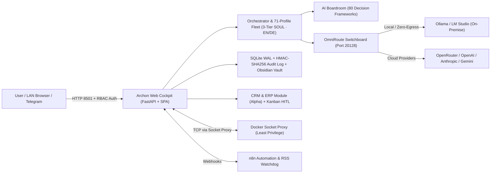

<div align="center">


# ARCHON OS -

**自主式多智能体操作系统 для创始人、团队和领域专家**

[](../../LICENSE)
[](../../CHANGELOG.md)
[-emerald.svg)](../../agent_profiles.json)
[](../../prompt_studio_catalog.json)
[](../../Dockerfile)
[](../../SECURITY.md)

[🇬🇧 English](../../README.md) · [🇩🇪 Deutsch](../../README.de.md) · [🇪🇸 Español](../../README.es.md) · [🇫🇷 Français](../../README.fr.md) · [🇮🇹 Italiano](../../README.it.md) · [🇯🇵 日本語](../../README.ja.md) · [🇰🇷 한국어](../../README.ko.md) · [🇳🇱 Nederlands](../../README.nl.md) · [🇵🇹 Português](../../README.pt.md) · [🇷🇺 Русский](../../README.ru.md) · **🇨🇳 中文**

[🌐 Live Landing Page](https://michaelbeatman.github.io/ARCHON-OS/) | [🤖 AI-Agent-Install-Protocol](https://michaelbeatman.github.io/INSTALL_AGENT.md) | [⚡ Zero-Key-Live-Demo](#option-c-instant-zero-key-read-only-demo-archon_demo_modetrue) | [📘 Manuals-&-PDFs](#documentation--manuals-pdf) | [🗺️ Roadmap-(M0–M113)](https://michaelbeatman.github.io/docs/system/ROADMAP_2026.md)

</div>

---

## 什么是 Archon OS？

Archon OS 是一个基于 [Hermes Agent](https://github.com/NousResearch/hermes-agent) (Nous Research) 构建的自托管多智能体工作空间。它运行在您自己的服务器上，并编排了 **71 个智能体配置文件**（`agent_profiles.json` 中的系统/元数据和领域专家），涵盖税务、法律、采购、销售、软件、房地产、医疗、战略等 8 个领域。每个配置文件都具有 3 层 `SOUL.md` 提示词（精简版/专业版/完整版），因此智能体仅在真正需要其领域知识时才会消耗 Token。

这在实践中的意义：

- **结构化决策，而非一次性回答。** AI Boardroom 通过批判性提示词和跨 80 种框架（OKR、事前验尸、六顶思考帽等）的综合分析，运行隔离的多视角辩论。
- **按模型和任务进行成本控制。** OmniRoute 将每个请求路由至本地（Ollama、LM Studio）或云端提供商，并在分发前核算成本（`cost_estimator.py` 会检查预算）。
- **数据主权。** Zero-Egress 路由将财务、合同和 CRM 工作保留在本地模型上；工作容器运行在 `internal: true` 的 Docker 网络中，且没有互联网路由。
- **防篡改审计追踪。** HMAC-SHA256 哈希链审计日志（外部锚点 + 启动密钥检查）记录了每一次分发，包括提供商、模型和主机。
- **您的文档。** 一个 Obsidian 库加上 AnythingLLM/Chroma RAG 可在本地索引您的资料库。
- **业务运营。** 带有四眼审批机制的 Kanban、电子邮件分类、CRM 以及 ERP 套件（报价、合同、发票、应收账款）—— **alpha 版本**。

**处于 1.0 版本之前，我们在此提前说明：** 接口和配置键在不同版本间会发生变化，ERP/CRM 模块处于 alpha 阶段，多用户角色强制执行功能仍在加固中。如果您能接受这些，欢迎提交 issues 和 PR。

### 当前发布状态 (`v0.6.0`, 2026-11-24)

授权发布状态见 [CHANGELOG.md](../../CHANGELOG.md)。自 `v0.5.6.0` 起的关键添加：

- **M110 执行硬化:** 使用 `UNKNOWN` + 强制 reconciliation，worker leases/heartbeats 与存活检查，pre-execution DAG 验证器和 `replan_count` cap。
- **24/7 存活 & UI性能:** 在 `/livez` 中实现了实时异步事件循环心跳（返回 `503` 时 stall），并将其与 Docker 健康检查集成，外部死人开关 webhook 支持 (`ARCHON_HEARTBEAT_WEBHOOK_URL`），以及 Prompt Studio 中的 180 ms 延迟搜索 + 60 项批量渲染。
- **治理:** 一个中心 PolicyEngine 和一个原子 BudgetBank (`reserve → settle/release`);现在对privileged 工具，如 `pay` / `mcp__*`，需要签名的证书。
- **可靠性:** idempotency 键和一个带重试/DLQ 的事件、 webhook 和调度器的 outbox；现在使用 HMAC 和环境键的 audit 日志，并在后台 anchor 中实现了非阻塞 anchor。
- **可观察性 & 工具:** LLM 内核和 DAG 中的 OTEL 跟踪，trace-to-eval 回放 fixtures，Python 3.13，split 测试要求。
- **工作区:** 4 步 onboarding 综述 v2，操作日历和 11 LinkedIn 技能。

> **配置 & 安全注意 (audit 23.11.2026):** 寄存的 `settings.json` 中 **没有 `auth` 块**。因此，系统将在绑定到 `127.0.0.1` 时运行在意图的 **本地单用户模式** (fallback admin，no login)。**这模式仅供本地桌面使用**。非环回绑已经强制 auth 通过 `_must_force_auth()`，但您必须添加 `"auth": {"enabled": true}` 之前在 LAN 或生产环境中使用。Egress 标志默认关闭 (`privacy.zero_egress = false`，`zero_egress_strict = false`；只有 `hard_block_on_local_offline = true`)。`config/version.json` 报告 **v0.6.0**； PDF 手册仍然目标 v0.5.2.1 — *PDF 仍然基于 v0.5.2.1, 请见 [CHANGELOG.md](../../CHANGELOG.md) 对 v0.6.0*。

> **在本次检出中测量的计数:** 71 项在 `agent_profiles.json` 中，71 个角色在 `roles.json` 中，71 个同步-profiles 在 `.hermes/profiles/` 中，312 个肖像资产在 `static/avatars/` 中，832 个提示模板和 11 个 UI 地区。PDF 手册为 `v0.5.2.1` 生成，并尚未为 `v0.6.0` 重新生成 — 请见 [CHANGELOG.md](../../CHANGELOG.md) 对 v0.6.0。

### 产品导览

| Prompt Studio (在聊天中打开) | 71-Profile Agent Fleet (3层 SOUL) |
|---|---|
|  |  |
| **组织架构与团队** | **AI Boardroom 辩论 (80 个框架)** |
|  |  |

[](https://star-history.com/#michaelbeatman/ARCHON-OS&Date)

---

## 文档与手册 (PDF)

| 文档 | 英语 (EN) | 德语 (DE) | 范围 |
|---|---|---|---|
| **用户与公司手册** | [**ARCHON_OS_SYSTEM_MANUAL_2026_EN.pdf**](../system/ARCHON_OS_SYSTEM_MANUAL_2026_EN.pdf) *(97 页, 1.9 MB)* | [ARCHON_OS_SYSTEM_HANDBUCH_2026.pdf](../system/ARCHON_OS_SYSTEM_HANDBUCH_2026.pdf) *(97 页, 1.9 MB)* | 安装、第 1–19 章、5 个用例、加密/GDPR 概述及 A–Z 术语表 |
| **完整功能列表 (PDF: v0.5.2.1 — 参见 v0.6.0 的 CHANGELOG)** | [**ARCHON_OS_FEATURE_LIST_2026_EN.pdf**](../system/ARCHON_OS_FEATURE_LIST_2026_EN.pdf) | [ARCHON_OS_FEATURELISTE_2026.pdf](../system/ARCHON_OS_FEATURELISTE_2026.pdf) | 完整模块目录、双语全球版、实时演示模式、首次运行向导、FinOps 与安全性 |
| **AI 會議廳：80 Frameworks** | [**ARCHON_OS_BOARDROOM_FRAMEWORKS_2026_EN.pdf**](../system/ARCHON_OS_BOARDROOM_FRAMEWORKS_2026_EN.pdf) | [ARCHON_OS_BOARDROOM_FRAMEWORKS_2026.pdf](../system/ARCHON_OS_BOARDROOM_FRAMEWORKS_2026.pdf) | All 80 structured Decision Engine methodologies (EN & DE) & index |
*[System Manual](../system/ARCHON_OS_SYSTEM_MANUAL_2026_ZH.pdf) · [Complete Feature List](../system/ARCHON_OS_FEATURELISTE_2026_ZH.pdf) · [AI Boardroom: 80 Frameworks](../system/ARCHON_OS_BOARDROOM_FRAMEWORKS_2026_ZH.pdf)*

*更多技术和安全指南：* [系统架构与审核](../system/SYSTEM_ARCHITEKTUR_UND_AUDIT_2026.md) · [路线图（M0–M113）](../system/ROADMAP_2026.md) · [EU AI 法律法规、GoBD PDF & 多租户指南（M43/M49）](../system/EU_AI_ACT_GOBD_COMPLIANCE_GUIDE.md) · [企业功能与playbooks 指南](../system/ENTERPRISE_FEATURES_2026_GUIDE.md) · [MCP 服务器（/mcp）指南](../system/ARCHON_MCP_SERVER_GUIDE.md) · [实时演示模式指南](../system/LIVE_DEMO_MODE_GUIDE.md) · [首次设置向导指南](../system/FIRST_RUN_SETUP_WIZARD_GUIDE.md) · [生态系统与迁移指南](../system/ECOSYSTEM_AND_MIGRATION_GUIDE.md) · [安全政策](../../SECURITY.md) · [变更记录](../../CHANGELOG.md)

---

## 单独对话 vs. 超智能体 vs. Archon OS

| 能力 | Classic AI 对话 | 单独 "超智能体" | **Archon 智能体 OS** |
|---|---|---|---|
| **智能体名册** | 1  generic 助手 | 1 通用智能体与工具插件 | **71 distinct profiles** (`agent_profiles.json`) with **3-tier `SOUL.md`** (`Compact` / `Pro` / `Full`) |
| **战略决策** | 一次回答 | 逐步工具循环 | **AI 會議廳**：隔离多角度辩论、批评提示与合成跨 **80 frameworks** |
| **长期记忆** | 平面对话历史 | 矢量存储片段 | **Obsidian 密钥同步**，每个智能体 HR 分数卡 (`Personalakten/`），WAL SQLite 数据库 & LRU-K 页码 |
| **隐私与出口** | 所有数据至云端 API | 运行时环境中的 API 密钥 | **Zero-Egress Gate 与 Privacy-Router 硬拦截**（当本地 LLM 离线时，针对财务/合同/CRM 采取故障关闭模式）+ **`internal: true` Worker 网络（无互联网路由）** + **双 LLM 防护** |
| **治理与责任** | 盲目输出 | 未经检查的工具调用 | **EU AI Act 引擎（第 4 条 / 附件 III）**、**一键式 GoBD 程序化 PDF**、**HITL 门控**与 **HMAC-SHA256 审计链（环境密钥；包含每次调用的 LLM-Dispatch 提供商/模型/主机证明）** |
| **业务运营** | 无 | 外部 SaaS 集成 | **多租户 SQLite 隔离（控股/GmbH/SPV）**、**Kanban（四眼门控）**、**电子邮件分类**、**CRM** 与 **ERP *(Alpha)*** |

---

## 系统预览

| Mission Control 与运营 | 71-Profile Fleet 与 3-Tier SOUL |
|---|---|
|  |  |
| **AI Boardroom (多智能体辩论)** | **组织架构与团队** |
|  |  |

---

## 核心基础 (必需生态系统)

Archon OS 构建于四个协同工作的核心组件之上。下方的 **Option A** 和 **Option B** 均可为您处理设置（标准默认配置）：

| 组件 | 在 Archon OS 中的角色 | 安装方式 |
|---|---|---|
| **1. Docker** *(Desktop / Engine v2)* | 运行 7 个默认隔离容器（Archon OS、OmniRoute、Hermes Agent、AnythingLLM、Chroma、Socket Proxy 与 Autoheal — 含可选配置最多 24 个） | 通过 `winget` (Windows)、`brew` (macOS) 或 `get.docker.com` (Linux) **自动提供** |
| **2. Hermes Agent** *(`nousresearch/hermes-agent`)* | 核心多智能体运行时、会话网关（端口 `8644`）以及 Telegram 接口 | 由 Docker Compose 在 Archon OS 启动时**自动拉取并运行** |
| **3. AnythingLLM + Chroma** *(Vector RAG)* | 使得 **中央图书馆 → RAG** (`http://localhost:3001`) 具有语义索引 | **自动启动** 在默认的 `Standard` 栈中 |
| **4. Obsidian** *(Desktop App + Mounted Vault)* | 持久 Markdown 第二大脑 (`/opt/data/obsidian`) 存储报告、HR 文件和图表 | 储物柜文件夹在 `./obsidian_vault` 中自动初始化； **Obsidian Desktop** 安装自动提供 (`winget` / `brew` / Flatpak) |

---

## 安装 Archon OS (2 种方式)

### 选项 A: 使用您的 AI 代理 (1 个提示 — 开发者推荐)

在 **Antigravity**、**Claude Code**、**OpenAI Codex**、**Cursor** 或 **Windsurf** 中打开此存储库，并粘贴这个提示：

```text
Read INSTALL_AGENT.md and set up Archon OS on my machine. Run the pre-flight check first and ask me the 6 discovery questions before installing.
```

您的 AI 代理将检查 Docker、RAM 和本地 LLMs，询问您要安装的位置、语言/栈级别、提供商 API 密钥或 Ollama/LM Studio 设置、网络暴露和自动验证 `/health`。

---

### 选项 B: 交互式 1-点击安装程序 (Zero-CLI 友好)

两个安装程序将自动检查/提供 **Docker** 和 **Obsidian Desktop**，初始化您的储物柜文件夹，pull **Nous Research Hermes Agent**，构建 Archon OS，并同步所有 71 个 `SOUL.md` 配置文件。

#### Windows (双击设置)
1. 克隆或下载 & 提取此存储库。
2. 双击 **`setup.bat`** (或右键 `setup.ps1` → *使用 PowerShell 运行*)。
3. 回答引导式提示 (或按 `Enter` 使用默认值):
- 自动安装缺失的 **Docker Desktop** 或 **Obsidian Desktop** (通过 `winget` 如果所需)
- Obsidian Vault 文件夹 (`./obsidian_vault` 默认)
- 语言 (`en` / `de`) & 栈大小 (`标准` [默认]: Archon + Hermes Agent + AnythingLLM/Chroma RAG + Socket 代理; `全自动化`: + n8n + Ollama-Embed; `最小核心`)
- API 密钥 (OpenRouter 建议，共享与 Archon & Hermes — 或留空为 Ollama / LM Studio)
- 网络可见性 (`127.0.0.1` 本地主机默认 vs. `0.0.0.0` 局域网)
4. 浏览器将自动打开在 `http://localhost:8501`。然后，在 Obsidian Desktop 中打开 `./obsidian_vault` (*"以文件夹形式打开"*）。

*(日常使用后：双击 `start.bat` 启动或 `stop.bat` 优雅关闭。)*

#### Linux & macOS (Intel & Apple Silicon ARM64)
```bash
git clone https://github.com/michaelbeatman/ARCHON-OS.git
cd ARCHON-OS
chmod +x install.sh
./install.sh
```
*(使用 `./install.sh --yes` 进行非交互式设置;首次浏览器访问时,**4步Web设置向导**将指导您通过公司概况、实时提供商检查、渠道和域名激活。)*

### 选项 C: 即时零密钥只读演示 (`ARCHON_DEMO_MODE=true`)

想要在 30 秒内探索完整的驾驶舱、**Mittelstand Muster GmbH** 4 期 AI 议会辩论 (+ 可选 MoA) 和 71 个-profile Kanban 卡片（或在 €5 VPS 上主持安全公共展示）？

```bash
ARCHON_DEMO_MODE=true docker compose -f docker-compose.demo.yml up --build -d
# Open http://localhost:8501 — read-only ASGI guard, zero token egress!
```

---

## 系统架构



### 四个导航柱
1. **指挥与操作:** 操作指挥中心、主聊天、过滤收件箱（ webhook、电子邮件、Messenger、批准）、**71-Profile 代理舰队**（包括 Bot 屏幕 PbD 和 3 层 SOUL）、**832-模板提示工作室**、展示沙箱。
2. **认知与知识:** 互联网监控（RSS/Web 检测）、研究实验室（多源三角化与 dossier）、中央图书馆（Obsidian 储库 + AnythingLLM RAG）、AI 议会（4 期辩论 + 可选 MoA Across 80 框架）。
3. **经济与 ERP（Alpha）:** 客户关系管理（地址、联系人、流水线）、ERP 套件（offer、合同、发票、应收/催收、收据）、OmniRoute 令牌 FinOps 与每个模型成本控制。
4. **基础设施与治理:** 组织结构 & 团队、守护者（并发、会话、速率限制）、系统控制中心（首次运行向导、API 密钥、路由、内核监控、更新）、证据 Audit 日志流。

---

## 71-Profile 舰队（8 个领域）

| # | 领域 | 数量 | 重点与护栏 |
|---|---|---|---|
| **1** | **战略、领导力与生活** | 12 | 系统编排、CEO 副驾驶、并购/决策、个人战略、OKR、跨领域综合与最终质量保证 |
| **2** | **商业、采购与电子商务** | 7 | 供应链、库存预测、寻源、供应商谈判、Shopify |
| **3** | **法律、税务、金融与保险** | 11 | 合同、GDPR、知识产权、公司/税务控股、债务融资、保险索赔 *(强制性法律/税务警告对话框)* |
| **4** | **房地产与建筑** | 7 | 现金流折现 (DCF) 估值、分区/BauGB 许可、ESG/KfW、施工管理 *(强制性 BauGB/HOAI 警告对话框)* |
| **5** | **创作、媒体与内容** | 8 | 文案写作、视频脚本、主题演讲、代笔、UI/UX 品牌设计 |
| **6** | **销售、CRM、营销与增长** | 11 | B2B 外联、定价、SEO/GEO、付费广告、留存、合作伙伴管理 |
| **7** | **技术、软件、数据与质量保证** | 8 | 全栈架构、DevOps/云安全、数据库调优、测试自动化 |
| **8** | **医学、化学、科学与工程** | 6 | 临床顾问、EU-MDR/医疗技术监管、化学/REACH、制药/生物技术、文献综合、工业工程 *(强制性 EU-MDR/REACH 警告对话框)* |

---

## 安全、隐私与监管声明

- **安全网络默认:** 绑定到 `127.0.0.1:8501` 默认情况下。启用多用户登录 (`auth.enabled = true`) 前在 LAN 上暴露 `ARCHON_BIND_IP=0.0.0.0`。本地单用户回退（`settings.json` 中无 `auth` 块）是 **localhost-only 设计** — 永不将其视为共享或生产主机的访问控制。
- **零信任套接字代理:** 容器管理路由通过 `docker-socket-proxy` 在隔离的内部网络 (`archon-admin_net`) 中。
- **提示注入防御:** 双LLM隔离 (`backend/dual_llm_sanitizer.py`) 在执行工具前对不受信任的外部邮件/网络内容进行 sanitization。
- **不提供专业建议:** 来自法律、税务、金融、建筑或医疗/化学专家档案的输出是 **仅供内部决策支持**，且不构成授予法律、税务、投资、工程或医疗建议 ([DISCLAIMER.md](../../DISCLAIMER.md)、[LICENSE](../../LICENSE)&[THIRD_PARTY_LICENSES.md](../../THIRD_PARTY_LICENSES.md))。
- **合成头像:** `static/avatars/` 中的所有 312 个本地肖像资产都是 Gemini Nano Banana 2 生成的合成 AI肖像，代表虚构人物；见 [THIRD_PARTY_LICENSES.md](../../THIRD_PARTY_LICENSES.md)。

---

## 项目结构 & 文档

```text
ARCHON-OS/
├── archon/                  # Modular FastAPI routers & core runtime (routers/, core/, services/)
├── backend/                 # Auth/RBAC, audit log, privacy router, CRM/ERP, workflow DAG, ~160 modules
├── static/                  # Border-first SPA UI, 11 locales & interactive liability modals
├── frontend/                # Next.js 16 / React 19 cockpit (/crm, /workflows, /cockpit)
├── .hermes/profiles/        # 71 synced SOUL.md profiles (Hermes runtime)
├── .agents/skills/          # Agent skills (LinkedIn suite, SEO, security, MCP bridges, ...)
├── data/                    # Runtime state: ops.db / business.db / memory.db, tenants, secrets, backups
├── obsidian_vault/          # Markdown Second Brain (HR, projects, radar, content)
├── scripts/                 # Bilingual SOUL & profile.yaml sync (sync_soul_modes.py), backups
├── plugins/                 # cost_guard, security_audit_hook, system_metrics, workflow_nodes
├── deploy/ecosystem/        # Self-hosting manifests & ecosystem integration guides
├── docs/system/             # System Architecture, Roadmap (M0–M113) & PDFs
├── INSTALL_AGENT.md         # Structured onboarding guide for AI Coding Agents
├── setup.bat / setup.ps1    # Interactive 1-Click Installer for Windows
├── install.sh               # Interactive Multi-Arch Installer for Linux & macOS
├── docker-compose.yml       # Full production container stack (non-root, socket-proxy, omniroute)
├── docker-compose.demo.yml  # Zero-key read-only showcase container (ARCHON_DEMO_MODE=true)
├── LICENSE                  # MIT License (SPDX: MIT)
├── SECURITY.md              # Zero-Trust Security Architecture & Vulnerability Policy
└── DISCLAIMER.md            # Regulatory & Professional Liability Notice
```

- **用户 & 公司手册（EN，PDF）：** [docs/system/ARCHON_OS_SYSTEM_MANUAL_2026_EN.pdf](../system/ARCHON_OS_SYSTEM_MANUAL_2026_EN.pdf) *(德语：[DE PDF](../system/ARCHON_OS_SYSTEM_HANDBUCH_2026.pdf))*
- **完整功能列表 & 系统目录（PDF：v0.5.2.1 — 参见 CHANGELOG 对 v0.6.0, EN）：** [docs/system/ARCHON_OS_FEATURE_LIST_2026_EN.pdf](../system/ARCHON_OS_FEATURE_LIST_2026_EN.pdf)
- **决策引擎 & 80 Boardroom Frameworks（EN，PDF）：** [docs/system/ARCHON_OS_BOARDROOM_FRAMEWORKS_2026_EN.pdf](../system/ARCHON_OS_BOARDROOM_FRAMEWORKS_2026_EN.pdf)
- **详细路线图（M0–M113）：** [docs/system/ROADMAP_2026.md](../system/ROADMAP_2026.md)
- **实时演示模式指南 (`ARCHON_DEMO_MODE`):** [docs/system/LIVE_DEMO_MODE_GUIDE.md](../system/LIVE_DEMO_MODE_GUIDE.md)
- **首次运行设置向导指南:** [docs/system/FIRST_RUN_SETUP_WIZARD_GUIDE.md](../system/FIRST_RUN_SETUP_WIZARD_GUIDE.md)
- **生态系统与迁移指南:** [docs/system/ECOSYSTEM_AND_MIGRATION_GUIDE.md](../system/ECOSYSTEM_AND_MIGRATION_GUIDE.md)
- **系统架构与审计:** [docs/system/SYSTEM_ARCHITEKTUR_UND_AUDIT_2026.md](../system/SYSTEM_ARCHITEKTUR_UND_AUDIT_2026.md)
- **MyPy 类型门控指南:** [docs/system/MYPY_TYPE_GATE_GUIDE.md](../system/MYPY_TYPE_GATE_GUIDE.md)
- **静态分析工具链指南:** [docs/system/STATIC_ANALYSIS_TOOLCHAIN_GUIDE.md](../system/STATIC_ANALYSIS_TOOLCHAIN_GUIDE.md)
