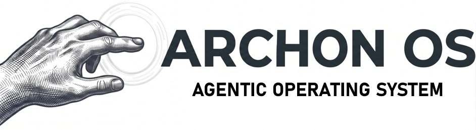
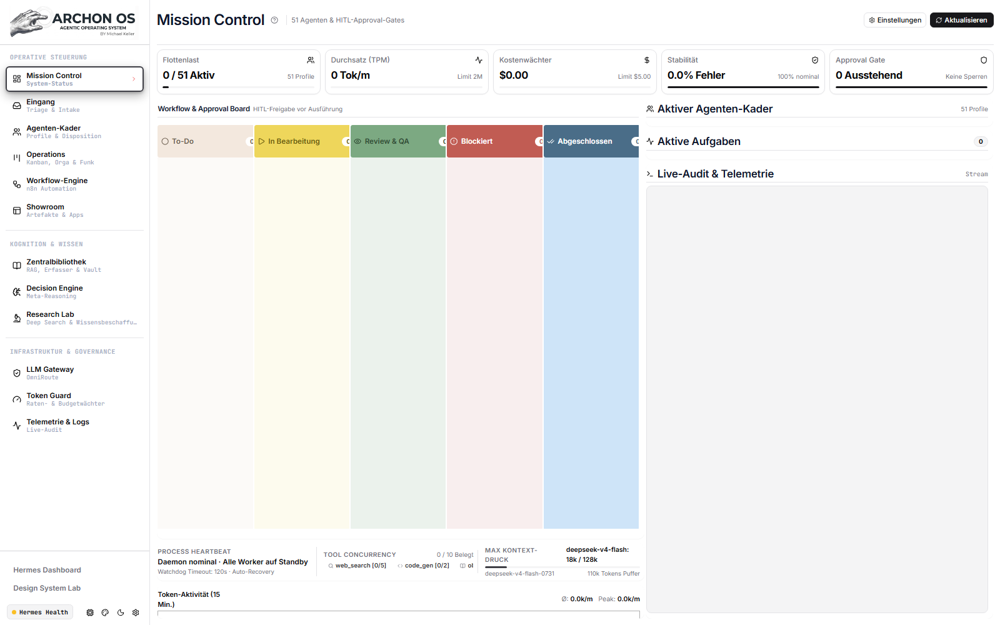
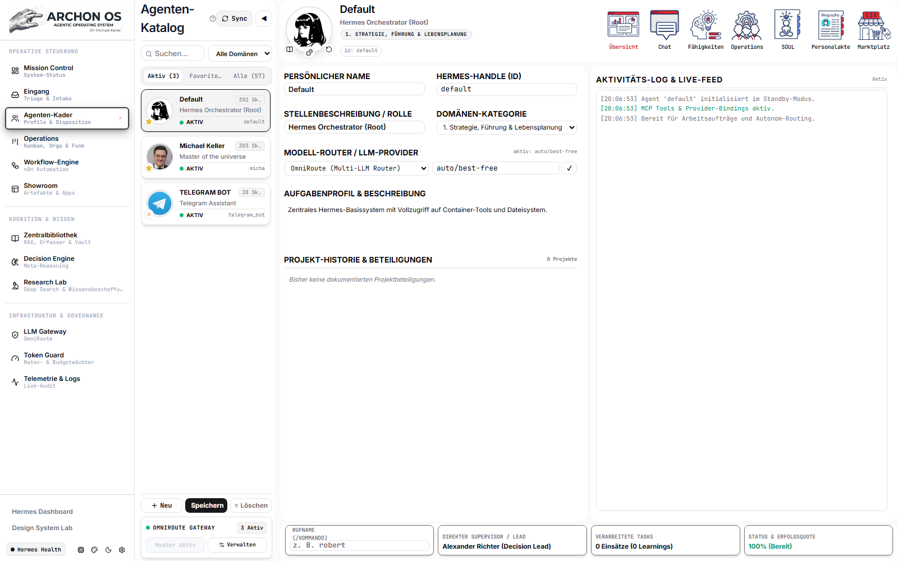
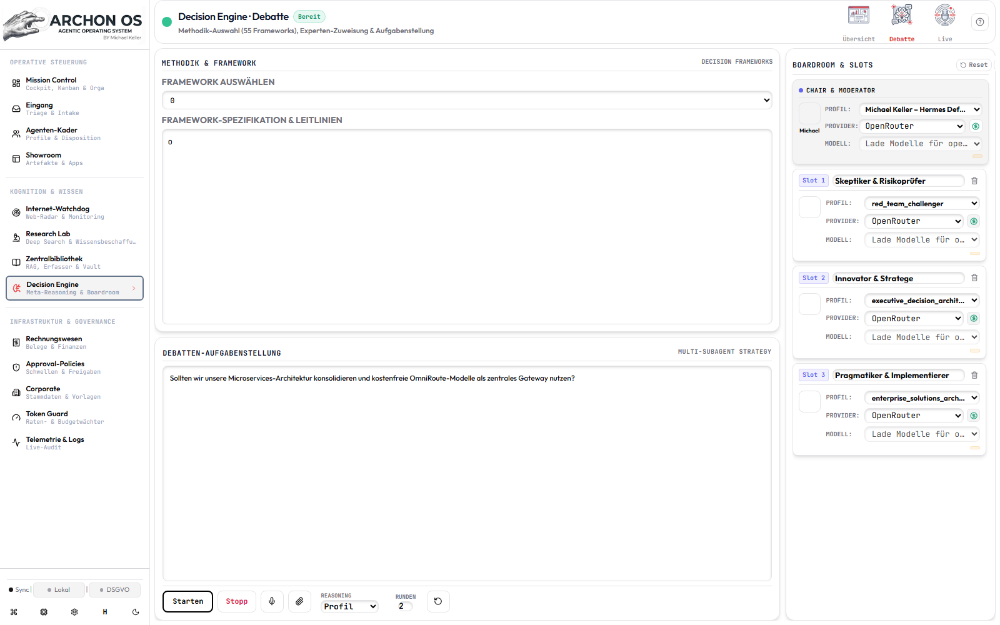
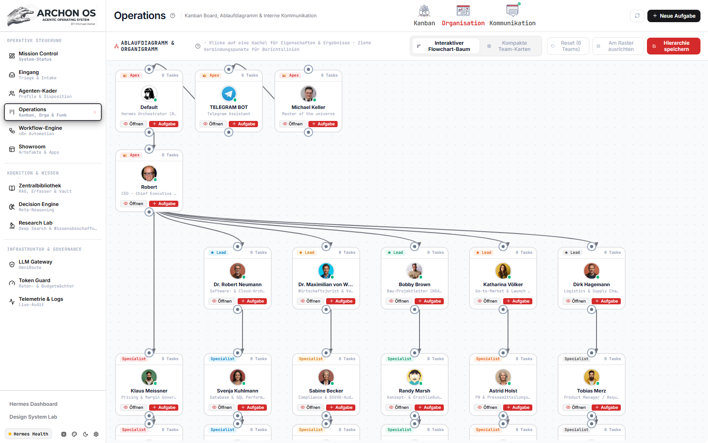

<div align="center">



# ARCHON AGENTIC OS (2026)

**面向创始人、团队与专业领域专家的自托管多智能体操作系统**

[](../../LICENSE)
[](../../agent_profiles.json)
[](../../requirements.txt)
[](../../docker-compose.yml)

[🇬🇧 English](../../README.md) · [🇩🇪 Deutsch](../../README.de.md) · [🇪🇸 Español](README.es.md) · [🇫🇷 Français](README.fr.md) · [🇵🇹 Português](README.pt.md) · [🇷🇺 Русский](README.ru.md) · [🇯🇵 日本語](README.ja.md) · [🇰🇷 한국어](README.ko.md) · **🇨🇳 中文** · [🇮🇹 Italiano](README.it.md) · [🇳🇱 Nederlands](README.nl.md)

[🤖 AI 智能体安装协议](../../INSTALL_AGENT.md) | [🗺️ 路线图 (Roadmap)](../system/ROADMAP_2026.md)

</div>

---

Archon OS 用持久化的自托管 **智能体操作系统（Agentic OS）** 取代孤立的对话机器人。它统一调度 **8 大核心领域的 70 位领域专家**，基于 **55 套决策框架** 开展 **AI 董事会（Boardroom）多视角辩论**，并将 **Zero-Egress 本地隐私路由**、可防篡改的 **SHA-256 审计日志（GoBD / ISO 27001）** 与 **Obsidian 第二大脑**、**n8n**、**Telegram** 以及内置的 **CRM 与 ERP *(Alpha)*** 模块深度打通。

> **本地化进度：** 界面支持 11 种语言（`en`, `de`, `es`, `fr`, `pt`, `it`, `nl`, `ru`, `ja`, `ko`, `zh`）。专家 `SOUL.md` 与董事会方法论目前为德语原版，多语言本地化正在持续推进中（[Roadmap M31](../system/ROADMAP_2026.md)）。

---

## 核心基础四大组件（缺一不可）

| 组件 | 在 Archon OS 中的作用 | 安装方式 |
|---|---|---|
| **1. Docker** *(Desktop / Engine v2)* | 在隔离容器中运行 Archon OS、Hermes Agent、AnythingLLM、Chroma 与 Socket Proxy | 自动检测并引导通过 `winget`（Windows）、`brew`（macOS）或 `get.docker.com`（Linux）安装 |
| **2. Hermes Agent** *(`nousresearch/hermes-agent`)* | 自主智能体运行时、会话网关（端口 `8644`）与 Telegram 桥接服务 | 由 Docker Compose 与 Archon OS 一并自动拉取并启动 |
| **3. AnythingLLM + Chroma** *(向量 RAG)* | 驱动 **中心图书馆 → RAG**（`http://localhost:3001`）实现语义检索与向量知识库 | 在默认 `Standard` 栈中自动拉取并启动 |
| **4. Obsidian** *(桌面客户端 + Vault 库)* | 持久化 Markdown 第二大脑（`/opt/data/obsidian`），承载报告、档案与知识图谱 | 自动初始化 `./obsidian_vault` 目录结构，并自动提示安装 **Obsidian Desktop** |

---

## 安装方式（两种途径）

### 方式 A：交给你的 AI 编程助手一键部署（1 条指令）
在 **Antigravity**、**Claude Code**、**OpenAI Codex**、**Cursor** 或 **Windsurf** 中打开本仓库并输入：
```text
Read INSTALL_AGENT.md and set up Archon OS on my machine. Run the pre-flight check first and ask me the 6 discovery questions before installing.
```

### 方式 B：交互式一键安装向导
- **Windows：** 双击 **`setup.bat`**（调用 [setup.ps1](../../setup.ps1) 自动检测 Docker、Obsidian、Ollama，并引导配置路径、语言、API 密钥与网络监听）。日常启停使用 `start.bat` / `stop.bat`。
- **Linux 与 macOS：**
  ```bash
  git clone https://github.com/michaelbeatman/Archon-Os.git
  cd Archon-Os
  chmod +x install.sh && ./install.sh
  ```
  *（使用 `./install.sh --yes` 可按默认配置静默安装）*

---

## 系统界面预览

| Mission Control & Operations | 70 位专业智能体阵列 (`SOUL.md`) |
|---|---|
|  |  |
| **AI Boardroom（多智能体协同辩论）** | **Org-Chart & Teams** |
|  |  |

---

## 70 位专家阵列（8 核心领域）

1. **战略、领导力与个人规划 (12)：** 系统总控、CEO 副驾、并购决策、OKR 管理，并负责跨域综合与终审
2. **贸易、采购与电商 (7)：** 供应链、库存预测、供应商谈判、Shopify 运营
3. **法律、税务、金融与保险 (11)：** 合同审查、GDPR、专利、控股税务、融资规划 *（强制触发合规免责警示弹窗）*
4. **不动产与工程建设 (7)：** DCF 估值、报建审批、ESG/KfW、施工项目管理 *（强制触发工程合规警示弹窗）*
5. **创意、媒体与内容 (8)：** 文案写作、视频脚本、演讲稿、UI/UX 品牌设计
6. **销售、CRM、营销与增长 (11)：** B2B 拓客、定价策略、SEO/GEO、付费投放、客户留存
7. **技术、软件、数据与 QA (8)：** 全栈架构、DevOps/CloudSec、数据库调优、自动化测试
8. **医学、化学、科研与工业工程 (6)：** 临床分析、EU-MDR 医疗法规、化学/REACH、生物医药、文献综述 *（强制触发医疗/化工警示弹窗）*

---

## 安全、隐私与免责声明

- **安全默认网络：** 默认仅绑定 `127.0.0.1:8501`。在开启局域网访问（`ARCHON_BIND_IP=0.0.0.0`）前，请务必先启用多用户登录验证（`auth.enabled = true`）。
- **不构成执业专业意见：** 法律、财税、金融、医疗与工程领域的输出仅供内部决策参考，不能替代持证专业人士意见（[LICENSE](../../LICENSE)）。
- **合成头像声明：** `static/avatars/` 中的 301 张人物头像均由 AI（Gemini Nano Banana 2）合成，不对应任何真实自然人（[THIRD_PARTY_LICENSES.md](../../THIRD_PARTY_LICENSES.md)）。
---

### Manuals & Documentation (PDF)
- **User & Company Manual:** [中文 PDF (2.9 MB)](../system/ARCHON_OS_SYSTEM_MANUAL_2026_ZH.pdf) | [English PDF (97 pp., 1.9 MB)](../system/ARCHON_OS_SYSTEM_MANUAL_2026_EN.pdf) | [Deutsch PDF (97 S., 1.9 MB)](../system/ARCHON_OS_SYSTEM_HANDBUCH_2026.pdf)
- **Complete Feature List (v0.5.1):** [中文 PDF (1.5 MB)](../system/ARCHON_OS_FEATURELISTE_2026_ZH.pdf) | [English PDF (31 pp., 0.7 MB)](../system/ARCHON_OS_FEATURE_LIST_2026_EN.pdf) | [Deutsch PDF (34 S., 0.7 MB)](../system/ARCHON_OS_FEATURELISTE_2026.pdf)
- **AI Boardroom (55 Frameworks):** [中文 PDF (1.1 MB)](../system/ARCHON_OS_BOARDROOM_FRAMEWORKS_2026_ZH.pdf) | [English PDF (31 pp., 0.7 MB)](../system/ARCHON_OS_BOARDROOM_FRAMEWORKS_2026_EN.pdf) | [Deutsch PDF (32 S., 0.7 MB)](../system/ARCHON_OS_BOARDROOM_FRAMEWORKS_2026.pdf)
